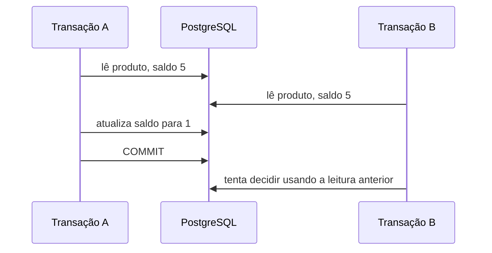
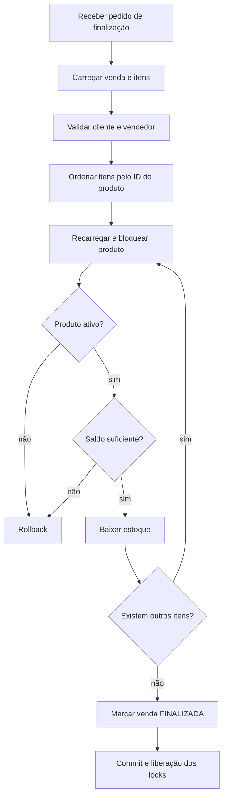

# Aula 11 — Concorrência de estoque, isolamento transacional e locking

[⬅ Voltar para o índice do curso](../../README.md)

---

## Apresentação

Na Aula 10 construímos a finalização de uma venda dentro de uma transação. Se um dos itens não possuir saldo, todas as baixas são desfeitas. Essa propriedade evita uma venda parcialmente finalizada, mas ainda não responde a uma situação comum em sistemas reais: duas requisições podem tentar comprar o mesmo produto ao mesmo tempo.

Considere um produto com cinco unidades e duas vendas com quatro unidades cada. Se as duas transações lerem o saldo `5` antes que alguma grave sua alteração, ambas poderão concluir que existe estoque suficiente. Sem coordenação, o sistema poderá confirmar oito unidades quando possuía apenas cinco.

Esta aula introduz concorrência no banco de dados, isolamento transacional, MVCC, condições de corrida, bloqueio otimista, bloqueio pessimista e deadlock. Na implementação, usaremos um bloqueio pessimista de escrita em todas as operações que alteram saldo: finalização da venda, entrada manual e saída manual.

> **Problema orientador:** como permitir várias requisições simultâneas sem confirmar vendas acima do estoque disponível?

### Escopo da aula

Nesta aula vamos:

- reproduzir mentalmente uma condição de corrida;
- diferenciar atomicidade de isolamento;
- comparar locking otimista e pessimista;
- bloquear produtos antes da baixa de estoque;
- proteger entradas e saídas manuais pela mesma regra;
- adquirir locks em ordem determinística;
- testar duas finalizações concorrentes;
- interpretar espera, rollback e possíveis deadlocks.

Ainda não vamos:

- criar filas ou mensageria;
- reservar estoque durante a abertura da venda;
- implementar processamento distribuído;
- criar login, JWT ou autorização;
- definir uma estratégia automática de repetição de transações.

---

## Resultados de aprendizagem

Ao final da aula, o estudante deverá ser capaz de:

1. explicar por que uma transação atômica ainda pode sofrer uma condição de corrida;
2. diferenciar atomicidade, consistência e isolamento;
3. descrever como o PostgreSQL usa versões de linhas para leituras concorrentes;
4. comparar locking otimista e pessimista;
5. justificar a escolha de `PESSIMISTIC_WRITE` para a baixa de estoque;
6. aplicar um bloqueio de escrita por meio do `EntityManager`;
7. explicar por que os produtos são bloqueados em ordem de identificador;
8. implementar um teste com duas threads e duas transações;
9. diagnosticar espera por lock, timeout e deadlock;
10. transferir a estratégia para um recurso disputado do projeto individual.

---

## Pré-requisitos

- Aula 10 concluída no marco `aula-10-vendas`;
- Java 21;
- PostgreSQL disponível;
- bancos e variáveis do arquivo `.env` configurados;
- domínio de transações, JPA, repositories e testes de integração;
- compreensão do fluxo `VendaService.finalizar`;
- suíte da Aula 10 aprovada antes de iniciar a alteração.

Confirme o ponto inicial:

```bash
git status
git log -1 --oneline
git tag --points-at HEAD
```

Resultado esperado:

```text
On branch main
nothing to commit, working tree clean
aula-10-vendas
```

Se o banco de testes estiver disponível, execute:

```bash
./mvnw test
```

No Windows PowerShell:

```powershell
.\mvnw.cmd test
```

Não avance sobre uma cópia que já possui alterações não compreendidas. Use `git diff` para identificar a origem de cada mudança.

---

## 1. O cenário concorrente

Uma execução sequencial seria:

```text
saldo inicial = 5

Venda A lê 5
Venda A retira 4
Venda A grava 1

Venda B lê 1
Venda B tenta retirar 4
Venda B falha
```

O resultado é correto. Entretanto, um servidor web atende várias requisições em threads diferentes. Uma intercalação possível é:

```text
saldo inicial = 5

Venda A lê 5
Venda B lê 5
Venda A calcula 1
Venda B calcula 1
Venda A grava 1
Venda B grava 1
```

As duas vendas podem ser marcadas como finalizadas, mas o banco termina com saldo `1`. Uma das baixas foi sobrescrita. O nome clássico desse problema é **lost update**, ou atualização perdida.

O defeito não depende de o computador executar exatamente no mesmo nanossegundo. Basta que as transações se sobreponham entre a leitura e a escrita.

### 1.1 Condição de corrida

Existe uma condição de corrida quando o resultado depende da ordem ou da intercalação de operações concorrentes. O código pode funcionar em testes sequenciais e falhar apenas sob carga.

Características frequentes:

- falha intermitente;
- difícil reprodução manual;
- dados finais aparentemente válidos, mas semanticamente incorretos;
- maior ocorrência quando a aplicação possui várias instâncias;
- desaparecimento temporário durante depuração por causa da mudança de tempo.

Adicionar `synchronized` em um método Java não resolve o problema de forma geral. Ele coordenaria apenas threads que compartilham a mesma instância da JVM. Duas instâncias da aplicação continuariam sem coordenação. O banco de dados é o ponto compartilhado entre todas elas.

---

## 2. ACID: atomicidade não é isolamento

As propriedades ACID ajudam a discutir transações:

| Propriedade | Pergunta | Aplicação no projeto |
|---|---|---|
| Atomicidade | tudo ocorre ou nada ocorre? | todas as baixas da venda são confirmadas ou desfeitas |
| Consistência | as regras permanecem verdadeiras? | saldo não pode ficar negativo e venda finalizada deve possuir itens |
| Isolamento | uma transação interfere indevidamente em outra? | duas vendas não podem consumir o mesmo saldo |
| Durabilidade | o commit permanece após falha? | venda e saldo confirmados permanecem no PostgreSQL |

O `@Transactional` da Aula 10 garantiu principalmente o limite da unidade de trabalho e o rollback. Ele não significa que nenhuma outra transação possa acessar as mesmas linhas.

### 2.1 Nível padrão utilizado

Quando não definimos `isolation` em `@Transactional`, Spring utiliza a configuração do banco. No PostgreSQL, o nível padrão é `READ COMMITTED`.

Nesse nível, cada comando SQL enxerga dados confirmados antes do início daquele comando. Isso impede leitura de dados ainda não confirmados, mas não transforma uma sequência “ler, decidir, alterar” em uma operação isolada de outras sequências concorrentes.

Não alteraremos globalmente o nível de isolamento. Um nível mais forte para todas as operações pode reduzir concorrência e aumentar a ocorrência de abortos. Aplicaremos coordenação no caso de uso que realmente disputa estoque.

---

## 3. MVCC no PostgreSQL

PostgreSQL utiliza **Multi-Version Concurrency Control** — controle de concorrência por múltiplas versões.

Em vez de bloquear toda leitura sempre que uma linha é alterada, o banco mantém versões que permitem a cada comando observar um estado coerente. Isso melhora a concorrência entre leitores e escritores.

Um modelo mental simplificado é:



MVCC não substitui a regra de coordenação do caso de uso. Ele define como versões ficam visíveis, mas a aplicação ainda deve escolher como resolver disputas por um recurso escasso.

---

## 4. Estratégias de controle de concorrência

### 4.1 Locking otimista

O locking otimista pressupõe que conflitos são raros. A entidade recebe uma versão, normalmente com `@Version`:

```java
@Version
private Long versao;
```

Uma atualização passa a incluir a versão conhecida:

```sql
UPDATE produto
SET saldo_estoque = ?, versao = versao + 1
WHERE id = ? AND versao = ?;
```

Se outra transação já alterou a linha, nenhuma linha será atualizada e a aplicação recebe uma exceção de concorrência.

Vantagens:

- não mantém um bloqueio enquanto a transação trabalha;
- funciona bem quando conflitos são raros;
- detecta alteração concorrente de maneira explícita.

Limitações:

- uma das operações precisa falhar ou ser repetida;
- a aplicação deve definir uma política de retry;
- o conflito aparece normalmente no flush ou commit;
- pode ser inconveniente quando a disputa é esperada.

### 4.2 Locking pessimista

O locking pessimista assume que o conflito merece coordenação imediata. A transação solicita ao banco um bloqueio de escrita sobre a linha.

Conceitualmente, o PostgreSQL executará algo equivalente a:

```sql
SELECT *
FROM produto
WHERE id = ?
FOR UPDATE;
```

Enquanto a transação mantém o lock:

- outra transação não pode adquirir um lock de escrita incompatível na mesma linha;
- a segunda transação aguarda;
- após o primeiro commit, a segunda lê o estado atualizado;
- o lock é liberado no commit ou rollback.

Vantagens:

- torna a decisão sobre estoque sequencial por produto;
- a segunda transação confere o saldo confirmado pela primeira;
- evita implementar retry nesta etapa.

Limitações:

- transações longas aumentam espera;
- aquisição em ordem inconsistente pode provocar deadlock;
- uso indiscriminado reduz throughput;
- dependência do comportamento transacional do banco.

### 4.3 Decisão do curso

Usaremos `PESSIMISTIC_WRITE` somente nas operações que alteram o saldo:

- finalização de uma venda;
- entrada manual de estoque;
- saída manual de estoque.

Não bloquearemos:

- listagens;
- pesquisas paginadas;
- consulta simples de produto;
- abertura da venda;
- inclusão de itens enquanto a venda permanece aberta.

Essa delimitação reduz a duração do lock e mantém as consultas comuns livres da coordenação mais restritiva.

---

## 5. Deadlock e ordem de aquisição

Considere duas vendas:

```text
Venda A: Produto 1 e Produto 2
Venda B: Produto 2 e Produto 1
```

Se cada transação usar a ordem dos itens recebidos:

```text
Transação A bloqueia Produto 1
Transação B bloqueia Produto 2
Transação A espera Produto 2
Transação B espera Produto 1
```

Cada transação espera um recurso mantido pela outra. Esse ciclo é um deadlock.

PostgreSQL detecta o ciclo e aborta uma das transações. A integridade permanece, mas uma requisição falha. Para reduzir esse risco, todas as transações devem adquirir recursos compartilhados na mesma ordem.

Nesta aula, os itens são ordenados pelo ID do produto:

```text
Produto 1 → Produto 2 → Produto 3
```

Ordenação consistente reduz a possibilidade de ciclos. Ela não é uma promessa de que nenhum deadlock poderá existir em um sistema maior, mas é uma técnica importante de prevenção.

---

## 6. Mapeamento teoria–prática

| Ação prática | Conceito observado |
|---|---|
| manter `@Transactional` em `finalizar` | unidade de trabalho e duração do lock |
| ordenar itens pelo ID do produto | prevenção de deadlock por ordem global |
| usar `PESSIMISTIC_WRITE` | bloqueio exclusivo para decisão e escrita |
| usar `refresh` | recarregar o estado confirmado ao adquirir o lock |
| retirar estoque após o lock | decisão baseada no saldo mais recente |
| bloquear entrada e saída manuais | uma única política para toda alteração de saldo |
| iniciar duas threads no teste | sobreposição real entre transações |
| conferir uma venda finalizada e outra aberta | rollback da transação perdedora |
| não criar changelog | separação entre mudança comportamental e estrutural |

---

## 7. Fluxo da finalização concorrente



O lock existe dentro da transação. Colocar a busca bloqueante em um método sem transação faria o bloqueio terminar cedo demais ou produzir comportamento dependente da infraestrutura.

---

## 8. Checkpoint 1 — observar o código vulnerável

Antes da alteração, `VendaService.finalizar` utiliza o produto carregado junto com a venda:

```java
@Transactional
public Venda finalizar(Long id) {
    Venda venda = buscarEntidade(id);
    validarParticipantes(venda.getCliente(), venda.getVendedor());
    for (ItemVenda item : venda.getItens()) {
        if (item.getProduto().getStatus() != Status.ATIVO)
            throw new IllegalArgumentException(
                    "Todos os produtos da venda devem estar ativos");
        item.getProduto().retirarEstoque(item.getQuantidade());
    }
    venda.finalizar();
    return venda;
}
```

Esse código está correto para execução sequencial e para rollback de vários itens. O problema é o intervalo entre carregar o saldo e gravar o novo valor.

> A vulnerabilidade não está no método `Produto.retirarEstoque`. A regra local continua correta. O problema está na coordenação entre duas unidades de trabalho.

---

## 9. Checkpoint 2 — injetar o `EntityManager`

Arquivo:

```text
src/main/java/com/curso/suporteos/application/VendaService.java
```

Adicione os imports:

```java
import jakarta.persistence.EntityManager;
import jakarta.persistence.LockModeType;

import java.util.Comparator;
import java.util.List;
```

Adicione o campo:

```java
private final EntityManager entityManager;
```

Inclua a dependência no construtor:

```java
public VendaService(
        VendaRepository repository,
        ClienteRepository clienteRepository,
        ColaboradorRepository colaboradorRepository,
        ProdutoRepository produtoRepository,
        EntityManager entityManager) {
    this.repository = repository;
    this.clienteRepository = clienteRepository;
    this.colaboradorRepository = colaboradorRepository;
    this.produtoRepository = produtoRepository;
    this.entityManager = entityManager;
}
```

### 9.1 Por que usar `EntityManager`?

Spring Data JPA continua sendo usado para operações de repository. Nesta alteração precisamos expressar duas ações juntas sobre uma entidade que já está gerenciada:

1. recarregar seu estado do banco;
2. adquirir um lock pessimista de escrita.

O método `EntityManager.refresh(entidade, modoDeLock)` representa essas duas intenções diretamente.

Não estamos abandonando repositories. Estamos usando a API JPA no ponto em que ela torna a semântica transacional mais explícita.

---

## 10. Checkpoint 3 — ordenar, atualizar e bloquear

Substitua o método `finalizar` por:

```java
@Transactional
public Venda finalizar(Long id) {
    Venda venda = buscarEntidade(id);
    validarParticipantes(venda.getCliente(), venda.getVendedor());

    List<ItemVenda> itensOrdenados = venda.getItens().stream()
            .sorted(Comparator.comparing(
                    item -> item.getProduto().getId()))
            .toList();

    for (ItemVenda item : itensOrdenados) {
        Produto produto = item.getProduto();
        entityManager.refresh(
                produto,
                LockModeType.PESSIMISTIC_WRITE);

        if (produto.getStatus() != Status.ATIVO) {
            throw new IllegalArgumentException(
                    "Todos os produtos da venda devem estar ativos");
        }

        produto.retirarEstoque(item.getQuantidade());
    }

    venda.finalizar();
    return venda;
}
```

### 10.1 Leitura linha por linha

```java
List<ItemVenda> itensOrdenados = venda.getItens().stream()
```

Cria uma nova lista para definir a ordem de aquisição. A coleção da entidade não precisa ser reorganizada.

```java
.sorted(Comparator.comparing(item -> item.getProduto().getId()))
```

Todas as finalizações usam a mesma ordem global: identificador crescente do produto.

```java
entityManager.refresh(produto, LockModeType.PESSIMISTIC_WRITE);
```

O JPA solicita um lock de escrita e atualiza a entidade gerenciada com o estado confirmado no banco. Se outra transação já mantiver o lock, esta chamada aguardará.

```java
produto.retirarEstoque(item.getQuantidade());
```

A regra de domínio é executada somente depois de a transação possuir o lock e enxergar o saldo atual.

```java
venda.finalizar();
```

O estado da venda muda somente depois que todos os produtos passam pelas validações. Se qualquer operação lançar exceção, Spring marca a transação para rollback.

### 10.2 O que ocorre com a segunda transação?

Suponha saldo `5` e duas retiradas de `4`:

```mermaid
sequenceDiagram
    participant A as Venda A
    participant DB as PostgreSQL
    participant B as Venda B

    A->>DB: lock Produto 1
    DB-->>A: saldo 5
    B->>DB: solicita lock Produto 1
    Note over B,DB: aguarda
    A->>DB: atualiza saldo para 1
    A->>DB: COMMIT
    DB-->>B: lock liberado; saldo atualizado 1
    B->>B: retirar 4 falha
    B->>DB: ROLLBACK
```

Resultado:

- uma venda fica `FINALIZADA`;
- a outra continua `ABERTA`;
- o saldo final é `1`;
- nenhuma quantidade inexistente é vendida.

---

## 11. Checkpoint 4 — proteger entradas e saídas manuais

Finalizar uma venda não é o único caminho que altera `saldoEstoque`. A API de produtos possui operações de entrada e saída manual. Se elas continuassem sem lock, uma saída manual poderia competir com uma venda e violar a mesma invariante.

Arquivo:

```text
src/main/java/com/curso/suporteos/application/ProdutoService.java
```

Adicione os imports:

```java
import jakarta.persistence.EntityManager;
import jakarta.persistence.LockModeType;
```

Adicione o campo e atualize o construtor:

```java
private final EntityManager entityManager;

public ProdutoService(
        ProdutoRepository produtoRepository,
        GrupoProdutoRepository grupoRepository,
        FornecedorRepository fornecedorRepository,
        EntityManager entityManager) {
    this.produtoRepository = produtoRepository;
    this.grupoRepository = grupoRepository;
    this.fornecedorRepository = fornecedorRepository;
    this.entityManager = entityManager;
}
```

Atualize as movimentações:

```java
@Transactional
public Produto receberEstoque(Long id, BigDecimal quantidade) {
    Produto produto = buscarEntidade(id);
    entityManager.refresh(
            produto,
            LockModeType.PESSIMISTIC_WRITE);
    produto.receberEstoque(quantidade);
    return produto;
}

@Transactional
public Produto retirarEstoque(Long id, BigDecimal quantidade) {
    Produto produto = buscarEntidade(id);
    entityManager.refresh(
            produto,
            LockModeType.PESSIMISTIC_WRITE);
    produto.retirarEstoque(quantidade);
    return produto;
}
```

Agora venda, entrada e saída coordenam a alteração pela mesma linha do PostgreSQL. Uma operação que encontrar o produto bloqueado aguarda a liberação e recarrega o saldo confirmado antes de calcular o novo valor.

### 11.1 Ajuste do teste unitário com Mockito

O construtor ganhou uma dependência. Acrescente o mock em:

```text
src/test/java/com/curso/suporteos/application/ProdutoServiceUnitTest.java
```

```java
@Mock
private EntityManager entityManager;
```

O mock não substitui o teste de integração do lock. Ele apenas permite que testes unitários continuem exercitando regras que não dependem do PostgreSQL. A evidência de concorrência será produzida pelo teste com banco real.

### 11.2 Fronteira adotada

Alterar descrição, preço, grupo ou fornecedor continua sem lock pessimista nesta etapa. Essas alterações possuem outras regras e frequências de conflito. A decisão da Aula 11 é proteger especificamente a invariante do saldo.

---

## 12. Por que não há changelog Liquibase?

A Aula 11 altera o comportamento transacional, não a estrutura persistida.

Não adicionamos:

- tabela;
- coluna;
- índice;
- constraint;
- sequência;
- dado de referência.

Portanto, não existe mudança de schema para o Liquibase versionar.

Criar um changelog vazio apenas para acompanhar o número da aula produziria ruído. Changelogs representam evolução do banco, não calendário do curso.

Confirme que o master permanece inalterado:

```text
src/main/resources/db/changelog/db.changelog-master.yaml
```

---

## 13. Checkpoint 5 — atualizar o contrato OpenAPI

Arquivo:

```text
src/main/java/com/curso/suporteos/api/controller/VendaController.java
```

Atualize a descrição da finalização:

```java
@Operation(
        summary = "Finalizar venda",
        description = "Valida toda a venda, bloqueia os produtos "
                + "em ordem determinística e baixa o estoque "
                + "na mesma transação.")
@PostMapping("/{id}/finalizacao")
public VendaResponse finalizar(@PathVariable Long id) {
    return mapper.toResponse(service.finalizar(id));
}
```

O endpoint e o formato da resposta não mudaram. A atualização documenta uma garantia comportamental importante sem quebrar consumidores.

Atualize também as descrições de entrada e saída em:

```text
src/main/java/com/curso/suporteos/api/controller/ProdutoController.java
```

```java
@Operation(
        summary = "Receber estoque",
        description = "Bloqueia o produto e soma uma quantidade "
                + "positiva ao saldo atual. "
                + "Repetir a chamada repete o efeito.")

@Operation(
        summary = "Retirar estoque",
        description = "Bloqueia o produto e subtrai uma quantidade "
                + "positiva sem permitir saldo negativo. "
                + "Repetir a chamada repete o efeito.")
```

Depois de iniciar a aplicação, consulte:

```text
http://localhost:8080/swagger-ui.html
```

ou:

```bash
curl http://localhost:8080/v3/api-docs
```

---

## 14. Checkpoint 6 — teste concorrente

Arquivo:

```text
src/test/java/com/curso/suporteos/application/VendaServiceTest.java
```

O teste precisa criar duas threads. Cada chamada ao bean `VendaService` inicia sua própria transação porque as chamadas partem de threads diferentes e atravessam o proxy do Spring.

Adicione os imports:

```java
import java.util.List;
import java.util.concurrent.CountDownLatch;
import java.util.concurrent.ExecutorService;
import java.util.concurrent.Executors;
import java.util.concurrent.Future;
import java.util.concurrent.TimeUnit;
```

Adicione o cenário:

```java
@Test
void deveImpedirVendaAcimaDoSaldoEmFinalizacoesConcorrentes()
        throws Exception {
    Participantes participantes = criarParticipantes();
    Produto produto = criarProduto(
            "VENDA-CONCORRENTE-" + System.nanoTime(),
            "5.000");
    Venda primeira = criarVendaComItem(
            participantes,
            produto,
            "4.000");
    Venda segunda = criarVendaComItem(
            participantes,
            produto,
            "4.000");

    CountDownLatch inicioSimultaneo = new CountDownLatch(1);

    try (ExecutorService executor = Executors.newFixedThreadPool(2)) {
        Future<ResultadoFinalizacao> primeiroResultado = executor.submit(
                () -> finalizarAposSinal(
                        primeira.getId(),
                        inicioSimultaneo));
        Future<ResultadoFinalizacao> segundoResultado = executor.submit(
                () -> finalizarAposSinal(
                        segunda.getId(),
                        inicioSimultaneo));

        inicioSimultaneo.countDown();

        List<ResultadoFinalizacao> resultados = List.of(
                primeiroResultado.get(10, TimeUnit.SECONDS),
                segundoResultado.get(10, TimeUnit.SECONDS));

        assertEquals(
                1,
                resultados.stream()
                        .filter(ResultadoFinalizacao::sucesso)
                        .count());
        assertEquals(
                1,
                resultados.stream()
                        .filter(resultado -> !resultado.sucesso())
                        .count());
        assertTrue(resultados.stream()
                .filter(resultado -> !resultado.sucesso())
                .allMatch(resultado ->
                        "Saldo de estoque insuficiente"
                                .equals(resultado.mensagem())));
    }

    assertEquals(
            new BigDecimal("1.000"),
            produtoRepository.findById(produto.getId())
                    .orElseThrow()
                    .getSaldoEstoque());

    List<StatusVenda> estados = List.of(
            vendaService.buscarPorId(primeira.getId()).getStatus(),
            vendaService.buscarPorId(segunda.getId()).getStatus());
    assertEquals(
            1,
            estados.stream()
                    .filter(StatusVenda.FINALIZADA::equals)
                    .count());
    assertEquals(
            1,
            estados.stream()
                    .filter(StatusVenda.ABERTA::equals)
                    .count());
}
```

Adicione os auxiliares:

```java
private Venda criarVendaComItem(
        Participantes participantes,
        Produto produto,
        String quantidade) {
    Venda venda = vendaService.cadastrar(
            participantes.cliente().getId(),
            participantes.vendedor().getId());
    vendaService.adicionarItem(
            venda.getId(),
            produto.getId(),
            new BigDecimal(quantidade));
    return venda;
}

private ResultadoFinalizacao finalizarAposSinal(
        Long vendaId,
        CountDownLatch inicioSimultaneo)
        throws InterruptedException {
    inicioSimultaneo.await();
    try {
        vendaService.finalizar(vendaId);
        return new ResultadoFinalizacao(true, null);
    } catch (IllegalArgumentException exception) {
        return new ResultadoFinalizacao(
                false,
                exception.getMessage());
    }
}

private record ResultadoFinalizacao(
        boolean sucesso,
        String mensagem) {
}
```

### 14.1 Responsabilidade de cada recurso concorrente

| Recurso | Função |
|---|---|
| `ExecutorService` | mantém duas threads trabalhadoras |
| `CountDownLatch` | segura as tarefas até o sinal comum |
| `Future` | transporta o resultado de cada thread |
| timeout de 10 segundos | impede que o teste espere indefinidamente |
| `ResultadoFinalizacao` | registra sucesso ou falha sem esconder a causa |

O teste não exige que a primeira venda específica seja vencedora. Em concorrência, a ordem legítima de agendamento não é determinada. O contrato importante é existir exatamente um sucesso.

### 14.2 Propriedades verificadas

O teste comprova:

- as duas operações podem começar de forma sobreposta;
- apenas uma consome quatro unidades;
- a outra observa saldo insuficiente;
- o saldo final é uma unidade;
- uma venda termina finalizada;
- a transação que falha preserva sua venda aberta.

---

## 15. Executar e interpretar os testes

Execute primeiro somente a classe alterada:

```bash
./mvnw -Dtest=VendaServiceTest test
```

No Windows:

```powershell
.\mvnw.cmd "-Dtest=VendaServiceTest" test
```

Depois execute a suíte completa:

```bash
./mvnw test
```

O marco anterior possuía 59 testes. Com o novo cenário, o total esperado passa a ser:

```text
Tests run: 60
Failures: 0
Errors: 0
Skipped: 0
BUILD SUCCESS
```

O número isolado não é a principal evidência. Confirme também:

- que o teste concorrente foi executado;
- que não houve timeout;
- que o PostgreSQL estava acessível;
- que o profile `test` foi usado;
- que o saldo final foi conferido no banco.

### 15.1 O teste exige PostgreSQL

O comportamento de lock pertence ao banco. Um teste puramente unitário com mocks não demonstra espera, aquisição ou liberação de locks.

Por esse motivo, mantemos PostgreSQL no profile de testes. Substituir por um banco com semântica diferente enfraqueceria a evidência produzida nesta aula.

---

## 16. Experimento opcional no PostgreSQL

Este experimento torna o lock visível sem depender da aplicação. Abra dois consoles SQL conectados ao banco de testes.

### Console A

```sql
BEGIN;

SELECT id, saldo_estoque
FROM produto
WHERE codigo_barras LIKE 'VENDA-%'
ORDER BY id
LIMIT 1
FOR UPDATE;
```

Não execute o commit ainda.

### Console B

Use o mesmo ID:

```sql
BEGIN;

SELECT id, saldo_estoque
FROM produto
WHERE id = 1
FOR UPDATE;
```

O segundo console deverá aguardar. Volte ao Console A:

```sql
COMMIT;
```

O Console B poderá prosseguir. Finalize-o:

```sql
ROLLBACK;
```

> Ajuste o ID para um registro realmente existente. Nunca execute experimentos de lock ou atualização em um banco de produção.

---

## 17. Diagnóstico orientado por evidências

| Sintoma | Hipótese | Evidência | Correção |
|---|---|---|---|
| `Connection refused` | PostgreSQL ou Docker não está iniciado | teste de conexão e estado do contêiner | iniciar a infraestrutura e conferir a porta |
| teste fica aguardando | lock não foi liberado ou ocorreu bloqueio prolongado | `pg_stat_activity` e timeout do `Future` | encerrar corretamente a transação que mantém o lock |
| `TransactionRequiredException` | `refresh` com lock ocorreu fora de transação | stack trace aponta `EntityManager.refresh` | manter chamada dentro de método `@Transactional` acessado pelo proxy |
| `PessimisticLockException` | banco não conseguiu adquirir o lock | causa SQL e logs do PostgreSQL | reduzir duração, revisar ordem e política de timeout |
| deadlock detectado | recursos foram adquiridos em ordens diferentes | log apresenta as transações envolvidas | ordenar locks e reduzir o conjunto bloqueado |
| as duas vendas finalizam | lock não foi aplicado antes da validação | SQL e saldo final | conferir `PESSIMISTIC_WRITE` e o limite transacional |
| nenhuma venda finaliza | dados do cenário são inválidos | mensagens de domínio | conferir participantes, status e quantidade |
| teste passa isolado e falha na suíte | dados não foram limpos ou houve interferência | tabelas e relatórios Surefire | manter códigos únicos e limpeza após cada cenário |

### 17.1 Consultas de diagnóstico

Sessões ativas:

```sql
SELECT pid, state, wait_event_type, wait_event, query
FROM pg_stat_activity
WHERE datname = current_database();
```

Locks ainda não concedidos:

```sql
SELECT locktype, relation::regclass, pid, mode, granted
FROM pg_locks
WHERE NOT granted;
```

Essas consultas são instrumentos de diagnóstico. Elas não substituem a análise da transação e da ordem de aquisição.

---

## 18. Segurança, qualidade e desempenho

### 18.1 Transações devem ser curtas

Enquanto mantém o lock, a aplicação não deve:

- esperar entrada do usuário;
- chamar serviço externo lento;
- enviar e-mail de forma síncrona;
- processar arquivo grande;
- executar tarefa que poderia ocorrer depois do commit.

Locks longos ampliam latência e reduzem a capacidade do sistema.

### 18.2 Bloquear somente o necessário

O projeto bloqueia somente produtos cujo saldo será alterado, não a tabela inteira. Finalizações e movimentações manuais usam `PESSIMISTIC_WRITE`; consultas comuns continuam sem lock pessimista.

### 18.3 Não implementar retry cego

Repetir qualquer operação automaticamente pode duplicar efeitos externos. Uma política de retry deve considerar:

- idempotência;
- número máximo de tentativas;
- intervalo crescente;
- causas recuperáveis;
- observabilidade;
- efeitos produzidos antes da falha.

Retry será tratado apenas quando o curso possuir um caso de uso que o justifique.

### 18.4 Não expor detalhes internos

Mensagens SQL, IDs de sessão, nomes internos de tabela e stack traces não devem ser enviados ao consumidor da API. Eles pertencem aos logs de diagnóstico.

### 18.5 Métricas futuras

Em produção, seria útil observar:

- tempo de finalização;
- tempo de espera por lock;
- número de deadlocks;
- quantidade de vendas recusadas por estoque;
- taxa de erro por endpoint.

Esses itens preparam a futura aula de observabilidade.

---

## 19. Transferência para o projeto do estudante

Cada estudante deve identificar um recurso que possa ser disputado simultaneamente.

Exemplos:

| Tema | Recurso disputado | Regra |
|---|---|---|
| biblioteca | exemplar | não permitir dois empréstimos do mesmo exemplar disponível |
| clínica | horário | não confirmar dois atendimentos no mesmo horário e profissional |
| eventos | vaga | não vender mais inscrições que a capacidade |
| hotel | acomodação | não confirmar reservas incompatíveis no mesmo período |
| oficina | peça | não consumir quantidade superior ao estoque |
| restaurante | item de estoque | não baixar o mesmo insumo além do saldo |

Entregáveis:

1. descrição da condição de corrida;
2. linha do tempo com duas transações;
3. justificativa entre locking otimista e pessimista;
4. implementação da estratégia escolhida;
5. teste concorrente;
6. evidência do estado final;
7. análise de risco de deadlock;
8. explicação sobre necessidade ou não de changelog.

Não basta trocar os nomes de `Produto` e `Venda`. A regra concorrente deve pertencer ao domínio escolhido.

---

## 20. Atividade orientada

Em duplas:

1. desenhe a intercalação que permite duas vendas de quatro unidades sobre saldo cinco;
2. indique onde começa e termina cada transação;
3. marque o instante em que o lock deve ser adquirido;
4. explique o que a segunda transação observa após o primeiro commit;
5. execute o teste concorrente;
6. registre a saída e o saldo final;
7. remova temporariamente o `PESSIMISTIC_WRITE`, execute o cenário algumas vezes e discuta por que um teste concorrente pode ser não determinístico;
8. restaure o código antes de continuar.

Evidência mínima:

- diagrama ou linha do tempo;
- saída do teste;
- estado das duas vendas;
- saldo final;
- explicação de até 300 palavras.

---

## 21. Atividade autônoma

Implemente o controle concorrente no projeto temático e produza um relatório curto contendo:

1. recurso protegido;
2. invariante preservada;
3. estratégia selecionada;
4. alternativa rejeitada e justificativa;
5. ordem de aquisição de recursos;
6. teste com pelo menos duas tarefas concorrentes;
7. evidência de um único resultado válido;
8. riscos que permanecem.

Restrição: não use `synchronized` como única solução. A estratégia deve funcionar quando existirem duas instâncias da aplicação conectadas ao mesmo banco.

---

## 22. Questões de revisão

1. Por que `@Transactional` não impede sozinho duas leituras do mesmo saldo?
2. Qual diferença existe entre atomicidade e isolamento?
3. O que caracteriza uma atualização perdida?
4. Como MVCC beneficia leituras concorrentes?
5. Quando locking otimista tende a ser mais adequado?
6. Quando locking pessimista pode ser justificável?
7. Por que o lock deve ser adquirido antes de validar o saldo?
8. Por que `refresh` é relevante quando o produto já foi carregado com a venda?
9. Por que ordenar produtos reduz o risco de deadlock?
10. O que ocorreria se uma transação mantivesse o lock durante uma chamada HTTP externa?
11. Por que `synchronized` não resolve a coordenação entre duas instâncias?
12. Por que esta aula não cria uma migração Liquibase?
13. Um teste com mocks provaria o comportamento do PostgreSQL? Justifique.
14. Em um conflito, por que não podemos exigir que “a primeira venda criada” seja a vencedora?
15. Que evidência diferencia uma espera legítima por lock de uma aplicação travada?

---

## 23. Avaliação

| Critério | Insuficiente | Básico | Adequado | Avançado |
|---|---|---|---|---|
| Fundamentação | confunde transação com exclusão mútua | reconhece concorrência sem explicar isolamento | diferencia ACID, MVCC e locking | relaciona alternativas, custo e nível de isolamento |
| Implementação | não protege a decisão de estoque | aplica lock sem delimitar escopo | bloqueia antes da baixa dentro da transação | também controla ordem e duração conscientemente |
| Deadlock | ignora a possibilidade | reconhece o termo | ordena recursos por ID | analisa ciclos e propõe diagnóstico |
| Teste | executa apenas cenário sequencial | usa threads sem verificar invariantes | produz duas transações e verifica estado final | discute não determinismo e limitações da prova |
| Diagnóstico | tenta correções sem evidência | reconhece erro de conexão | usa logs, timeout e consultas do PostgreSQL | diferencia espera, timeout, deadlock e falha de negócio |
| Transferência | copia o domínio de vendas | troca nomes | protege um recurso real do tema | justifica estratégia e alternativa rejeitada |
| Comunicação | lista comandos | descreve o que fez | conecta teoria, código e evidência | explicita simplificações e riscos residuais |

---

## 24. Checklist e ponto de quebra

- [ ] consigo explicar o cenário de atualização perdida;
- [ ] diferencio atomicidade de isolamento;
- [ ] comparei locking otimista e pessimista;
- [ ] o lock ocorre dentro de `@Transactional`;
- [ ] produtos são bloqueados antes da conferência do saldo;
- [ ] produtos são processados por ID crescente;
- [ ] entradas e saídas manuais também bloqueiam o produto;
- [ ] consultas comuns permanecem sem lock pessimista;
- [ ] não criei changelog sem mudança estrutural;
- [ ] o teste inicia duas tarefas concorrentes;
- [ ] exatamente uma venda é finalizada;
- [ ] exatamente uma venda permanece aberta;
- [ ] o saldo final nunca fica negativo;
- [ ] a suíte completa passa com PostgreSQL;
- [ ] `git diff --check` não encontra problemas;
- [ ] nenhum segredo foi adicionado ao Git.

Revise as mudanças:

```bash
git status
git diff --check
git diff
```

Depois da validação, o marco sugerido é:

```bash
git add README.md docs/11aula src/main src/test
git commit -m "feat: controla concorrencia de estoque na aula 11"
git tag -a aula-11-concorrencia -m "Aula 11 - concorrencia, isolamento e locking"
```

Não crie commit ou tag enquanto a infraestrutura estiver indisponível ou os testes de integração não tiverem sido executados.

---

## 25. Orientações para o professor

### Organização sugerida

Dois encontros de 100 minutos.

**Encontro 1**

- 20 min: condição de corrida com linha do tempo;
- 20 min: ACID, isolamento e MVCC;
- 25 min: comparação otimista versus pessimista;
- 15 min: deadlock e ordem global;
- 20 min: implementação do lock.

**Encontro 2**

- 20 min: revisão do fluxo e do SQL conceitual;
- 30 min: construção do teste concorrente;
- 20 min: experimento em dois consoles PostgreSQL;
- 15 min: diagnóstico com `pg_stat_activity` e `pg_locks`;
- 15 min: transferência para os temas dos estudantes.

### Perguntas para discussão

- Estoque deve ser reservado ao adicionar item ou somente na finalização?
- Uma espera longa é melhor que uma resposta imediata de conflito?
- Quando uma política de retry seria segura?
- Como a estratégia mudaria em um sistema com milhares de vendas por segundo?
- Que outros recursos do projeto precisam de coordenação concorrente?

### Falhas controladas

- remover temporariamente o lock;
- retirar a ordenação dos itens;
- mover o lock para depois da validação do saldo;
- remover `@Transactional`;
- segurar manualmente uma linha com `SELECT ... FOR UPDATE`;
- desligar o PostgreSQL e diferenciar infraestrutura de regra de negócio.

### Cuidado pedagógico

Não apresente locking como solução universal. O objetivo é ensinar seleção de estratégia. Uma escolha tecnicamente correta depende da frequência de conflitos, do custo de retry, da duração da transação e das invariantes do domínio.

---

## 26. Próxima aula

Com a integridade concorrente do estoque estabelecida, o domínio está preparado para receber uma identidade de acesso sem misturá-la às funções comerciais.

A próxima evolução recomendada é:

```text
Aula 12 — Conta de acesso, senha segura e fundamentos do Spring Security
```

Essa aula deverá separar:

- `Pessoa`: identidade civil e dados do domínio;
- `Colaborador`: papel comercial;
- `ContaAcesso`: credencial e estado de autenticação;
- `PerfilAcesso`: autorização dentro do sistema.

---

## Referências para aprofundamento

- PostgreSQL — Transaction Isolation: <https://www.postgresql.org/docs/current/transaction-iso.html>
- PostgreSQL — Explicit Locking: <https://www.postgresql.org/docs/current/explicit-locking.html>
- PostgreSQL — The Internals of MVCC: <https://www.postgresql.org/docs/current/mvcc.html>
- Jakarta Persistence — `LockModeType`: <https://jakarta.ee/specifications/persistence/>
- Spring Framework — Transaction Management: <https://docs.spring.io/spring-framework/reference/data-access/transaction.html>
- Spring Data JPA — Locking: <https://docs.spring.io/spring-data/jpa/reference/jpa/locking.html>
- Martin Kleppmann. *Designing Data-Intensive Applications*. O'Reilly, 2017.
- Jim Gray; Andreas Reuter. *Transaction Processing: Concepts and Techniques*. Morgan Kaufmann, 1992.
