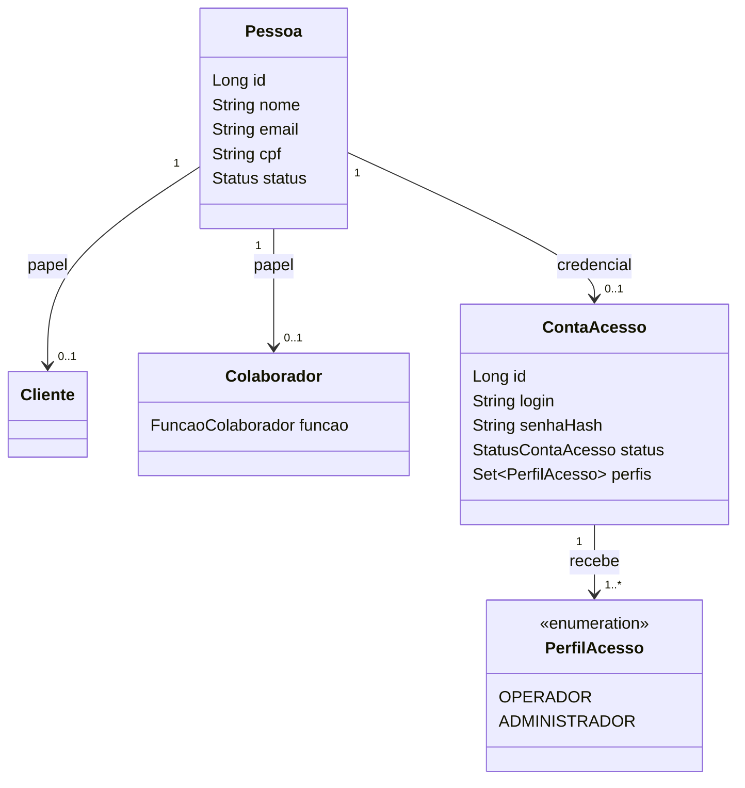
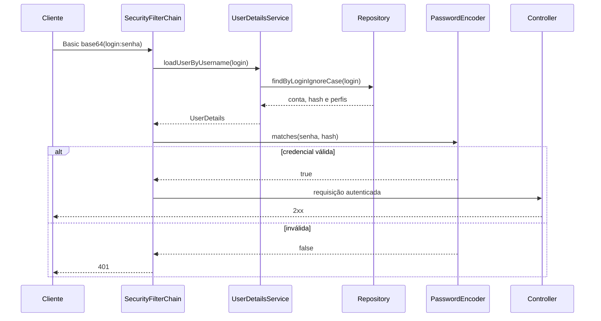

# Aula 12 — Autenticação, proteção de senhas e Spring Security

[⬅ Voltar para o índice do curso](../../README.md)

---

## Apresentação

Até a Aula 11, qualquer cliente que conhecesse o endereço da API poderia consultar ou alterar os dados do sistema. A aplicação possuía regras de negócio, transações e controle de concorrência, mas ainda não sabia responder: **quem está fazendo esta requisição?**

Nesta aula criaremos uma identidade de acesso associada a `Pessoa`, armazenaremos a senha com hash BCrypt e protegeremos a API com Spring Security. Usaremos HTTP Basic porque ele torna visível o ciclo completo de autenticação com poucos componentes. JWT será estudado posteriormente.

> **Problema orientador:** como confirmar a identidade de quem chama a API sem armazenar ou devolver sua senha?

### Escopo

Vamos:

- diferenciar identificação, autenticação e autorização;
- separar função profissional de perfil de acesso;
- explicar hash, salt e fator de trabalho;
- criar `ContaAcesso` e seus perfis;
- versionar as tabelas com Liquibase;
- integrar o banco ao `UserDetailsService`;
- configurar uma cadeia de filtros stateless;
- autenticar requisições com HTTP Basic;
- impedir exposição de senha e hash;
- documentar a segurança no OpenAPI;
- testar `200`, `201` e `401` com MockMvc e Postman.

Ainda não vamos:

- emitir JWT;
- implementar OAuth 2.0, login social ou recuperação de senha;
- limitar tentativas ou registrar auditoria;
- diferenciar permissões de operador e administrador;
- oferecer cadastro público pronto para produção.

---

## Resultados de aprendizagem

Ao final, o estudante deverá ser capaz de:

1. distinguir identidade, autenticação e autorização;
2. justificar por que `ContaAcesso` não é `Colaborador`;
3. explicar por que senhas recebem hash e não criptografia reversível;
4. descrever salt e fator de trabalho;
5. mapear perfis com JPA;
6. implementar `UserDetailsService` apoiado pelo banco;
7. interpretar a cadeia de filtros do Spring Security;
8. explicar por que HTTP Basic depende de HTTPS;
9. configurar uma API stateless;
10. escrever testes que demonstrem proteção e autenticação.

---

## Pré-requisitos

- marco `aula-11-concorrencia` concluído;
- Java 21 e Maven Wrapper;
- PostgreSQL 16 disponível;
- `.env` configurado para `dev` e `test`;
- conhecimentos de JPA, Liquibase, DTOs, serviços e MockMvc.

Confirme o ponto inicial:

```bash
git status
git tag --points-at HEAD
./mvnw test
```

No PowerShell:

```powershell
git status
git tag --points-at HEAD
.\mvnw.cmd test
```

O ponto inicial deve possuir 60 testes aprovados e não deve conter alterações desconhecidas.

---

## 1. Fundamentos de segurança

### 1.1 Identificação, autenticação e autorização

| Conceito | Pergunta | Exemplo |
|---|---|---|
| Identificação | quem você afirma ser? | login `ana.souza` |
| Autenticação | como confirmar a afirmação? | senha comparada com o hash |
| Autorização | o que a identidade pode fazer? | perfil `OPERADOR` |

`401 Unauthorized` indica que a identidade não foi autenticada. `403 Forbidden` indica identidade autenticada, mas sem permissão. Nesta aula todas as contas autenticadas possuem o mesmo acesso; os perfis preparam a autorização futura.

### 1.2 Identidade civil, papel comercial e acesso

O modelo já possui:

- `Pessoa`: identidade civil, CPF, nome e e-mail;
- `Cliente`: papel de quem compra;
- `Colaborador`: papel profissional;
- `FuncaoColaborador`: vendedor, técnico etc.

Função profissional não é permissão de software. Um técnico pode não possuir login; um administrador pode não ser vendedor. Por isso a credencial pertence a `ContaAcesso`.



### 1.3 Ameaça, vulnerabilidade e controle

- **Ameaça:** alguém tenta usar identidade alheia.
- **Vulnerabilidade:** a API aceita requisições anônimas.
- **Controle:** Spring Security exige credencial válida.

Um controle reduz risco, mas não resolve tudo. HTTP Basic sem TLS, cadastro público e ausência de limitação de tentativas permanecem riscos conhecidos.

---

## 2. Proteção de senhas

### 2.1 Por que não guardar texto aberto

Uma coluna contendo `minhaSenha123` revela a credencial em consultas indevidas, backups expostos e logs. Como usuários reutilizam senhas, o impacto pode atingir outros serviços.

### 2.2 Hash não é criptografia

Criptografia é reversível com a chave. Para autenticação local usamos uma função unidirecional:

```text
senha + salt + custo -> hash
```

No login, o algoritmo verifica a senha informada contra o hash. A senha original não é recuperada.

O **salt** aleatório faz senhas iguais produzirem hashes diferentes. O **fator de trabalho** torna cada tentativa custosa, dificultando ataques em massa.

Usaremos:

```java
PasswordEncoderFactories.createDelegatingPasswordEncoder()
```

Ele gera BCrypt prefixado por `{bcrypt}`. O prefixo identifica o algoritmo e permite evolução futura.

> BCrypt considera no máximo 72 bytes. O serviço valida o limite em UTF-8 para evitar entradas diferentes tratadas como equivalentes.

Adotamos mínimo didático de 12 caracteres, máximo de 72 bytes e permitimos frases-senha. Regras arbitrárias de composição não substituem comprimento, bloqueio de senhas comprometidas e MFA.

Leituras:

- [Spring Security — Password Storage](https://docs.spring.io/spring-security/reference/features/authentication/password-storage.html)
- [OWASP Password Storage Cheat Sheet](https://cheatsheetseries.owasp.org/cheatsheets/Password_Storage_Cheat_Sheet.html)
- [OWASP Authentication Cheat Sheet](https://cheatsheetseries.owasp.org/cheatsheets/Authentication_Cheat_Sheet.html)

---

## Ponto de quebra 1 — Dependências

No `pom.xml`:

```xml
<dependency>
    <groupId>org.springframework.boot</groupId>
    <artifactId>spring-boot-starter-security</artifactId>
</dependency>
```

Nos testes:

```xml
<dependency>
    <groupId>org.springframework.security</groupId>
    <artifactId>spring-security-test</artifactId>
    <scope>test</scope>
</dependency>
```

Valide:

```bash
./mvnw -DskipTests compile
```

Commit sugerido:

```bash
git add pom.xml
git commit -m "build: adiciona spring security"
```

---

## 3. Liquibase

Inclua no changelog mestre:

```yaml
- include:
    file: db/changelog/changes/006-contas-acesso.yaml
```

O primeiro changeset cria:

```yaml
- createTable:
    tableName: conta_acesso
    columns:
      - column:
          name: id
          type: BIGINT
          autoIncrement: true
          constraints:
            primaryKey: true
            nullable: false
      - column:
          name: pessoa_id
          type: BIGINT
          constraints:
            nullable: false
            unique: true
      - column:
          name: login
          type: VARCHAR(80)
          constraints:
            nullable: false
      - column:
          name: senha_hash
          type: VARCHAR(255)
          constraints:
            nullable: false
      - column:
          name: status
          type: VARCHAR(20)
          constraints:
            nullable: false
```

O login é único ignorando caixa e espaços externos:

```yaml
- sql:
    sql: >
      CREATE UNIQUE INDEX uk_conta_acesso_login_lower
      ON conta_acesso (LOWER(BTRIM(login)))
```

A coleção de perfis usa chave composta:

```yaml
- createTable:
    tableName: conta_acesso_perfil
    columns:
      - column:
          name: conta_acesso_id
          type: BIGINT
          constraints:
            nullable: false
      - column:
          name: perfil
          type: VARCHAR(30)
          constraints:
            nullable: false
- addPrimaryKey:
    tableName: conta_acesso_perfil
    columnNames: conta_acesso_id, perfil
    constraintName: pk_conta_acesso_perfil
```

O arquivo completo também possui FKs, `CHECK`, exclusão em cascata apenas dos perfis e rollback. Após a execução, devem existir 33 changesets:

```sql
SELECT id, author, filename
FROM databasechangelog
ORDER BY orderexecuted;
```

### Ponto de quebra 2 — Banco versionado

Critérios:

- uma conta por pessoa;
- login único sem diferenciar maiúsculas;
- status e perfil limitados a valores conhecidos;
- rollback remove primeiro a tabela dependente.

```bash
git add src/main/resources/db/changelog
git commit -m "feat: versiona contas de acesso"
```

---

## 4. Domínio, repository e DTOs

Enums:

```java
public enum StatusContaAcesso { ATIVA, BLOQUEADA }
public enum PerfilAcesso { OPERADOR, ADMINISTRADOR }
```

Mapeamento principal:

```java
@Entity
@Table(name = "conta_acesso")
public class ContaAcesso {
    @Id
    @GeneratedValue(strategy = GenerationType.IDENTITY)
    private Long id;

    @OneToOne(fetch = FetchType.LAZY, optional = false)
    @JoinColumn(name = "pessoa_id", nullable = false, unique = true)
    private Pessoa pessoa;

    @Column(nullable = false, length = 80)
    private String login;

    @Column(name = "senha_hash", nullable = false, length = 255)
    private String senhaHash;

    @Enumerated(EnumType.STRING)
    private StatusContaAcesso status;

    @ElementCollection(fetch = FetchType.EAGER)
    @CollectionTable(name = "conta_acesso_perfil",
            joinColumns = @JoinColumn(name = "conta_acesso_id"))
    @Enumerated(EnumType.STRING)
    @Column(name = "perfil")
    private Set<PerfilAcesso> perfis = new LinkedHashSet<>();
}
```

Decisões:

- `@OneToOne`: uma conta por pessoa nesta versão;
- `LAZY`: pessoa não é carregada sem necessidade;
- `@ElementCollection`: perfil é valor, não entidade;
- `EAGER`: autoridades são necessárias durante autenticação;
- construtor inicia `ATIVA` e adiciona somente `OPERADOR`;
- `podeAutenticar()` exige conta e pessoa ativas.

Repository:

```java
public interface ContaAcessoRepository extends JpaRepository<ContaAcesso, Long> {
    boolean existsByLoginIgnoreCase(String login);
    boolean existsByPessoaId(Long pessoaId);

    @EntityGraph(attributePaths = {"pessoa", "perfis"})
    Optional<ContaAcesso> findByLoginIgnoreCase(String login);
}
```

Entrada:

```java
public record ContaAcessoRequest(
        @NotNull Long pessoaId,
        @NotBlank @Size(min = 3, max = 80)
        @Pattern(regexp = "^[A-Za-z0-9._-]+$") String login,
        @NotBlank @Size(min = 12, max = 72) String senha) { }
```

Saída:

```java
public record ContaAcessoResponse(
        Long id,
        Long pessoaId,
        String nomePessoa,
        String login,
        StatusContaAcesso status,
        Set<PerfilAcesso> perfis) { }
```

Nunca inclua `senha` ou `senhaHash` em resposta, log, `toString()` ou erro.

---

## 5. Serviço e hash

No cadastro:

```java
String senhaHash = passwordEncoder.encode(senhaAberta);
return repository.save(new ContaAcesso(pessoa, login, senhaHash));
```

Na alteração:

```java
if (!passwordEncoder.matches(senhaAtual, conta.getSenhaHash())) {
    throw new IllegalArgumentException("Senha atual inválida");
}
if (passwordEncoder.matches(novaSenha, conta.getSenhaHash())) {
    throw new IllegalArgumentException("Nova senha deve ser diferente");
}
conta.alterarSenha(passwordEncoder.encode(novaSenha));
```

Não compare `encode(senha)` com o hash por `equals`: salts diferentes produzem hashes diferentes.

### Ponto de quebra 3 — Conta persistida

Escreva um teste que:

1. persista uma pessoa;
2. cadastre a conta;
3. confirme que o valor não é a senha;
4. confirme o prefixo `{bcrypt}`;
5. valide com `passwordEncoder.matches`.

```bash
git add src/main/java src/test/java
git commit -m "feat: implementa conta e hash de senha"
```

---

## 6. Fluxo do Spring Security



### 6.1 `UserDetailsService`

```java
@Service
public class ContaAcessoUserDetailsService implements UserDetailsService {
    private final ContaAcessoRepository repository;

    @Override
    @Transactional(readOnly = true)
    public UserDetails loadUserByUsername(String login) {
        ContaAcesso conta = repository.findByLoginIgnoreCase(login)
                .orElseThrow(() ->
                        new UsernameNotFoundException("Login ou senha inválidos"));

        String[] autoridades = conta.getPerfis().stream()
                .map(perfil -> "ROLE_" + perfil.name())
                .toArray(String[]::new);

        return User.withUsername(conta.getLogin())
                .password(conta.getSenhaHash())
                .authorities(autoridades)
                .disabled(!conta.podeAutenticar())
                .build();
    }
}
```

A mensagem genérica evita confirmar se um login existe.

### 6.2 Configuração

```java
@Bean
PasswordEncoder passwordEncoder() {
    return PasswordEncoderFactories.createDelegatingPasswordEncoder();
}

@Bean
SecurityFilterChain securityFilterChain(HttpSecurity http) throws Exception {
    return http
            .csrf(AbstractHttpConfigurer::disable)
            .sessionManagement(session -> session
                    .sessionCreationPolicy(SessionCreationPolicy.STATELESS))
            .authorizeHttpRequests(authorize -> authorize
                    .requestMatchers("/api/health", "/v3/api-docs/**",
                            "/swagger-ui.html", "/swagger-ui/**")
                    .permitAll()
                    .requestMatchers(HttpMethod.POST,
                            "/api/pessoas", "/api/contas-acesso")
                    .permitAll()
                    .anyRequest().authenticated())
            .httpBasic(Customizer.withDefaults())
            .build();
}
```

`STATELESS` impede que autenticação seja guardada em sessão: cada requisição apresenta sua credencial. Isso favorece APIs e múltiplas instâncias.

CSRF explora credenciais enviadas automaticamente pelo navegador, como cookies. Como esta API não usa cookie de autenticação e o cliente envia Basic explicitamente, CSRF foi desabilitado. Se a arquitetura mudar para cookie, a decisão deve ser revista.

### 6.3 Bootstrap público provisório

`POST /api/pessoas` e `POST /api/contas-acesso` ficam públicos para iniciar um banco vazio. A conta criada recebe somente `OPERADOR`; o request não aceita perfis.

Isso é simplificação didática, não produção. Um sistema real exige provisionamento administrativo, convite de uso único, verificação de identidade, limitação e auditoria.

### 6.4 HTTP Basic e TLS

```text
Authorization: Basic base64(login:senha)
```

Base64 é codificação, não criptografia. Quem intercepta HTTP recupera a credencial. Em produção, Basic somente sobre HTTPS/TLS. Não deixe credenciais em comandos compartilhados, prints ou Git.

---

## 7. Endpoints

### 7.1 Criar a pessoa inicial

```http
POST /api/pessoas
Content-Type: application/json

{
  "nome": "Ana Souza",
  "email": "ana.souza@example.com",
  "cpf": "52998224725"
}
```

### 7.2 Criar conta

```http
POST /api/contas-acesso
Content-Type: application/json

{
  "pessoaId": 1,
  "login": "ana.souza",
  "senha": "uma-frase-senha-2026"
}
```

Resposta `201` sem senha:

```json
{
  "id": 1,
  "pessoaId": 1,
  "nomePessoa": "Ana Souza",
  "login": "ana.souza",
  "status": "ATIVA",
  "perfis": ["OPERADOR"]
}
```

### 7.3 Consultar a própria conta

```bash
curl --user 'ana.souza:uma-frase-senha-2026' \
  http://localhost:8080/api/contas-acesso/me
```

Sem credencial:

```bash
curl -i http://localhost:8080/api/produtos
```

Resultado:

```text
HTTP/1.1 401
WWW-Authenticate: Basic realm="Realm"
```

### 7.4 Alterar senha

```http
PUT /api/contas-acesso/me/senha
Authorization: Basic ...
Content-Type: application/json

{
  "senhaAtual": "uma-frase-senha-2026",
  "novaSenha": "outra-frase-senha-2026"
}
```

Resposta esperada: `204`. A senha anterior deve deixar de autenticar.

---

## 8. OpenAPI e Swagger UI

Registre o esquema:

```java
.components(new Components()
        .addSecuritySchemes("basicAuth", new SecurityScheme()
                .type(SecurityScheme.Type.HTTP)
                .scheme("basic")))
.addSecurityItem(new SecurityRequirement().addList("basicAuth"))
```

Operações públicas usam `@SecurityRequirements` vazio para retirar a exigência global no contrato.

No Swagger UI:

1. abra `http://localhost:8080/swagger-ui.html`;
2. clique em **Authorize**;
3. informe login e senha;
4. execute `GET /api/contas-acesso/me`;
5. faça logout e confirme `401` em uma rota protegida.

O cadeado documenta autenticação; a proteção real está nos filtros.

---

## 9. Testes automatizados

`ContaAcessoSecurityTest`, com filtros ativos, comprova:

- health público retorna `200`;
- produto anônimo retorna `401`;
- cadastro armazena BCrypt sem expor senha;
- Basic correto permite `/me`;
- senha errada retorna `401`;
- conta bloqueada retorna `401`.

```java
mockMvc.perform(get("/api/contas-acesso/me")
                .with(httpBasic("operadora.2026", SENHA)))
        .andExpect(status().isOk())
        .andExpect(jsonPath("$.login").value("operadora.2026"));
```

Testes web anteriores continuam verificando controllers e regras HTTP. Neles:

```java
@AutoConfigureMockMvc(addFilters = false)
```

Isso não torna as rotas públicas; apenas isola o objeto testado. A segurança é demonstrada em teste específico, com filtros ativos.

Execute:

```bash
./mvnw test
```

Esperado:

```text
Tests run: 65, Failures: 0, Errors: 0, Skipped: 0
BUILD SUCCESS
```

---

## 10. Laboratório Postman

Importe `postman/Suporte-OS.postman_collection.json`. A coleção define Basic na raiz com:

- `{{authLogin}}`;
- `{{authPassword}}`.

Execute em ordem:

1. **01 — Infraestrutura**: health e OpenAPI públicos;
2. **02 — Primeira conta**: cria pessoa, conta e consulta `/me`;
3. **03 em diante**: fluxos protegidos anteriores.

Se repetir a pasta 02 no mesmo banco, altere `authLogin`, pois ele é único. Nunca exporte credenciais reais.

### Experimento

1. execute `/me` com senha correta;
2. altere um caractere de `authPassword`;
3. confirme o `401`;
4. restaure a senha;
5. inspecione `Authorization` no Postman Console;
6. explique por que Base64 não protege sem TLS;
7. confirme ausência de `senha` e `senhaHash`.

---

## Ponto de quebra 4 — API protegida

Critérios:

- somente rotas explicitamente públicas funcionam anonimamente;
- credencial válida cria `Authentication`;
- conta ou pessoa inativa não autentica;
- OpenAPI apresenta `basicAuth`;
- Postman funciona após o bootstrap;
- todos os 65 testes passam.

```bash
git add .
git commit -m "feat: autentica api com http basic"
```

---

## 11. Diagnóstico

### Sempre recebo `401`

Verifique se conta e pessoa estão ativas, senha e login estão corretos, o cliente envia Basic e o hash começa com `{bcrypt}`.

### Recebo `403`

A identidade foi autenticada, mas uma regra de autorização negou a rota. Nesta aula ainda não diferenciamos perfis.

### `Encoded password does not look like BCrypt`

Não grave senha diretamente em `senha_hash`. Use o `PasswordEncoder`. O `DelegatingPasswordEncoder` espera o identificador `{bcrypt}`.

### Senha longa falha

O DTO mede caracteres, mas o serviço mede bytes UTF-8. A regra efetiva do BCrypt é 72 bytes.

### Liquibase falha

Consulte:

```sql
SELECT id, exectype, md5sum
FROM databasechangelog
ORDER BY orderexecuted DESC;
```

Não edite changeset já aplicado em ambiente compartilhado. Crie um changeset corretivo.

---

## 12. Limitações e próximos passos

Débitos intencionais:

- cadastro inicial público;
- Basic envia credencial em toda requisição;
- execução local sem HTTPS;
- perfis ainda sem regras diferentes;
- ausência de rate limiting, MFA e auditoria;
- `401` e `403` ainda não seguem `ApiError`;
- credencial não expira.

Uma sequência adequada é: JWT, autorização por perfil, erros padronizados e auditoria da identidade.

---

## 13. Atividade de transferência

No projeto individual:

1. identifique a entidade que representa pessoa ou organização;
2. crie conta separada dos papéis de negócio;
3. defina dois perfis compatíveis com o tema;
4. persista somente hash;
5. documente o bootstrap provisório;
6. proteja uma rota;
7. teste acesso anônimo, válido e bloqueado;
8. desenhe o diagrama atualizado;
9. descreva três ameaças ainda não tratadas.

Não basta renomear classes: justifique identidade, papel e permissão no domínio escolhido.

---

## 14. Questões para discussão

1. Por que senha em `Colaborador` limita o modelo?
2. Qual a diferença entre Base64 e criptografia?
3. Por que hashes BCrypt da mesma senha diferem?
4. Por que `equals(encode(senha))` falha?
5. Qual risco surgiria se o request aceitasse `ADMINISTRADOR`?
6. Quando desabilitar CSRF seria incorreto?
7. Qual a diferença entre `401` e `403`?
8. Por que não revelar se a senha de conta bloqueada estava correta?
9. Quais controles levariam o cadastro inicial à produção?
10. Por que separar testes de controller e de filtros?

---

## 15. Avaliação

| Critério | Peso |
|---|---:|
| Separação entre pessoa, papel e conta | 20% |
| Liquibase e integridade | 15% |
| Hash e não exposição de credenciais | 20% |
| Integração Spring Security | 20% |
| Testes de segurança | 15% |
| Limitações e ameaças | 10% |

Erros críticos: senha aberta; rota protegida anônima; cliente escolhendo perfil administrativo; credencial real no Git; remoção de constraints para passar testes.

---

## 16. Encerramento e marco Git

Valide:

```bash
./mvnw test
git status
git diff --check
```

Após aprovação:

```bash
git add .
git commit -m "feat: implementa autenticacao da aula 12"
git tag -a aula-12-autenticacao-http-basic -m "Aula 12 - autenticação e proteção de senhas"
git push origin main
git push origin aula-12-autenticacao-http-basic
```

### Checklist

- [ ] diferencio autenticação e autorização;
- [ ] não confundo função e perfil;
- [ ] o banco armazena somente hash;
- [ ] entendo salt e custo;
- [ ] sei por que Basic exige TLS;
- [ ] rotas públicas estão explícitas;
- [ ] rota protegida retorna `401` sem credencial;
- [ ] conta bloqueada não autentica;
- [ ] OpenAPI e Postman refletem a segurança;
- [ ] os 65 testes passam;
- [ ] reconheço que bootstrap público é provisório.

Marco sugerido: `aula-12-autenticacao-http-basic`.
