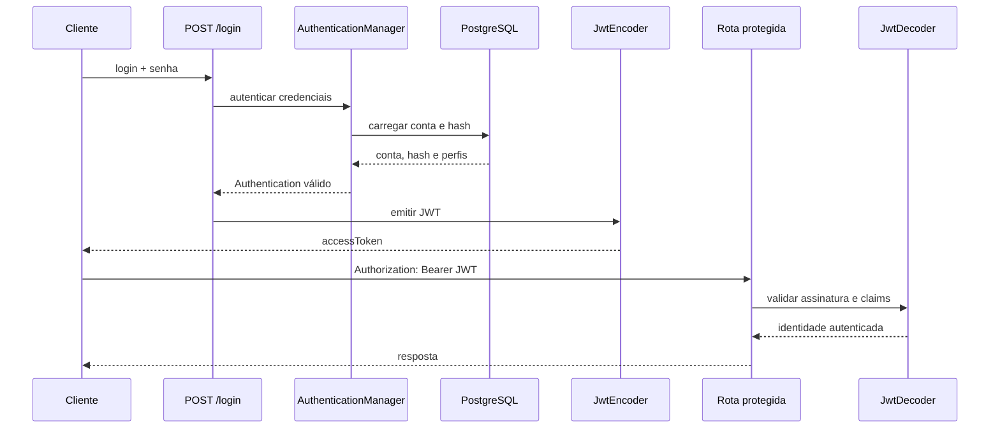
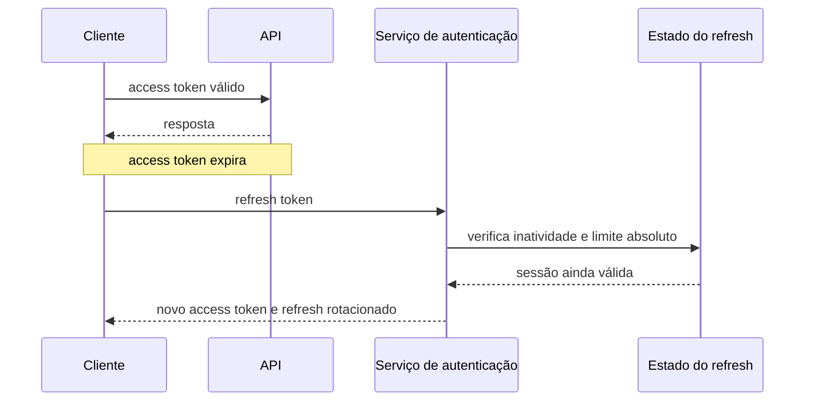

# Aula 13 — JWT, Bearer Token e OAuth2 Resource Server

[⬅ Voltar para o índice do curso](../../README.md)

---

## Apresentação

Na Aula 12, a API passou a validar login e senha com Spring Security. O HTTP Basic foi importante para tornar o processo visível: a cada requisição, o cliente enviava novamente as credenciais. Entretanto, repetir a senha em todas as chamadas amplia sua exposição e não é o modelo normalmente adotado por aplicações web e móveis modernas.

Nesta aula, login e senha serão enviados apenas ao endpoint de autenticação. Se forem válidos, a aplicação emitirá um **JSON Web Token — JWT** com validade de 30 minutos. Nas chamadas seguintes, o cliente apresentará o token no esquema Bearer.

> **Problema orientador:** como representar uma autenticação já realizada sem criar sessão no servidor e sem reenviar a senha a cada requisição?

### Escopo

Vamos:

- compreender a estrutura de um JWT;
- diferenciar codificação, assinatura e criptografia;
- estudar claims registrados e customizados;
- gerar uma chave secreta fora do código;
- emitir tokens com `JwtEncoder`;
- validar tokens com `JwtDecoder`;
- configurar a aplicação como OAuth2 Resource Server;
- substituir HTTP Basic por Bearer Token;
- documentar JWT no OpenAPI;
- automatizar o login no Postman;
- testar emissão, claims, assinatura e rejeição de tokens inválidos.

Ainda não vamos:

- diferenciar acesso de operador e administrador;
- criar refresh token;
- implementar logout ou lista de revogação;
- usar um Authorization Server completo;
- usar chaves RSA ou publicar JWK Set;
- armazenar tokens no banco.

A autorização por perfil será o tema da Aula 14.

---

## Resultados de aprendizagem

Ao final, o estudante deverá ser capaz de:

1. explicar as três partes de um JWT;
2. diferenciar Base64URL, assinatura e criptografia;
3. interpretar `iss`, `sub`, `iat` e `exp`;
4. justificar a validade curta de um access token;
5. gerar uma chave aleatória e mantê-la fora do Git;
6. reutilizar o `AuthenticationManager` para validar credenciais;
7. emitir um token com claims controlados pelo servidor;
8. configurar Spring Security como Resource Server;
9. enviar um Bearer Token em requisições HTTP;
10. reconhecer as limitações de revogação de um JWT stateless.

---

## Pré-requisitos

- Aula 12 concluída no marco `aula-12-autenticacao-http-basic`;
- conta de acesso, BCrypt e `UserDetailsService` compreendidos;
- arquivo `.env` fora do versionamento;
- PostgreSQL e profile `test` disponíveis;
- suíte anterior com 65 testes aprovados.

Confirme o ponto inicial:

```bash
git status
git log -1 --oneline
git tag --points-at HEAD
./mvnw test
```

No PowerShell:

```powershell
git status
git log -1 --oneline
git tag --points-at HEAD
.\mvnw.cmd test
```

---

## 1. Do HTTP Basic para o Bearer Token

Na Aula 12, cada requisição protegida enviava:

```text
Authorization: Basic base64(login:senha)
```

Agora o fluxo será dividido:

```text
1. Cliente envia login e senha uma vez.
2. Servidor autentica a conta.
3. Servidor emite um JWT temporário.
4. Cliente envia o JWT nas próximas requisições.
5. Servidor valida assinatura, emissor e tempo.
```

O novo cabeçalho é:

```text
Authorization: Bearer eyJraWQiOi...
```

**Bearer** significa “portador”: quem possui um token válido consegue apresentá-lo. O token deve ser protegido contra cópia, logs, extensões maliciosas, XSS e tráfego sem TLS.

### 1.1 Stateless não significa sem estado em todo o sistema

A API continua possuindo estado de negócio no PostgreSQL. O termo **stateless**, neste contexto, significa que o servidor não armazena uma sessão HTTP para lembrar a autenticação. Cada requisição contém informação suficiente para validar o acesso.



---

## 2. Anatomia de um JWT

Um JWT assinado possui três segmentos separados por ponto:

```text
header.payload.signature
```

Exemplo ilustrativo:

```text
eyJhbGciOiJIUzI1NiIsInR5cCI6IkpXVCJ9
.
eyJpc3MiOiJodHRwczovL3N1cG9ydGVvczIwMjYubG9jYWwiLCJzdWIiOiJhbmEuc291emEifQ
.
assinatura
```

### 2.1 Header

Descreve como o token foi assinado:

```json
{
  "alg": "HS256",
  "typ": "JWT"
}
```

O servidor não deve aceitar cegamente qualquer algoritmo indicado no header. Nossa configuração aceita explicitamente apenas HS256.

### 2.2 Payload

Contém claims, isto é, afirmações:

```json
{
  "iss": "https://suporteos2026.local",
  "sub": "ana.souza",
  "jti": "5b83b0de-8eb7-4a72-9b7d-1a4f3d8f7fd1",
  "iat": 1793318400,
  "exp": 1793320200,
  "perfis": ["OPERADOR"]
}
```

| Claim | Significado | Uso |
|---|---|---|
| `iss` | issuer | identifica quem emitiu |
| `sub` | subject | identifica a conta |
| `jti` | JWT ID | identifica unicamente o token |
| `iat` | issued at | instante da emissão |
| `exp` | expiration | limite de validade |
| `perfis` | customizado | prepara a Aula 14 |

Não coloque senha, CPF, segredo, dado médico ou informação confidencial no payload.

### 2.3 Assinatura

Uma representação simplificada do HS256 é:

```text
HMAC-SHA256(
    base64url(header) + "." + base64url(payload),
    chaveSecreta
)
```

Se alguém alterar o payload sem possuir a chave, a assinatura deixa de corresponder e o token é rejeitado.

### 2.4 JWT assinado não é criptografado

Header e payload usam Base64URL e podem ser decodificados por qualquer pessoa. A assinatura oferece:

- **integridade**: detecta alteração;
- **autenticidade**: comprova que o emissor possuía a chave.

Ela não oferece confidencialidade. JWT criptografado existe como JWE, mas não faz parte desta aula.

> Nunca cole tokens reais em sites públicos de depuração. Para examinar um token, use ferramentas locais ou dados exclusivamente didáticos.

---

## 3. HS256, RS256 e a decisão didática

### HS256

Usa a mesma chave para assinar e validar.

Vantagens:

- configuração pequena;
- adequado para demonstrar o fluxo em uma única aplicação;
- bom desempenho.

Limitações:

- todo validador que possui a chave também consegue emitir tokens;
- compartilhamento da chave amplia o impacto de vazamento;
- rotação exige planejamento.

### RS256

Usa chave privada para assinar e pública para validar. Resource Servers podem validar sem poder emitir. É mais adequado quando emissão e consumo estão separados.

Nesta aula usamos HS256 porque a mesma aplicação emite e valida tokens. Em arquiteturas reais, é comum delegar emissão a um provedor de identidade ou Spring Authorization Server e validar com chave pública/JWK Set.

---

## Ponto de quebra 1 — Dependência JWT

Adicione:

```xml
<dependency>
    <groupId>org.springframework.boot</groupId>
    <artifactId>spring-boot-starter-oauth2-resource-server</artifactId>
</dependency>
```

O Resource Server processa Bearer Tokens. O suporte JOSE fornece os componentes de assinatura e validação JWT.

Valide:

```bash
./mvnw -DskipTests compile
```

Commit sugerido:

```bash
git add pom.xml
git commit -m "build: adiciona suporte a jwt"
```

---

## 4. Gerando a chave no `.env`

A chave não deve estar em Java, `application.properties`, documentação, imagem Docker ou Git.

### macOS e Linux

```bash
openssl rand -base64 32
```

### Windows PowerShell

```powershell
$bytes = New-Object byte[] 32
[Security.Cryptography.RandomNumberGenerator]::Fill($bytes)
[Convert]::ToBase64String($bytes)
```

Copie o resultado para o `.env` local:

```dotenv
JWT_SECRET=resultado-base64-gerado-na-sua-maquina
```

Cada aluno e cada ambiente devem gerar um valor diferente. Não use o valor conhecido do profile de testes em produção.

O `.env.example` contém apenas orientação:

```dotenv
JWT_SECRET=substitua-por-uma-chave-base64-de-256-bits
```

O valor propositalmente não funciona como chave: ele obriga a geração consciente.

### Propriedades

Em `application.properties`:

```properties
app.security.jwt.issuer=https://suporteos2026.local
app.security.jwt.expiration=PT30M
app.security.jwt.secret=${JWT_SECRET}
```

`PT30M` segue a notação ISO-8601 para duração: período de tempo de 30 minutos.

No profile `test`, usamos uma chave conhecida e exclusiva dos testes. Ela não é segredo de produção.

---

## 5. Configuração tipada

```java
@ConfigurationProperties(prefix = "app.security.jwt")
public record JwtProperties(
        String issuer,
        Duration expiration,
        String secret) {
}
```

O binding converte `PT30M` para `Duration` e concentra as configurações relacionadas.

### 5.1 Decodificando Base64

```java
@Bean
SecretKey jwtSecretKey(JwtProperties properties) {
    byte[] chave = Base64.getDecoder().decode(properties.secret());
    if (chave.length < 32) {
        throw new IllegalStateException(
                "JWT_SECRET deve possuir pelo menos 32 bytes");
    }
    return new SecretKeySpec(chave, "HmacSHA256");
}
```

32 bytes correspondem a 256 bits, compatíveis com HS256.

### 5.2 Encoder

```java
@Bean
JwtEncoder jwtEncoder(SecretKey secretKey) {
    return NimbusJwtEncoder.withSecretKey(secretKey)
            .algorithm(MacAlgorithm.HS256)
            .build();
}
```

### 5.3 Decoder

```java
@Bean
JwtDecoder jwtDecoder(
        SecretKey secretKey,
        JwtProperties properties) {
    NimbusJwtDecoder decoder = NimbusJwtDecoder
            .withSecretKey(secretKey)
            .macAlgorithm(MacAlgorithm.HS256)
            .build();
    decoder.setJwtValidator(
            JwtValidators.createDefaultWithIssuer(properties.issuer()));
    return decoder;
}
```

O decoder verifica assinatura, emissor, expiração e claims temporais padrão. Fixar HS256 evita aceitar um algoritmo inesperado.

---

## Ponto de quebra 2 — Chave e infraestrutura criptográfica

Critérios:

- chave não está no Git;
- chave é Base64 válida;
- valor decodificado possui ao menos 32 bytes;
- encoder e decoder usam HS256;
- decoder valida o emissor.

```bash
git add .env.example src/main/resources src/test/resources \
  src/main/java/com/curso/suporteos/config
git commit -m "feat: configura assinatura jwt"
```

---

## 6. Autenticando login e senha

Não vamos duplicar a comparação BCrypt. O `AuthenticationManager` já coordena:

1. `ContaAcessoUserDetailsService` carrega a conta;
2. `PasswordEncoder` compara senha e hash;
3. status da conta e da pessoa são verificados;
4. um `Authentication` autenticado é produzido.

Exponha o componente:

```java
@Bean
AuthenticationManager authenticationManager(
        AuthenticationConfiguration configuration) throws Exception {
    return configuration.getAuthenticationManager();
}
```

No serviço:

```java
public TokenAcesso autenticar(String login, String senha) {
    try {
        Authentication authentication = authenticationManager.authenticate(
                UsernamePasswordAuthenticationToken
                        .unauthenticated(login, senha));
        return tokenService.emitir(authentication);
    } catch (AuthenticationException exception) {
        throw new CredenciaisInvalidasException(
                "Login ou senha inválidos");
    }
}
```

A mesma mensagem é usada para login inexistente, senha errada ou conta bloqueada. Isso reduz enumeração de contas.

---

## 7. Emitindo o token

O token é um resultado da camada de aplicação:

```java
public record TokenAcesso(
        String valor,
        Instant expiraEm,
        long duracaoSegundos) {
}
```

No `TokenService`:

```java
Instant emitidoEm = clock.instant();
Instant expiraEm = emitidoEm.plus(properties.expiration());

List<String> perfis = authentication.getAuthorities().stream()
        .map(GrantedAuthority::getAuthority)
        .filter(valor -> valor.startsWith("ROLE_"))
        .map(valor -> valor.substring("ROLE_".length()))
        .sorted()
        .toList();

JwtClaimsSet claims = JwtClaimsSet.builder()
        .issuer(properties.issuer())
        .issuedAt(emitidoEm)
        .expiresAt(expiraEm)
        .subject(authentication.getName())
        .id(UUID.randomUUID().toString())
        .claim("perfis", perfis)
        .build();

String valor = encoder
        .encode(JwtEncoderParameters.from(claims))
        .getTokenValue();
```

Os perfis vêm do objeto autenticado e nunca do JSON enviado pelo cliente. Caso contrário, o cliente poderia declarar privilégios próprios.

O `Clock` é injetado para tornar a dependência temporal explícita e permitir testes mais controlados no futuro.

---

## 8. Endpoint de login

Entrada:

```java
public record LoginRequest(
        @NotBlank @Size(max = 80) String login,
        @NotBlank @Size(max = 72) String senha) {
}
```

Saída:

```java
public record TokenResponse(
        String accessToken,
        String tokenType,
        long expiresIn,
        Instant expiresAt) {
}
```

Controller:

```java
@PostMapping("/login")
public TokenResponse login(@Valid @RequestBody LoginRequest request) {
    TokenAcesso token = service.autenticar(
            request.login(), request.senha());
    return new TokenResponse(
            token.valor(),
            "Bearer",
            token.duracaoSegundos(),
            token.expiraEm());
}
```

A rota é pública porque o usuário ainda não possui token. Pública não significa sem validação: ela valida credenciais e deve receber rate limiting em produção.

### Requisição

```http
POST /api/autenticacao/login
Content-Type: application/json

{
  "login": "ana.souza",
  "senha": "uma-frase-senha-2026"
}
```

### Resposta

```json
{
  "accessToken": "eyJraWQiOi...",
  "tokenType": "Bearer",
  "expiresIn": 1800,
  "expiresAt": "2026-10-29T21:30:00Z"
}
```

Credencial inválida retorna `401` no formato `ApiError`, sem revelar qual parte falhou.

---

## 9. Protegendo como Resource Server

Substitua:

```java
.httpBasic(Customizer.withDefaults())
```

por:

```java
.oauth2ResourceServer(oauth2 -> oauth2
        .jwt(Customizer.withDefaults()))
```

E torne o login público:

```java
.requestMatchers(HttpMethod.POST,
        "/api/pessoas",
        "/api/contas-acesso",
        "/api/autenticacao/login")
.permitAll()
.anyRequest()
.authenticated()
```

O filtro do Resource Server:

1. procura o Bearer Token no cabeçalho;
2. chama o `JwtDecoder`;
3. valida assinatura e claims;
4. cria um `JwtAuthenticationToken`;
5. coloca a autenticação no `SecurityContext` durante a requisição.

Não criamos filtro JWT manual. Usar o suporte oficial reduz código sensível e aproveita validações mantidas pelo Spring Security.

Leituras oficiais:

- [Spring Security — OAuth2 Resource Server JWT](https://docs.spring.io/spring-security/reference/servlet/oauth2/resource-server/jwt.html)
- [Spring Security — Bearer Tokens](https://docs.spring.io/spring-security/reference/servlet/oauth2/resource-server/bearer-tokens.html)
- [RFC 7519 — JSON Web Token](https://www.rfc-editor.org/rfc/rfc7519)

### Esta aplicação é um Authorization Server?

Não. Ela possui um endpoint didático que autentica suas próprias contas e emite um JWT customizado. Um OAuth2 Authorization Server completo implementa protocolos, clients, grants, consentimento, endpoints padronizados, rotação e metadados. Não devemos usar os nomes como sinônimos.

---

## Ponto de quebra 3 — Login e Bearer funcionando

Critérios:

- login correto emite token;
- senha não aparece no token;
- Basic deixa de liberar rotas;
- Bearer válido libera rota protegida;
- token alterado retorna `401`;
- token expirado é rejeitado pelo decoder.

```bash
git add src/main/java src/test/java
git commit -m "feat: emite e valida jwt"
```

---

## 10. Testando com cURL

Primeiro, obtenha o token:

```bash
curl -X POST http://localhost:8080/api/autenticacao/login \
  -H 'Content-Type: application/json' \
  -d '{
    "login": "ana.souza",
    "senha": "uma-frase-senha-2026"
  }'
```

Copie `accessToken` e chame:

```bash
curl http://localhost:8080/api/contas-acesso/me \
  -H 'Authorization: Bearer COLE_O_TOKEN_AQUI'
```

Experimente:

- sem cabeçalho: `401`;
- prefixo `Basic`: `401`;
- Bearer com caractere alterado: `401`;
- Bearer válido: `200`.

Nunca coloque token real em um repositório ou roteiro compartilhado.

---

## 11. OpenAPI e Swagger UI

Troque o esquema Basic:

```java
.addSecuritySchemes("bearerAuth", new SecurityScheme()
        .type(SecurityScheme.Type.HTTP)
        .scheme("bearer")
        .bearerFormat("JWT"))
.addSecurityItem(new SecurityRequirement().addList("bearerAuth"))
```

No Swagger UI:

1. execute `POST /api/autenticacao/login`;
2. copie somente `accessToken`;
3. clique em **Authorize**;
4. cole o token;
5. execute `/api/contas-acesso/me`.

Em versões atuais do Swagger UI, o prefixo `Bearer` é acrescentado pelo esquema. Se a interface solicitar explicitamente o cabeçalho completo, siga a indicação exibida.

---

## 12. Postman automatizado

A coleção agora define:

```json
"auth": {
  "type": "bearer",
  "bearer": [
    {"key": "token", "value": "{{accessToken}}"}
  ]
}
```

A requisição de login possui `No Auth` e salva o resultado:

```javascript
const body = pm.response.json();
if (pm.response.code === 200) {
    pm.collectionVariables.set('accessToken', body.accessToken);
}
```

Fluxo da pasta 02:

1. cadastrar pessoa;
2. cadastrar conta;
3. realizar login e salvar JWT;
4. consultar `/me` herdando Bearer.

As pastas seguintes reutilizam a variável até o token expirar. Se receber `401` após 30 minutos, execute novamente apenas a requisição de login.

### Inspeção local do payload

No script de teste do Postman, apenas para estudo:

```javascript
const payloadBase64Url = body.accessToken.split('.')[1];
const payload = JSON.parse(
    Buffer.from(payloadBase64Url, 'base64url').toString('utf8')
);
console.log(payload);
```

Decodificar não valida a assinatura. Somente o servidor, com `JwtDecoder`, decide se o token é confiável.

---

## 13. Testes automatizados

`ContaAcessoSecurityTest` agora demonstra:

- rota protegida sem token retorna `401`;
- login válido retorna Bearer com duração de 1800 segundos;
- decoder aceita assinatura e emissor;
- `sub` contém o login e `jti` identifica o token;
- `perfis` contém `OPERADOR`;
- `exp` ocorre depois de `iat`;
- token válido consulta `/me`;
- senha errada e conta bloqueada retornam `401`;
- token malformado retorna `401`.

Exemplo:

```java
String token = autenticar("operadora.2026", SENHA);
Jwt jwt = jwtDecoder.decode(token);

assertEquals("https://suporteos2026.local",
        jwt.getIssuer().toString());
assertEquals("operadora.2026", jwt.getSubject());
assertTrue(jwt.getClaimAsStringList("perfis")
        .contains("OPERADOR"));

mockMvc.perform(get("/api/contas-acesso/me")
                .header(HttpHeaders.AUTHORIZATION, "Bearer " + token))
        .andExpect(status().isOk());
```

Execute:

```bash
./mvnw test
```

Resultado esperado:

```text
Tests run: 67, Failures: 0, Errors: 0, Skipped: 0
BUILD SUCCESS
```

---

## 14. Expiração, bloqueio e revogação

Aqui está uma consequência importante do modelo stateless:

```text
token emitido -> conta bloqueada -> token ainda válido até expirar
```

Durante uma requisição com JWT, o Resource Server valida o token localmente e não consulta `conta_acesso`. Portanto, bloquear a conta impede **novos logins**, mas não invalida automaticamente tokens já emitidos.

Estratégias possíveis:

- access token curto;
- lista de revogação por `jti`;
- versão de credencial consultada em cache ou banco;
- introspecção de token opaco;
- rotação de chave para incidente amplo;
- Authorization Server centralizado.

Escolhemos 30 minutos para o laboratório. Em sistemas reais, a duração depende da ameaça, experiência do usuário e estratégia de renovação.

### 14.1 Vencimento por tempo absoluto

É o comportamento implementado nesta aula. O token recebe `iat` e `exp` no momento do login:

```text
iat = 10:00
exp = 10:30
```

O token vence às 10:30 independentemente de ter sido usado zero, uma ou cem vezes. Uma chamada feita às 10:29 não prolonga sua validade.

```text
10:00  login e emissão
10:05  uso válido
10:20  uso válido
10:29  uso válido
10:30  token expirado
```

Esse modelo preserva a validação stateless: basta conferir a assinatura e comparar `exp` com o relógio. O servidor não precisa registrar as atividades do usuário.

O cálculo está no `TokenService`:

```java
Instant emitidoEm = clock.instant();
Instant expiraEm = emitidoEm.plus(properties.expiration());
```

A duração vem de:

```properties
app.security.jwt.expiration=PT30M
```

Diminuir esse valor reduz o tempo de uso de um token roubado, mas aumenta a frequência de novos logins ou renovações.

### 14.2 Vencimento por inatividade — idle timeout

Vencimento por inatividade responde a outra pergunta:

> Há quanto tempo esta identidade não realiza uma atividade aceita pelo sistema?

Exemplo com limite de 15 minutos:

```text
10:00  login
10:10  atividade -> novo limite de inatividade: 10:25
10:20  atividade -> novo limite de inatividade: 10:35
10:36  tentativa -> rejeitada por 16 minutos sem atividade
```

Um JWT autossuficiente não conhece requisições ocorridas depois de sua emissão. O claim `iat` não pode ser atualizado: alterar o payload quebra a assinatura. Para implementar inatividade real, o servidor precisa manter ou consultar algum estado compartilhado, por exemplo:

```text
identificador da sessão/token -> instante da última atividade
```

Um algoritmo simplificado seria:

```text
1. validar assinatura e expiração absoluta do JWT;
2. localizar a última atividade pelo jti ou pela sessão;
3. calcular agora - ultimaAtividade;
4. rejeitar se ultrapassou o idle timeout;
5. atualizar ultimaAtividade se a requisição for aceita.
```

Esse estado deve estar em um local compartilhado, como Redis ou banco, quando existem várias instâncias da aplicação. Também é necessário decidir:

- quais requisições contam como atividade;
- com que frequência atualizar o registro para evitar uma escrita por chamada;
- como tratar chamadas simultâneas;
- quando remover registros expirados;
- como impedir que atividade indefinida elimine um limite máximo de sessão.

Portanto, idle timeout puro diminui parte da vantagem stateless do JWT.

### 14.3 Expiração deslizante com access e refresh token

Uma solução frequente combina dois prazos:

- **access token curto**: usado na API e validado localmente;
- **refresh token**: usado somente para solicitar um novo access token;
- **limite de inatividade**: o refresh deixa de funcionar se não for utilizado no intervalo definido;
- **limite absoluto**: mesmo com atividade, a sessão exige novo login após um máximo.

Exemplo:

```text
access token:       10 minutos
idle timeout:       30 minutos sem renovação
limite absoluto:     8 horas desde o login
```



O refresh token deve ser protegido, rotacionado e revogável. Apenas reemitir um JWT em toda requisição gera tráfego, corrida entre tokens e uma janela que pode ser prolongada indefinidamente por um invasor.

### 14.4 Comparação dos modelos

| Modelo | Exige estado no servidor? | Atividade prolonga acesso? | Implementado agora? |
|---|---:|---:|---:|
| `exp` absoluto no JWT | não | não | sim |
| idle timeout consultado por requisição | sim | sim | não |
| access + refresh com rotação | estado para refresh | sim, até o máximo | não |
| sessão HTTP tradicional | sim | normalmente sim | não |

Nesta Aula 13 implementamos somente o vencimento absoluto de 30 minutos. O aluno deve ser capaz de explicar que “30 minutos de validade” não significa “30 minutos de inatividade”.

### Logout

Sem sessão ou lista de revogação, “logout” significa o cliente apagar o token. Uma cópia roubada continua válida até `exp`. Não criaremos um endpoint que promete invalidar algo que o servidor não armazena.

---

## 15. Onde guardar o token no cliente

Não existe opção universalmente segura:

- memória: reduz persistência, mas perde token ao recarregar;
- Web Storage: simples, mas JavaScript e XSS podem acessar;
- cookie `HttpOnly`: protege contra leitura por JavaScript, mas reintroduz decisões de CSRF e atributos de cookie;
- armazenamento seguro móvel: depende da plataforma.

Nesta disciplina, Postman mantém uma variável de coleção exclusivamente para laboratório. Isso não define a arquitetura de um frontend de produção.

---

## 16. Diagnóstico

### A aplicação não inicia e informa `JWT_SECRET`

Gere uma chave Base64 de 32 bytes e coloque no `.env`. Confirme que o profile `dev` importa o arquivo.

### `JWT_SECRET deve estar codificada em Base64`

Não escreva uma frase comum. Use `openssl rand -base64 32` ou o comando PowerShell indicado.

### Recebo `401` com token recém-emitido

Verifique:

- prefixo `Bearer ` com espaço;
- token completo, sem aspas ou quebras;
- mesma chave na emissão e validação;
- emissor esperado;
- relógio do sistema;
- algoritmo HS256.

### Token possui três partes, mas é rejeitado

Formato não prova autenticidade. Assinatura, emissor ou tempo podem ser inválidos.

### Alterei o payload e recebi `401`

Comportamento correto: a assinatura foi calculada sobre o payload original.

### Conta bloqueada ainda acessa com token antigo

É a limitação de revogação explicada nesta aula. Espere a expiração ou implemente uma das estratégias futuras.

### Swagger continua enviando Basic

Atualize a página, verifique `bearerAuth` em `/v3/api-docs` e remova autorizações antigas da interface.

---

## Ponto de quebra 4 — Fluxo externo validado

Critérios:

- OpenAPI anuncia `bearerAuth` e `JWT`;
- Postman captura `accessToken` automaticamente;
- collection runner executa as rotas protegidas;
- segredo não aparece no Git;
- 67 testes passam;
- limitações de expiração e revogação foram explicadas.

```bash
git add README.md docs postman
git commit -m "docs: publica aula 13 sobre jwt"
```

---

## 17. Atividade de transferência

No projeto individual:

1. gere uma chave própria;
2. defina emissor e duração;
3. implemente endpoint de login;
4. inclua `sub`, `iat`, `exp` e um claim do domínio;
5. substitua Basic por Bearer;
6. automatize captura no Postman;
7. teste token válido, alterado e ausente;
8. explique o que ocorre quando a conta é bloqueada;
9. proponha uma estratégia de revogação compatível com seu tema.

Não entregue chave real, token ativo ou senha junto ao relatório.

---

## 18. Questões para discussão

1. Por que payload JWT não é confidencial?
2. O que a assinatura protege?
3. Quem possui uma chave HS256 pode apenas validar?
4. Qual diferença entre sessão e JWT stateless?
5. Por que o servidor controla os claims de perfil?
6. O que `exp` reduz, mas não elimina?
7. Por que bloquear conta não revoga token existente?
8. Qual diferença entre nosso emissor didático e um Authorization Server?
9. Quando uma chave assimétrica seria preferível?
10. Por que decodificar um token não significa validá-lo?

---

## 19. Avaliação sugerida

| Critério | Peso |
|---|---:|
| Fundamentação sobre JWT e assinatura | 20% |
| Gestão segura da chave | 20% |
| Emissão e claims | 20% |
| Resource Server e Bearer | 20% |
| Testes e Postman | 15% |
| Análise de limitações | 5% |

Erros críticos:

- chave real versionada;
- senha colocada no token;
- token sem expiração;
- aceitar algoritmo não controlado;
- confiar em perfis enviados no request;
- afirmar que Base64 criptografa;
- prometer logout sem revogação.

---

## 20. Encerramento e marco Git

Valide:

```bash
./mvnw test
jq empty postman/Suporte-OS.postman_collection.json
git diff --check
git status
```

Após aprovação:

```bash
git add .
git commit -m "feat: implementa jwt na aula 13"
git tag -a aula-13-jwt -m "Aula 13 - JWT e Bearer Token"
git push origin main
git push origin aula-13-jwt
```

### Checklist final

- [ ] sei separar header, payload e assinatura;
- [ ] entendo que JWT assinado não é criptografado;
- [ ] a chave é aleatória e externa ao Git;
- [ ] login reutiliza o `AuthenticationManager`;
- [ ] token possui emissor, sujeito, emissão e expiração;
- [ ] perfis vêm da conta autenticada;
- [ ] Resource Server valida Bearer;
- [ ] Basic não libera mais as rotas;
- [ ] OpenAPI e Postman usam JWT;
- [ ] conheço a limitação de revogação;
- [ ] os 67 testes passam.

Marco sugerido: `aula-13-jwt`.
