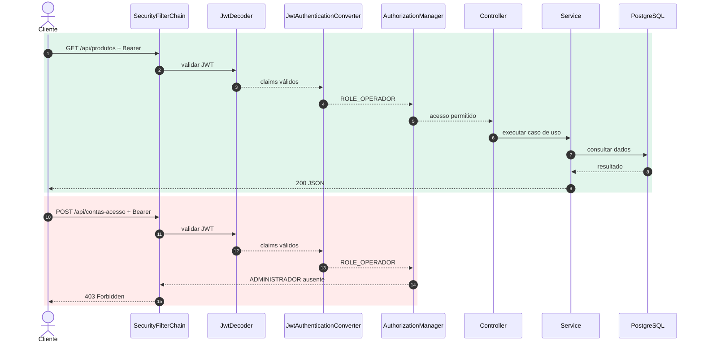
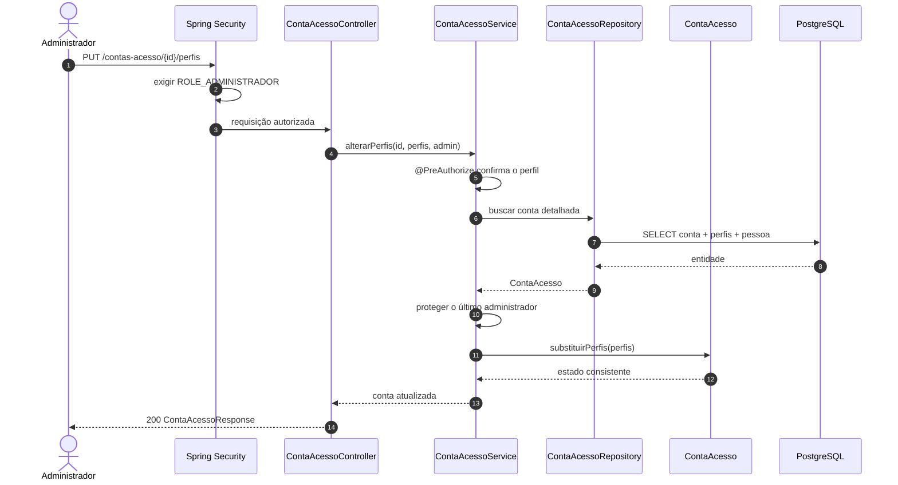
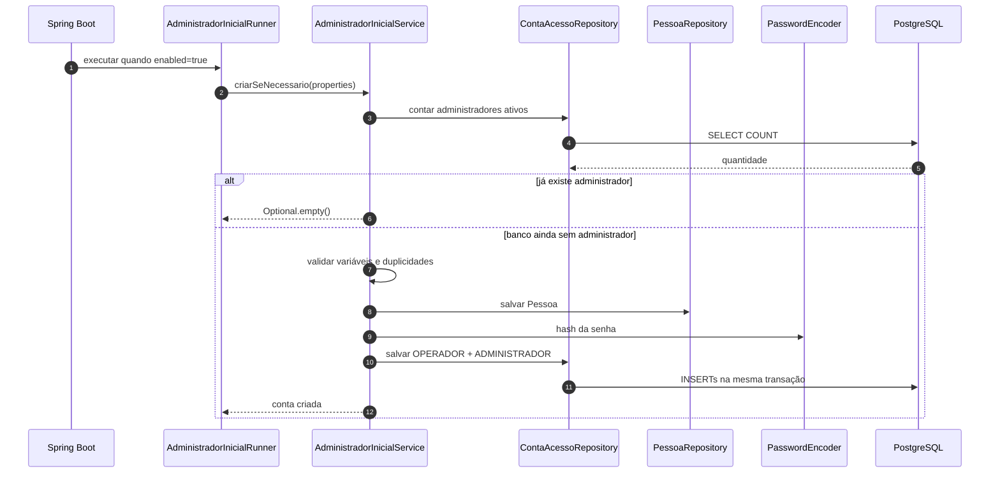

# Aula 14 — Autorização, perfis e controle de acesso

[⬅ Voltar para o índice do curso](../../README.md)

---

## Apresentação

Na Aula 13, a aplicação passou a autenticar o cliente por meio de um JWT. O token informa quem é o usuário, quando foi emitido, quando vence e quais perfis pertenciam à conta no momento do login. Entretanto, possuir um token válido ainda não responde a uma pergunta essencial:

> A pessoa autenticada pode executar esta operação?

Nesta aula transformaremos os perfis `OPERADOR` e `ADMINISTRADOR` em decisões reais de acesso. Um operador poderá usar as funcionalidades cotidianas do sistema, mas não poderá criar contas, alterar perfis, bloquear usuários ou excluir recursos. Essas operações serão reservadas ao administrador.

Também eliminaremos o cadastro público provisório usado nas Aulas 12 e 13. Em um banco vazio, a primeira conta administrativa será criada a partir de variáveis de ambiente e esse mecanismo permanecerá desativado por padrão.

### Problema orientador

> Como permitir que usuários autenticados executem somente as operações necessárias às suas responsabilidades, sem confiar em informações enviadas livremente pelo cliente?

### Escopo

Nesta aula vamos:

- diferenciar autenticação e autorização;
- estudar papéis, authorities e permissões;
- aplicar o princípio do menor privilégio;
- converter o claim `perfis` do JWT em authorities do Spring Security;
- definir uma política para `OPERADOR` e `ADMINISTRADOR`;
- proteger rotas com regras HTTP;
- proteger serviços com `@PreAuthorize`;
- implementar criação, alteração de perfis e bloqueio de contas;
- impedir que o último administrador ativo seja removido ou bloqueado;
- criar o administrador inicial por configuração externa;
- testar os resultados `200`, `201`, `400`, `401` e `403`;
- atualizar OpenAPI e Postman;
- representar os fluxos com diagramas de sequência.

Ainda não vamos:

- criar permissões configuráveis no banco;
- implementar grupos dinâmicos ou uma matriz ACL;
- criar refresh token, logout ou revogação;
- limitar tentativas de login;
- produzir trilha de auditoria persistente;
- integrar um provedor de identidade externo.

Esses limites preservam o objetivo central: compreender como uma identidade autenticada se torna uma decisão de autorização.

---

## Resultados de aprendizagem

Ao final da aula, o estudante deverá ser capaz de:

1. diferenciar identificação, autenticação e autorização;
2. explicar a diferença entre perfil, authority e permissão;
3. interpretar corretamente `401 Unauthorized` e `403 Forbidden`;
4. justificar o princípio do menor privilégio;
5. converter claims de um JWT em authorities do Spring Security;
6. definir políticas por método HTTP e rota;
7. aplicar segurança em profundidade com `@PreAuthorize`;
8. administrar perfis e status sem remover o último administrador;
9. provisionar uma identidade administrativa sem publicar senha no Git;
10. testar decisões positivas e negativas de autorização;
11. ler um diagrama de sequência de autenticação e autorização;
12. transferir a política para o projeto temático.

---

## Pré-requisitos

- marco `aula-13-jwt` concluído;
- Java 21 e Maven Wrapper;
- PostgreSQL 16 disponível;
- arquivo `.env` configurado e ignorado pelo Git;
- compreensão de `ContaAcesso`, `PerfilAcesso`, BCrypt e JWT;
- capacidade de realizar login e enviar um Bearer Token;
- suíte da Aula 13 com 67 testes aprovados.

Confirme o ponto inicial:

```bash
git status
git tag --points-at HEAD
./mvnw test
```

No PowerShell:

```powershell
git status
git tag --points-at HEAD
.\mvnw.cmd test
```

O ponto inicial deve estar no marco `aula-13-jwt`. Não continue se houver alterações desconhecidas ou falhas anteriores.

---

## 1. Autenticação não é autorização

Considere três perguntas diferentes:

| Conceito | Pergunta | Evidência no projeto |
|---|---|---|
| Identificação | Quem a pessoa declara ser? | login enviado pelo cliente |
| Autenticação | A identidade foi comprovada? | senha validada e JWT assinado |
| Autorização | A identidade pode executar esta operação? | perfis convertidos em authorities e comparados com a política |

Um JWT válido comprova que o token foi emitido pelo servidor, não foi alterado, pertence a um sujeito e ainda está dentro da validade. Isso não significa que o sujeito pode executar todas as operações.

```text
Token válido + perfil suficiente     → operação autorizada
Token válido + perfil insuficiente   → 403 Forbidden
Token ausente, inválido ou expirado  → 401 Unauthorized
```

### 1.1 Por que o nome `401 Unauthorized` confunde?

Apesar do nome histórico, `401` representa ausência de autenticação válida. A resposta normalmente informa como o cliente pode se autenticar por meio do cabeçalho `WWW-Authenticate`.

O `403` significa que a identidade foi estabelecida, mas a política não permite a operação. Repetir a mesma requisição com o mesmo perfil não resolve o problema.

### 1.2 Perfil, authority e permissão

No domínio, usamos perfis compreensíveis para o negócio:

```java
public enum PerfilAcesso {
    OPERADOR,
    ADMINISTRADOR
}
```

Dentro do Spring Security, uma **authority** é uma string concedida à autenticação. Por convenção, `hasRole("ADMINISTRADOR")` procura a authority `ROLE_ADMINISTRADOR`.

| Domínio | Claim no JWT | Authority no Spring | Expressão |
|---|---|---|---|
| `OPERADOR` | `"OPERADOR"` | `ROLE_OPERADOR` | `hasRole('OPERADOR')` |
| `ADMINISTRADOR` | `"ADMINISTRADOR"` | `ROLE_ADMINISTRADOR` | `hasRole('ADMINISTRADOR')` |

O prefixo `ROLE_` é uma convenção da infraestrutura de segurança. Ele não precisa contaminar o enum do domínio nem o JSON do token.

---

## 2. RBAC e menor privilégio

O modelo desta aula é uma forma simples de **Role-Based Access Control — RBAC**. Permissões são agrupadas em papéis, e as contas recebem um ou mais desses papéis.

```text
Conta → Perfil → conjunto de operações autorizadas
```

O princípio do menor privilégio determina que uma identidade receba somente os acessos necessários para sua função. Uma conta usada diariamente para registrar vendas não precisa administrar usuários ou excluir cadastros.

### 2.1 Política adotada

| Operação | Público | OPERADOR | ADMINISTRADOR |
|---|:---:|:---:|:---:|
| health check | ✓ | ✓ | ✓ |
| OpenAPI e Swagger em desenvolvimento | ✓ | ✓ | ✓ |
| login | ✓ | ✓ | ✓ |
| consultar e operar recursos do negócio | — | ✓ | ✓ |
| consultar e alterar a própria senha | — | ✓ | ✓ |
| criar conta | — | — | ✓ |
| alterar perfis | — | — | ✓ |
| ativar ou bloquear conta | — | — | ✓ |
| excluir recursos | — | — | ✓ |

O `ADMINISTRADOR` também recebe `OPERADOR`, por isso pode executar as atividades cotidianas. Essa composição fica explícita na primeira conta e nos testes.

### 2.2 Política não é interface

Esconder um botão na interface web melhora a experiência, mas não protege a API. Um cliente pode construir a requisição manualmente com cURL ou Postman. A decisão precisa ocorrer no servidor.

---

## 3. Diagramas de sequência

Diagramas de sequência representam participantes na horizontal e mensagens ao longo do tempo. Eles ajudam a localizar onde uma decisão acontece e quem é responsável por ela.

### 3.1 Login e emissão do JWT

[Abrir diagrama interativo de login](diagramas/login-jwt.html)

```mermaid
sequenceDiagram
    autonumber
    actor Cliente
    participant Controller as AutenticacaoController
    participant Service as AutenticacaoService
    participant Manager as AuthenticationManager
    participant Details as UserDetailsService
    participant Banco as PostgreSQL
    participant Token as TokenService
    participant Encoder as JwtEncoder

    Cliente->>Controller: POST /api/autenticacao/login
    Controller->>Service: autenticar(login, senha)
    Service->>Manager: authenticate(credentials)
    Manager->>Details: loadUserByUsername(login)
    Details->>Banco: consultar conta, hash e perfis
    Banco-->>Details: ContaAcesso
    Details-->>Manager: UserDetails + ROLE_*
    Manager-->>Service: Authentication autenticado
    Service->>Token: emitir(authentication)
    Token->>Encoder: assinar claims
    Encoder-->>Token: JWT assinado
    Token-->>Controller: TokenAcesso
    Controller-->>Cliente: 200 TokenResponse
```

Leitura passo a passo:

1. A senha chega somente ao endpoint de login.
2. `AuthenticationManager` coordena a validação.
3. `UserDetailsService` recupera hash, status e perfis.
4. O `PasswordEncoder` compara a senha sem descriptografar o hash.
5. Os perfis pertencem à conta carregada do banco; não são escolhidos pelo cliente.
6. Somente após o sucesso o `TokenService` emite o JWT.

### 3.2 Requisição autorizada e requisição proibida

[Abrir diagrama interativo de autorização](diagramas/autorizacao-jwt.html)



Observe que o segundo token é válido. O resultado é `403`, não `401`, porque a autenticação foi estabelecida e somente a autorização falhou. O controller não é executado.

### 3.3 Administração de perfis



Há duas verificações complementares:

- a cadeia HTTP impede que a chamada chegue ao controller;
- `@PreAuthorize` protege o caso de uso se ele for chamado por outra entrada futura.

Esse modelo é chamado de **defesa em profundidade**.

### 3.4 Administrador inicial



O provisionamento não é um endpoint público. Ele depende de configuração do ambiente e deve ser desligado depois da primeira execução.

---

## 4. Mapeamento teoria–prática

| Conceito | Implementação | Evidência |
|---|---|---|
| autenticação | `JwtDecoder` valida o token | token ausente ou inválido retorna `401` |
| authority | claim `perfis` convertido para `ROLE_*` | OPERADOR acessa rota cotidiana |
| autorização | regras em `SecurityFilterChain` | OPERADOR recebe `403` na administração |
| defesa em profundidade | `@PreAuthorize` no service | chamada ao caso de uso também exige ADMINISTRADOR |
| menor privilégio | criação e gestão de contas reservadas | token OPERADOR não administra usuários |
| configuração externa | administrador inicial no `.env` | banco vazio recebe a primeira conta sem senha no Git |
| invariantes administrativas | proteção do último administrador | bloqueio ou remoção indevida retorna `400` |

---

## Ponto de quebra 1 — Converter perfis em authorities

Na Aula 13, o JWT já possuía:

```json
{
  "sub": "operador",
  "perfis": ["OPERADOR"]
}
```

O Resource Server valida o token, mas o conversor padrão procura scopes. Precisamos indicar que a origem das authorities é o claim `perfis`.

```java
@Bean
JwtAuthenticationConverter jwtAuthenticationConverter() {
    JwtGrantedAuthoritiesConverter authoritiesConverter =
            new JwtGrantedAuthoritiesConverter();
    authoritiesConverter.setAuthoritiesClaimName("perfis");
    authoritiesConverter.setAuthorityPrefix("ROLE_");

    JwtAuthenticationConverter authenticationConverter =
            new JwtAuthenticationConverter();
    authenticationConverter.setJwtGrantedAuthoritiesConverter(
            authoritiesConverter);
    return authenticationConverter;
}
```

Para o claim `OPERADOR`, o resultado será `ROLE_OPERADOR`.

Conecte o conversor ao Resource Server:

```java
.oauth2ResourceServer(oauth2 -> oauth2
        .jwt(jwt -> jwt.jwtAuthenticationConverter(
                jwtAuthenticationConverter)))
```

### O que o conversor não faz

- não consulta o banco novamente;
- não aceita perfis enviados no corpo da requisição;
- não altera o token;
- não renova a validade;
- não substitui a política de autorização.

Ele apenas transforma claims já validados em authorities compreendidas pelo Spring Security.

---

## Ponto de quebra 2 — Definir a política HTTP

Habilite segurança de métodos:

```java
@Configuration
@EnableMethodSecurity
public class SecurityConfig {
```

Depois organize as regras da mais específica para a mais geral:

```java
.authorizeHttpRequests(authorize -> authorize
        .requestMatchers(
                "/api/health",
                "/v3/api-docs/**",
                "/v3/api-docs.yaml",
                "/swagger-ui.html",
                "/swagger-ui/**")
        .permitAll()
        .requestMatchers(HttpMethod.POST, "/api/autenticacao/login")
        .permitAll()
        .requestMatchers(HttpMethod.POST, "/api/contas-acesso")
        .hasRole("ADMINISTRADOR")
        .requestMatchers(
                "/api/contas-acesso/*/perfis",
                "/api/contas-acesso/*/status")
        .hasRole("ADMINISTRADOR")
        .requestMatchers(HttpMethod.DELETE, "/api/**")
        .hasRole("ADMINISTRADOR")
        .requestMatchers("/api/**")
        .hasAnyRole("OPERADOR", "ADMINISTRADOR")
        .anyRequest()
        .denyAll())
```

### Por que a ordem importa?

As regras são avaliadas na ordem. Se `"/api/**"` aparecesse antes da criação de contas, a regra geral aceitaria qualquer operador e a regra administrativa nunca seria alcançada.

### Por que terminar com `denyAll()`?

Uma nova rota não deve se tornar pública por esquecimento. `denyAll()` faz o padrão final ser negar, exigindo uma decisão consciente para caminhos fora da API já classificada.

---

## Ponto de quebra 3 — Proteger os casos de uso

Na fronteira de aplicação:

```java
@Transactional
@PreAuthorize("hasRole('ADMINISTRADOR')")
public ContaAcesso cadastrar(
        Long pessoaId,
        String login,
        String senhaAberta) {
    // regras do cadastro
}
```

A anotação precisa de `@EnableMethodSecurity`. Sem essa habilitação, ela seria apenas metadado sem efeito.

### Segurança no controller ou no service?

| Local | Vantagem | Limite |
|---|---|---|
| cadeia HTTP | bloqueia cedo e evita executar o controller | protege somente requisições que passam por essa cadeia |
| controller | aproxima regra da operação HTTP | pode ser contornado por outra entrada |
| service | protege o caso de uso | depende de proxy e contexto de segurança |

Neste projeto usamos cadeia HTTP e service para operações administrativas. O objetivo não é duplicar toda regra indiscriminadamente, mas proteger fronteiras relevantes.

### Autoinvocação e proxies

`@PreAuthorize` é aplicado por um proxy Spring. Quando um método do próprio objeto chama outro método anotado no mesmo objeto, a chamada pode não atravessar o proxy. Por isso, a arquitetura não deve depender de uma autoinvocação para aplicar o controle.

---

## 5. Evoluir o domínio da conta

Uma conta deve possuir pelo menos um perfil:

```java
public void substituirPerfis(Set<PerfilAcesso> novosPerfis) {
    if (novosPerfis == null || novosPerfis.isEmpty()) {
        throw new IllegalArgumentException(
                "A conta deve possuir ao menos um perfil");
    }
    this.perfis.clear();
    this.perfis.addAll(novosPerfis);
}
```

Para o provisionamento inicial:

```java
public void concederPerfil(PerfilAcesso perfil) {
    this.perfis.add(Objects.requireNonNull(
            perfil,
            "Perfil é obrigatório"));
}
```

### Invariantes administrativas

O service protege dois cenários:

1. o administrador autenticado não pode remover de si mesmo `ADMINISTRADOR`;
2. o último administrador ativo não pode ser bloqueado nem perder o perfil.

Essas regras reduzem o risco de deixar o sistema sem alguém capaz de administrá-lo.

```java
if (removeAdministrador && quantidadeAdministradoresAtivos() <= 1) {
    throw new IllegalArgumentException(
            "O sistema deve manter ao menos um administrador ativo");
}
```

Esse controle não substitui processos organizacionais, revisão por pares ou contas de emergência em ambientes reais. Ele apenas preserva uma invariante mínima do protótipo.

Também existe uma limitação concorrente: duas alterações administrativas simultâneas poderiam observar a mesma contagem antes do commit. Uma solução de produção deve serializar essa decisão com locking apropriado ou política externa de identidade. A limitação é declarada para não confundir uma verificação de aplicação com garantia distribuída absoluta.

---

## 6. DTOs e endpoints administrativos

DTO de perfis:

```java
public record PerfisContaAcessoRequest(
        @NotEmpty(message = "Informe ao menos um perfil")
        Set<PerfilAcesso> perfis) {
}
```

DTO de status:

```java
public record StatusContaAcessoRequest(
        @NotNull(message = "Status é obrigatório")
        StatusContaAcesso status) {
}
```

Novas operações:

| Método e rota | Perfil | Resultado |
|---|---|---|
| `POST /api/contas-acesso` | ADMINISTRADOR | cria conta OPERADOR |
| `PUT /api/contas-acesso/{id}/perfis` | ADMINISTRADOR | substitui perfis |
| `PUT /api/contas-acesso/{id}/status` | ADMINISTRADOR | ativa ou bloqueia |
| `GET /api/contas-acesso/me` | OPERADOR ou ADMINISTRADOR | consulta a própria conta |
| `PUT /api/contas-acesso/me/senha` | OPERADOR ou ADMINISTRADOR | altera a própria senha |

O endpoint de perfis não aceita strings arbitrárias: Jackson converte somente os valores definidos no enum. Valor desconhecido produz `400 Bad Request`.

---

## Ponto de quebra 4 — Criar o administrador inicial

Ao fechar o cadastro público, um banco vazio precisa receber a primeira identidade administrativa por outro canal. Usaremos configuração externa, desativada por padrão.

Acrescente ao `.env` local:

```properties
INITIAL_ADMIN_ENABLED=true
INITIAL_ADMIN_NAME=Administrador do Curso
INITIAL_ADMIN_EMAIL=administrador@example.com
INITIAL_ADMIN_CPF=52998224725
INITIAL_ADMIN_LOGIN=administrador
INITIAL_ADMIN_PASSWORD=defina-uma-senha-forte-e-local
```

> [!CAUTION]
> Nunca copie a senha real para a apostila, `application.properties`, coleção Postman ou commit. O valor acima é apenas uma instrução para substituição.

As propriedades da aplicação:

```properties
app.security.initial-admin.enabled=${INITIAL_ADMIN_ENABLED:false}
app.security.initial-admin.nome=${INITIAL_ADMIN_NAME:}
app.security.initial-admin.email=${INITIAL_ADMIN_EMAIL:}
app.security.initial-admin.cpf=${INITIAL_ADMIN_CPF:}
app.security.initial-admin.login=${INITIAL_ADMIN_LOGIN:}
app.security.initial-admin.senha=${INITIAL_ADMIN_PASSWORD:}
```

O `AdministradorInicialRunner` somente é criado quando a flag está ativa:

```java
@Component
@ConditionalOnProperty(
        name = "app.security.initial-admin.enabled",
        havingValue = "true")
public class AdministradorInicialRunner implements ApplicationRunner {
    // chama o service durante a inicialização
}
```

O service:

1. verifica se já existe administrador ativo;
2. valida as propriedades;
3. impede login, CPF e e-mail duplicados;
4. cria `Pessoa` e `ContaAcesso` na mesma transação;
5. adiciona `OPERADOR` e `ADMINISTRADOR`;
6. grava apenas o hash BCrypt.

### Procedimento de primeira execução

1. configure as variáveis no `.env`;
2. defina `INITIAL_ADMIN_ENABLED=true`;
3. inicie a aplicação;
4. confirme no log que a conta foi criada;
5. interrompa a aplicação;
6. altere para `INITIAL_ADMIN_ENABLED=false`;
7. inicie novamente;
8. realize login com a conta administrativa;
9. crie as demais contas pela API protegida.

O processo é idempotente: se já existir administrador ativo, nenhuma nova conta é criada. A flag deve mesmo assim ser desativada, reduzindo superfícies e ambiguidades operacionais.

### Limite do mecanismo didático

Em implantação distribuída, várias instâncias poderiam iniciar simultaneamente. Um sistema real precisa coordenar o provisionamento pela plataforma, por migração operacional controlada, por um provedor de identidade ou por mecanismo distribuído. O runner desta aula é adequado ao laboratório de uma única instância.

---

## 7. Por que não há novo changelog Liquibase?

`PerfilAcesso.ADMINISTRADOR`, a tabela `conta_acesso_perfil` e o status da conta já foram criados na Aula 12. A Aula 14 altera comportamento e política, não estrutura relacional.

Criar um changeSet vazio apenas para acompanhar o número da aula seria incorreto. Liquibase registra mudanças de banco, não mudanças gerais do projeto.

Verifique:

```bash
./mvnw test
```

O Liquibase deve informar que o banco está atualizado com os changeSets existentes.

---

## 8. Testes automatizados

A autorização precisa de casos positivos e negativos. Testar apenas o administrador não demonstra que o operador foi realmente restringido.

### 8.1 Matriz mínima

| Cenário | Resultado esperado |
|---|---:|
| rota protegida sem token | `401` |
| token malformado ou expirado | `401` |
| OPERADOR em operação cotidiana | `200` ou `201` |
| OPERADOR criando conta | `403` |
| ADMINISTRADOR criando conta | `201` |
| ADMINISTRADOR alterando perfis | `200` |
| ADMINISTRADOR bloqueando outra conta | `200` |
| ADMINISTRADOR bloqueando a si mesmo | `400` |
| inicialização quando não existe admin | cria uma conta |
| nova inicialização com admin existente | não duplica |

### 8.2 Testar `401` e `403`

```java
mockMvc.perform(post("/api/contas-acesso")
                .contentType(MediaType.APPLICATION_JSON)
                .content(corpo))
        .andExpect(status().isUnauthorized());

mockMvc.perform(post("/api/contas-acesso")
                .header(HttpHeaders.AUTHORIZATION,
                        "Bearer " + tokenOperador)
                .contentType(MediaType.APPLICATION_JSON)
                .content(corpo))
        .andExpect(status().isForbidden());
```

O corpo é o mesmo. A primeira requisição não apresenta identidade; a segunda apresenta uma identidade sem privilégio administrativo.

### 8.3 Testar o provisionamento

O teste chama `criarSeNecessario` duas vezes:

```java
Optional<ContaAcesso> criada = service.criarSeNecessario(properties);

assertTrue(criada.isPresent());
assertTrue(criada.orElseThrow()
        .possuiPerfil(PerfilAcesso.ADMINISTRADOR));
assertTrue(service.criarSeNecessario(properties).isEmpty());
```

Isso verifica criação e idempotência sem ligar a flag global no profile de testes.

---

## 9. OpenAPI e documentação da política

O esquema Bearer continua configurado globalmente. As descrições das operações administrativas informam que `ADMINISTRADOR` é obrigatório.

O contrato passa a incluir:

```text
PUT /api/contas-acesso/{id}/perfis
PUT /api/contas-acesso/{id}/status
```

OpenAPI descreve a expectativa, mas quem aplica a política é o Spring Security. Uma descrição escrita não substitui a configuração nem os testes.

---

## 10. Laboratório Postman

A coleção agora começa com uma conta administrativa criada pelo ambiente.

Configure as variáveis da coleção:

| Variável | Valor |
|---|---|
| `adminLogin` | mesmo valor de `INITIAL_ADMIN_LOGIN` |
| `adminPassword` | mesmo valor local de `INITIAL_ADMIN_PASSWORD` |
| `authLogin` | login do operador que será criado |
| `authPassword` | senha didática do operador |

Execute a pasta **02 — Autorização e conta OPERADOR**:

1. login do administrador e captura do JWT;
2. cadastro da pessoa usando o token administrativo;
3. cadastro da conta `OPERADOR`;
4. login do operador e substituição do token da coleção;
5. consulta da própria conta;
6. tentativa de criar outra conta, com resultado `403`.

Depois execute as demais pastas. Elas herdam o token OPERADOR e demonstram o trabalho cotidiano.

### Experimento adicional

1. refaça login como administrador;
2. use `PUT /api/contas-acesso/{id}/perfis`;
3. envie:

```json
{
  "perfis": ["OPERADOR", "ADMINISTRADOR"]
}
```

4. faça novo login com a conta alterada;
5. inspecione o claim `perfis`;
6. repita uma operação administrativa.

O token antigo não muda. A alteração de perfil aparece somente em um token emitido depois da mudança. Esse comportamento será importante ao estudar revogação e ciclo de vida na Aula 16.

---

## 11. Diagnóstico orientado por evidências

### Token válido recebe `403` em todas as rotas

Inspecione o claim `perfis`. Confira se o `JwtAuthenticationConverter` usa exatamente esse nome e se acrescenta `ROLE_`.

### `hasRole` nunca reconhece o administrador

Não grave `ROLE_ADMINISTRADOR` no claim se o conversor já acrescenta o prefixo. Caso contrário, a authority poderá virar `ROLE_ROLE_ADMINISTRADOR`.

### `@PreAuthorize` parece não executar

Confira `@EnableMethodSecurity`, se a classe é um bean Spring e se a chamada atravessa o proxy. Autoinvocação é um diagnóstico provável.

### Aplicação não inicia com o administrador inicial

Se `INITIAL_ADMIN_ENABLED=true`, todas as demais variáveis são obrigatórias. Confira CPF, e-mail, tamanho da senha e duplicidades.

### O administrador inicial é criado em toda execução

Verifique se o perfil `ADMINISTRADOR` foi persistido. O mecanismo verifica a existência de administrador ativo. Desative a flag após a primeira execução mesmo quando a idempotência estiver correta.

### Alterei o perfil, mas o token antigo continua igual

JWT é autocontido. Seus claims não são atualizados depois da emissão. Faça novo login para receber um token com o estado atual. Revogação antecipada será assunto de uma aula posterior.

### Recebo `400` ao bloquear um administrador

O sistema protege a própria conta e o último administrador ativo. Crie ou habilite outro administrador antes de remover esse acesso.

---

## 12. Segurança e qualidade

### 12.1 Não confiar no cliente

O cliente não envia o perfil desejado durante o login. O servidor obtém os perfis da conta persistida e os inclui no token.

### 12.2 Token não é autorização eterna

Uma conta bloqueada não recebe novos tokens, mas um access token emitido anteriormente permanece válido até `exp` nesta implementação. Por isso a Aula 13 adotou validade curta e a Aula 16 estudará refresh token e revogação.

### 12.3 Segredos fora do repositório

Senha administrativa e chave JWT pertencem ao ambiente. `.env.example` contém nomes e exemplos, nunca valores reais.

### 12.4 Negar por padrão

Novos caminhos fora das regras conhecidas terminam em `denyAll()`. Toda nova API exige decisão explícita.

### 12.5 Proteger o caso de uso

Rotas administrativas também possuem `@PreAuthorize`. Isso prepara a aplicação para outras entradas, como mensageria ou tarefas internas, sem supor que toda chamada futura virá do mesmo controller.

---

## 13. Atividade orientada

No projeto de referência:

1. identifique os claims do token da Aula 13;
2. implemente o conversor de authorities;
3. habilite segurança de métodos;
4. aplique a política HTTP;
5. feche as rotas públicas de pessoa e conta;
6. implemente o administrador inicial;
7. crie os DTOs de perfis e status;
8. implemente as operações administrativas;
9. execute os testes direcionados;
10. use Postman para observar `401`, `403` e `201`;
11. execute a suíte completa.

Registre evidências de cada ponto de quebra antes de prosseguir.

---

## 14. Atividade autônoma e transferência

No projeto temático, o estudante deverá:

1. definir pelo menos dois perfis com responsabilidades diferentes;
2. produzir uma matriz de acesso antes de escrever a configuração;
3. justificar cada operação administrativa;
4. converter claims em authorities sem confiar no corpo da requisição;
5. proteger uma operação na cadeia HTTP e no service;
6. criar um processo controlado para a primeira identidade administrativa;
7. escrever um diagrama de sequência do login;
8. escrever um diagrama de sequência de uma operação permitida e uma proibida;
9. testar pelo menos um caso `401`, um `403` e dois casos permitidos;
10. documentar limitações do modelo.

### Entregáveis

- matriz de autorização;
- código da política;
- diagrama de sequência;
- testes automatizados;
- coleção Postman atualizada;
- explicação de 300 a 500 palavras justificando o desenho.

---

## 15. Questões para discussão

1. Por que um JWT válido pode resultar em `403`?
2. Qual é a diferença entre `hasRole` e `hasAuthority`?
3. Por que o prefixo `ROLE_` não foi armazenado no enum?
4. O que aconteceria se o cliente pudesse escolher os perfis durante o login?
5. Por que esconder um botão não protege a API?
6. Qual vantagem existe em proteger controller e service?
7. Que problema pode ocorrer com `@PreAuthorize` em autoinvocação?
8. Por que o token antigo não muda depois da alteração de perfil?
9. Por que impedir o bloqueio do último administrador?
10. Quais limites o runner inicial possui em múltiplas instâncias?

---

## 16. Avaliação sugerida

| Critério | Peso | Evidência |
|---|---:|---|
| fundamentação de autenticação e autorização | 15% | explicação e questões |
| matriz de acesso | 15% | política coerente com o domínio |
| conversão JWT para authorities | 15% | claims transformados corretamente |
| proteção HTTP e de métodos | 20% | regras e `@PreAuthorize` |
| administração segura de contas | 10% | invariantes e bootstrap |
| testes de `401`, `403` e sucesso | 15% | suíte automatizada |
| documentação e diagramas | 10% | fluxos legíveis e coerentes |

Não atribua nota máxima a uma solução que testa somente o caminho administrativo positivo. Restrições precisam de evidência negativa.

---

## 17. Checklist e marco Git

Antes do marco:

- [ ] claim `perfis` convertido em `ROLE_*`;
- [ ] `@EnableMethodSecurity` habilitado;
- [ ] login, health e documentação públicos conforme o ambiente;
- [ ] operações gerais exigem OPERADOR ou ADMINISTRADOR;
- [ ] criação e gestão de contas exigem ADMINISTRADOR;
- [ ] exclusões exigem ADMINISTRADOR;
- [ ] administrador inicial desativado por padrão;
- [ ] senha administrativa ausente do Git;
- [ ] último administrador ativo protegido;
- [ ] OpenAPI atualizado;
- [ ] coleção Postman válida;
- [ ] diagramas de sequência conferidos;
- [ ] testes direcionados aprovados;
- [ ] suíte completa aprovada;
- [ ] `git diff --check` sem erros;
- [ ] diff revisado antes do commit.

Comandos sugeridos:

```bash
./mvnw test
git diff --check
git status
git add .
git diff --staged
git commit -m "feat: implementa autorizacao por perfis"
git tag -a aula-14-autorizacao-perfis \
  -m "Conclusão da Aula 14 - autorização e controle de acesso"
git push origin main
git push origin aula-14-autorizacao-perfis
```

No PowerShell, use `.\mvnw.cmd test` no lugar de `./mvnw test`.

---

## 18. Orientações para o professor

### Organização sugerida

Esta aula pode ocupar dois encontros:

**Encontro 1**

- autenticação versus autorização;
- RBAC e menor privilégio;
- leitura dos diagramas;
- conversor de authorities;
- política HTTP;
- experimento `401` versus `403`.

**Encontro 2**

- segurança de métodos;
- administração de contas;
- administrador inicial;
- testes automatizados;
- laboratório Postman;
- transferência ao projeto temático.

### Demonstrações essenciais

1. token sem o claim `perfis` não recebe authorities de negócio;
2. OPERADOR acessa consulta e recebe `403` na criação de conta;
3. ADMINISTRADOR executa a mesma criação;
4. alteração de perfil exige novo login para aparecer no token;
5. tentativa de bloquear a própria conta administrativa retorna `400`;
6. segunda execução do bootstrap não duplica a conta.

### Falhas controladas

- remover o `JwtAuthenticationConverter`;
- inverter a ordem das regras;
- retirar `@EnableMethodSecurity`;
- usar `hasAuthority('ADMINISTRADOR')` quando a authority real é `ROLE_ADMINISTRADOR`;
- alterar perfil no banco e reutilizar o token antigo;
- ligar o bootstrap sem preencher uma variável.

Peça que a turma formule uma hipótese antes de observar o resultado.

---

## 19. Próxima aula

A Aula 15 consolidará testes de software e cobertura. O sistema já possui testes unitários, transacionais, HTTP, concorrentes e de segurança; o próximo passo será organizar essa estratégia, discutir pirâmide de testes e medir cobertura com JaCoCo sem confundir percentual com qualidade.

---

## Referências para aprofundamento

- [Spring Security Reference — Authorization Architecture](https://docs.spring.io/spring-security/reference/servlet/authorization/architecture.html).
- [Spring Security Reference — Method Security](https://docs.spring.io/spring-security/reference/servlet/authorization/method-security.html).
- [Spring Security Reference — OAuth 2.0 Resource Server JWT](https://docs.spring.io/spring-security/reference/servlet/oauth2/resource-server/jwt.html).
- [RFC 9110 — HTTP Semantics](https://www.rfc-editor.org/rfc/rfc9110.html), especialmente os status `401` e `403`.
- [OWASP Authorization Cheat Sheet](https://cheatsheetseries.owasp.org/cheatsheets/Authorization_Cheat_Sheet.html).
- [OWASP Application Security Verification Standard](https://owasp.org/www-project-application-security-verification-standard/).

---

[⬅ Voltar para o índice do curso](../../README.md)
