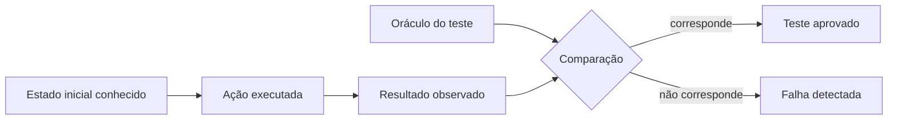
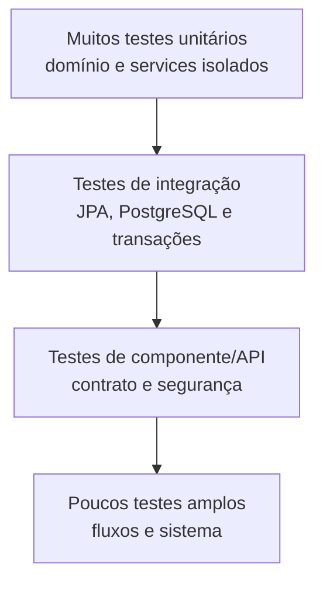
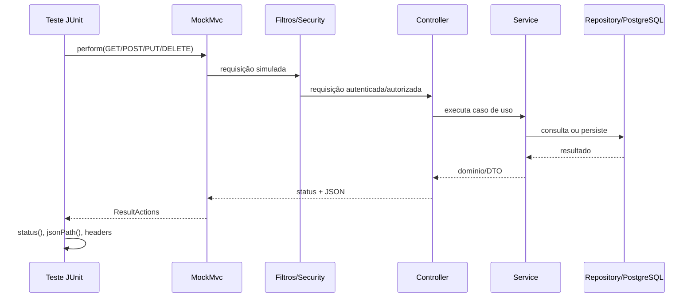
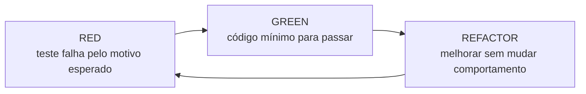
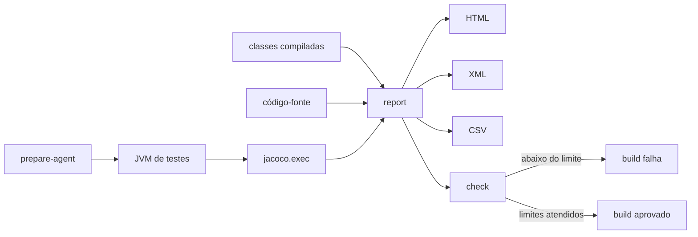

# Aula 15 — Testes de software, estratégia de testes e cobertura com JaCoCo

[⬅ Voltar para o índice do curso](../../README.md)

---

## 1. Apresentação

Nas aulas anteriores construímos um sistema que possui domínio, persistência, serviços transacionais, API REST, concorrência, autenticação com JWT e autorização por perfis. Cada incremento adicionou testes, mas ainda não estudamos a suíte como um sistema de evidências.

Esta aula responde à seguinte pergunta:

> Como obter evidências de que regras de negócio, integrações, contratos HTTP e controles de segurança continuam corretos depois de uma mudança?

O projeto de referência já possui testes de naturezas diferentes. Em vez de criar exemplos artificiais desconectados do sistema, vamos investigar esses testes, comparar seus objetivos e medir quais partes do código de produção eles exercitam.

O resultado será uma estratégia em camadas:

```text
muitos testes rápidos de domínio e aplicação
        +
testes de integração seletivos com PostgreSQL
        +
testes de API, contrato e segurança
        +
relatório de cobertura interpretado por risco
```

### Escopo da aula

Nesta aula serão estudados:

- fundamentos de verificação e validação;
- níveis e tipos de teste;
- JUnit Jupiter;
- estrutura Arrange–Act–Assert;
- testes parametrizados;
- dublês de teste e Mockito;
- testes com o contexto Spring;
- testes com PostgreSQL real;
- testes HTTP com `MockMvc`;
- testes de autenticação e autorização;
- TDD e o ciclo Red–Green–Refactor;
- instrumentação e métricas do JaCoCo;
- relatório HTML e portão de cobertura no Maven;
- limites da cobertura como indicador de qualidade.

Não serão implementados nesta aula:

- testes de carga ou desempenho;
- testes de invasão;
- testes de interface gráfica;
- execução em pipeline do GitHub Actions;
- teste de mutação como parte obrigatória do build.

Esses assuntos exigem objetivos, ferramentas e custos diferentes. O pipeline de integração contínua será estudado em uma aula posterior.

---

## 2. Resultados de aprendizagem

Ao concluir a aula, o estudante deverá ser capaz de:

1. diferenciar verificação, validação, erro, defeito e falha;
2. classificar os testes do projeto conforme escopo, dependências e velocidade;
3. estruturar testes legíveis com Arrange–Act–Assert;
4. escrever testes unitários com JUnit Jupiter;
5. usar testes parametrizados para representar partições equivalentes;
6. explicar dummy, stub, fake, mock e spy;
7. decidir quando usar Mockito e quando usar um colaborador real;
8. explicar o custo de `@SpringBootTest` e o funcionamento do cache de contexto;
9. testar regras do banco com PostgreSQL e Liquibase;
10. testar o contrato HTTP e a cadeia de segurança com `MockMvc`;
11. executar o ciclo Red–Green–Refactor em um incremento pequeno;
12. gerar e interpretar um relatório JaCoCo;
13. diferenciar cobertura de linhas, branches, métodos e instruções;
14. configurar um limite mínimo de cobertura no Maven;
15. justificar testes novos a partir do risco, e não apenas de um percentual.

---

## 3. Pré-requisitos

### Marco inicial

O ponto de partida é a tag:

```text
aula-14-autorizacao
```

Para conferir:

```bash
git describe --tags --exact-match
```

### Ambiente

- Java 21;
- Maven Wrapper do projeto;
- Docker Desktop em execução;
- PostgreSQL 16 disponível no contêiner usado durante o curso;
- banco `suporteos2026_test` criado;
- `DB_TEST_PASSWORD` configurada no ambiente;
- IntelliJ IDEA para navegação e execução individual dos testes.

### Conhecimentos recuperados

- invariantes do domínio;
- repositories e services;
- transações;
- Liquibase;
- DTOs e controllers;
- HTTP e status de resposta;
- JWT, autenticação e autorização;
- concorrência e locking.

---

## 4. O que significa testar software?

Um teste é uma experiência controlada sobre o software. Ele prepara um estado, provoca um comportamento e compara o resultado observado com um resultado esperado.



O **oráculo** é a fonte que informa qual resultado deveria ocorrer. Pode ser:

- uma regra de negócio;
- uma especificação;
- um status HTTP esperado;
- uma restrição do banco;
- um valor calculado manualmente;
- uma política de segurança.

Um teste fraco frequentemente possui um oráculo fraco. Se o valor esperado é calculado repetindo exatamente a lógica da implementação, o teste pode confirmar o mesmo erro presente no código.

### 4.1 Verificação e validação

| Conceito | Pergunta | Exemplo neste projeto |
|---|---|---|
| Verificação | Estamos construindo o sistema de acordo com a especificação? | O endpoint devolve `403` quando o OPERADOR tenta criar uma conta? |
| Validação | Estamos construindo o sistema adequado à necessidade? | Os perfis OPERADOR e ADMINISTRADOR representam corretamente as responsabilidades do domínio escolhido? |

Testes automatizados são especialmente fortes na verificação. A validação também exige análise do problema, participação dos interessados e avaliação do uso real.

### 4.2 Erro, defeito e falha

```text
erro humano
    ↓
defeito introduzido no artefato
    ↓
estado interno incorreto
    ↓
falha observável durante a execução
```

Exemplo:

1. o programador esquece de verificar o status da pessoa;
2. `ContaAcesso.podeAutenticar()` contém um defeito;
3. uma pessoa inativa continua sendo considerada autenticável;
4. o sistema permite login quando deveria negar.

O teste não prova que não existem outros defeitos. Ele fornece evidência sobre os cenários exercitados.

### 4.3 Testes são amostras

Mesmo um método pequeno pode receber muitas combinações de entrada. Não é viável testar todas as combinações possíveis. Selecionamos casos representativos usando técnicas como:

- classes de equivalência;
- análise de valores-limite;
- tabelas de decisão;
- transição de estados;
- cenários de erro;
- testes orientados ao risco.

Para o login, por exemplo, entradas como `null`, `""` e `"   "` pertencem à partição “ausente ou em branco”. Um teste parametrizado pode documentar essa partição sem duplicar a estrutura do teste.

---

## 5. Níveis de teste encontrados no projeto

Não existe uma única taxonomia universal. Nesta disciplina usaremos o **escopo observado** e as **dependências reais** para classificar um teste.

| Nível | Unidade observada | Infraestrutura | Exemplo do projeto |
|---|---|---|---|
| Unitário de domínio | uma classe ou pequeno conjunto de objetos | nenhuma | `ProdutoTest`, `VendaTest`, `ContaAcessoTest` |
| Unitário de aplicação | um service isolado | Mockito, sem Spring | `ProdutoServiceUnitTest`, `GrupoProdutoServiceUnitTest` |
| Integração de aplicação | service + repositories + JPA + banco | Spring e PostgreSQL | `ProdutoServiceTest` |
| Integração de persistência | mapeamento e restrições reais | Spring, Hibernate, Liquibase e PostgreSQL | `PersistenciaJpaTest` |
| Componente/API | cadeia HTTP interna da aplicação | Spring, `MockMvc`, segurança e banco | `ProdutoApiTest`, `GrupoProdutoApiTest` |
| Contrato | documento OpenAPI publicado | Spring e `MockMvc` | `OpenApiDocumentationTest` |
| Segurança | autenticação, JWT, filtros e autorização | Spring Security, `MockMvc` e banco | `ContaAcessoSecurityTest` |
| Concorrência | transações simultâneas e lock | Spring, PostgreSQL e threads | `VendaServiceTest` |

### 5.1 A pirâmide de testes



A pirâmide não determina números exatos. Ela comunica uma relação econômica:

- testes unitários devem fornecer feedback rápido e localizar defeitos com precisão;
- testes de integração validam fronteiras reais, mas custam mais;
- testes amplos fornecem confiança sobre fluxos completos, mas podem ser mais lentos e mais difíceis de diagnosticar.

O objetivo não é substituir todos os testes por unitários. Um mock não consegue provar que uma constraint do PostgreSQL existe, que o Hibernate mapeou uma associação corretamente ou que os filtros do Spring Security estão na ordem correta.

### 5.2 Teste unitário não significa “teste de um método”

A unidade é uma fronteira de comportamento escolhida pelo teste. Um teste de `Venda` pode envolver `ItemVenda` e `Produto` sem deixar de ser unitário quando todos são objetos em memória e não existe infraestrutura externa.

### 5.3 Integração não é sinônimo de ponta a ponta

`MockMvc` atravessa controller, filtros, validação, services e serialização, mas não abre uma porta TCP real. Ele é um teste de componente ou integração web, não um teste de sistema implantado.

---

## 6. Anatomia de um teste: Arrange–Act–Assert

Considere um trecho de `ProdutoServiceUnitTest`:

```java
@Test
void naoDeveRetirarQuantidadeMaiorQueOSaldo() {
    // Arrange: cenário e comportamento do colaborador
    Produto produto = novoProduto();
    when(produtoRepository.buscarPorIdComRelacionamentos(1L))
            .thenReturn(Optional.of(produto));

    // Act + Assert: executa e verifica a exceção observável
    assertThrows(
            IllegalArgumentException.class,
            () -> service.retirarEstoque(1L, new BigDecimal("10.001")));

    // Assert: a tentativa inválida não alterou o saldo
    assertEquals(
            0,
            new BigDecimal("10.000").compareTo(produto.getSaldoEstoque()));
}
```

### 6.1 Arrange

Prepara somente o estado necessário:

- objetos;
- valores;
- mocks;
- dados no banco;
- credenciais;
- relógio ou dependências controladas.

Um Arrange muito grande é um sinal de que o cenário pode estar abrangendo responsabilidades demais ou de que faltam builders/fábricas de teste.

### 6.2 Act

Executa o comportamento que dá nome ao teste. Preferencialmente existe uma ação principal.

### 6.3 Assert

Compara o resultado com o oráculo. Um teste pode possuir várias chamadas de `assert`, desde que todas sustentem um único comportamento lógico.

### 6.4 Nomes como especificação

Compare:

```text
testaProduto()
```

com:

```text
naoDeveRetirarQuantidadeMaiorQueOSaldo()
```

O segundo nome informa:

- a condição;
- o comportamento esperado;
- a regra protegida.

Ao falhar no relatório do Maven, ele já comunica parte do diagnóstico.

---

## 7. JUnit Jupiter em profundidade

O ecossistema moderno do JUnit separa responsabilidades:

| Componente | Responsabilidade |
|---|---|
| JUnit Platform | descobre e executa engines de teste |
| JUnit Jupiter | modelo de programação e engine dos testes atuais |
| JUnit Vintage | compatibilidade opcional com testes antigos do JUnit 3/4 |

No projeto, usamos JUnit Jupiter por meio dos módulos de teste fornecidos pelo Spring Boot.

### 7.1 Ciclo de vida

Por padrão, o JUnit cria uma nova instância da classe de teste para cada método. Isso reduz o compartilhamento acidental de estado.

Anotações comuns:

| Anotação | Uso |
|---|---|
| `@Test` | caso de teste comum |
| `@BeforeEach` | preparação repetida antes de cada caso |
| `@AfterEach` | liberação ou conferência depois de cada caso |
| `@BeforeAll` | preparação única da classe |
| `@AfterAll` | finalização única da classe |
| `@ParameterizedTest` | mesmo comportamento avaliado com argumentos diferentes |
| `@DisplayName` | descrição adicional para relatório |
| `@Nested` | agrupamento de cenários relacionados |

Evite depender da ordem de execução. Testes devem poder rodar individualmente, em conjunto ou em ordem diferente.

### 7.2 Asserções importantes

```java
assertEquals(esperado, observado);
assertTrue(condicao);
assertFalse(condicao);
assertNull(valor);
assertNotNull(valor);
assertThrows(TipoDaExcecao.class, acao);
assertAll(assercoes...);
```

`assertAll` executa um grupo de asserções e relata todas as falhas encontradas. Ele é útil quando várias propriedades descrevem o mesmo estado lógico.

### 7.3 Valores monetários e quantidades com `BigDecimal`

`BigDecimal.equals` considera valor e escala:

```java
new BigDecimal("10.0").equals(new BigDecimal("10.00")); // false
```

Quando a regra deseja comparar o valor numérico, usamos:

```java
assertEquals(0, esperado.compareTo(observado));
```

Essa decisão precisa refletir a regra. Se a escala também fizer parte do contrato, `equals` pode ser apropriado.

---

## 8. Novo teste orientado ao risco: `ContaAcessoTest`

As Aulas 12 a 14 adicionaram regras críticas em `ContaAcesso`. Parte delas era exercitada apenas por testes amplos de segurança. Nesta aula adicionaremos um teste unitário para obter feedback rápido e localizar falhas diretamente no domínio.

Crie o arquivo:

```text
src/test/java/com/curso/suporteos/domain/ContaAcessoTest.java
```

```java
package com.curso.suporteos.domain;

import org.junit.jupiter.api.Test;
import org.junit.jupiter.params.ParameterizedTest;
import org.junit.jupiter.params.provider.NullAndEmptySource;
import org.junit.jupiter.params.provider.ValueSource;

import java.time.LocalDate;
import java.util.Set;

import static org.junit.jupiter.api.Assertions.assertAll;
import static org.junit.jupiter.api.Assertions.assertEquals;
import static org.junit.jupiter.api.Assertions.assertFalse;
import static org.junit.jupiter.api.Assertions.assertThrows;
import static org.junit.jupiter.api.Assertions.assertTrue;

class ContaAcessoTest {

    @Test
    void deveCriarContaAtivaComLoginNormalizadoEPerfilOperador() {
        Pessoa pessoa = novaPessoa();

        ContaAcesso conta = new ContaAcesso(
                pessoa,
                "  ALUNA.2026  ",
                "  {bcrypt}hash-seguro  ");

        assertAll(
                () -> assertEquals("aluna.2026", conta.getLogin()),
                () -> assertEquals("{bcrypt}hash-seguro", conta.getSenhaHash()),
                () -> assertEquals(StatusContaAcesso.ATIVA, conta.getStatus()),
                () -> assertEquals(Set.of(PerfilAcesso.OPERADOR), conta.getPerfis()),
                () -> assertTrue(conta.podeAutenticar()));
    }

    @ParameterizedTest(name = "login inválido: [{0}]")
    @NullAndEmptySource
    @ValueSource(strings = {" ", "   "})
    void naoDeveAceitarLoginNuloOuEmBranco(String loginInvalido) {
        Pessoa pessoa = novaPessoa();

        IllegalArgumentException erro = assertThrows(
                IllegalArgumentException.class,
                () -> new ContaAcesso(pessoa, loginInvalido, "{bcrypt}hash"));

        assertEquals("Login é obrigatório", erro.getMessage());
    }

    @Test
    void deveAlterarSenhaSomenteQuandoOHashForValido() {
        ContaAcesso conta = novaConta();

        conta.alterarSenha("  {bcrypt}novo-hash  ");

        assertEquals("{bcrypt}novo-hash", conta.getSenhaHash());
        assertThrows(
                IllegalArgumentException.class,
                () -> conta.alterarSenha(" "));
    }

    @Test
    void deveAdministrarPerfisSemPermitirUmaContaSemPerfil() {
        ContaAcesso conta = novaConta();

        conta.concederPerfil(PerfilAcesso.ADMINISTRADOR);
        conta.substituirPerfis(Set.of(PerfilAcesso.ADMINISTRADOR));

        assertTrue(conta.possuiPerfil(PerfilAcesso.ADMINISTRADOR));
        assertFalse(conta.possuiPerfil(PerfilAcesso.OPERADOR));
        assertThrows(
                IllegalArgumentException.class,
                () -> conta.substituirPerfis(Set.of()));
    }

    @Test
    void deveConsiderarOStatusDaContaEDaPessoaParaAutenticar() {
        Pessoa pessoa = novaPessoa();
        ContaAcesso conta = new ContaAcesso(
                pessoa,
                "aluna.2026",
                "{bcrypt}hash");

        conta.bloquear();
        assertFalse(conta.podeAutenticar());

        conta.ativar();
        pessoa.inativar();
        assertFalse(conta.podeAutenticar());

        pessoa.ativar();
        assertTrue(conta.podeAutenticar());
    }

    private ContaAcesso novaConta() {
        return new ContaAcesso(
                novaPessoa(),
                "aluna.2026",
                "{bcrypt}hash");
    }

    private Pessoa novaPessoa() {
        return new Pessoa(
                "Aluna de Teste",
                "aluna.teste@example.com",
                "52998224725",
                LocalDate.of(2026, 10, 29));
    }
}
```

### 8.1 Por que esse teste é unitário?

- instancia objetos diretamente;
- não inicia o Spring;
- não usa banco;
- não abre conexão;
- não usa mocks;
- exercita apenas regras em memória.

### 8.2 Por que usar um teste parametrizado?

O método `naoDeveAceitarLoginNuloOuEmBranco` representa uma regra com quatro amostras:

- `null`;
- string vazia;
- um espaço;
- três espaços.

Cada argumento aparece como execução independente no relatório. Se apenas um valor falhar, saberemos qual partição causou a diferença.

### 8.3 Risco protegido

As regras de status e perfil participam da segurança da aplicação. O teste unitário não substitui `ContaAcessoSecurityTest`, porque ele não valida JWT, filtros ou status HTTP. Os dois testes fornecem evidências complementares:

```text
ContaAcessoTest
    prova a regra local de estado

ContaAcessoSecurityTest
    prova a integração da regra com autenticação e autorização
```

### 8.4 Executar somente a classe

macOS/Linux:

```bash
./mvnw -Dtest=ContaAcessoTest test
```

Windows:

```powershell
.\mvnw.cmd "-Dtest=ContaAcessoTest" test
```

Resultado esperado: oito execuções, pois o método parametrizado produz quatro casos.

---

## 9. Test doubles e Mockito

Um **test double** substitui uma dependência durante o teste. O termo engloba papéis diferentes.

| Tipo | Finalidade | Exemplo conceitual |
|---|---|---|
| Dummy | apenas preenche um parâmetro; não é usado | objeto necessário para construir outro |
| Stub | devolve respostas previamente definidas | repository retorna um produto conhecido |
| Fake | implementação funcional simplificada | repository em memória |
| Mock | verifica interações esperadas | confirmar que um gateway recebeu uma chamada |
| Spy | observa parcialmente um objeto real | registrar chamadas preservando comportamento |

Mockito cria objetos configuráveis que podem atuar como stub ou mock.

### 9.1 Exemplo real: `ProdutoServiceUnitTest`

```java
@ExtendWith(MockitoExtension.class)
class ProdutoServiceUnitTest {

    @Mock
    private ProdutoRepository produtoRepository;

    @Mock
    private GrupoProdutoRepository grupoRepository;

    @Mock
    private FornecedorRepository fornecedorRepository;

    @Mock
    private EntityManager entityManager;

    @InjectMocks
    private ProdutoService service;
}
```

`@Mock` cria os dublês. `@InjectMocks` constrói o service e fornece esses colaboradores.

Neste trecho:

```java
when(produtoRepository.buscarPorIdComRelacionamentos(1L))
        .thenReturn(Optional.of(produto));
```

o mock atua como **stub**: define uma resposta para o cenário.

### 9.2 O que o teste com mock prova?

Ele prova que o service se comporta conforme esperado **se** os colaboradores respeitarem o contrato simulado.

Ele não prova:

- que a consulta JPQL está correta;
- que o PostgreSQL está disponível;
- que o mapeamento JPA funciona;
- que uma constraint existe;
- que a transação realiza rollback.

### 9.3 Quando usar Mockito

Use quando a dependência:

- é lenta ou externa;
- é não determinística;
- produz efeitos colaterais indesejados;
- precisa simular uma falha difícil;
- pertence a outra fronteira arquitetural;
- impediria um teste unitário rápido.

Evite mockar objetos de valor e entidades simples apenas para reduzir linhas de preparação. Um objeto real costuma tornar o teste mais fiel e legível.

### 9.4 Testes frágeis por excesso de interação

Este teste hipotético é frágil:

```java
verify(repository, times(1)).findById(1L);
verify(repository, times(1)).save(produto);
verifyNoMoreInteractions(repository);
```

Ele pode quebrar durante uma refatoração que preserva o comportamento. Prefira verificar o resultado observável. Verifique interações quando a interação for o próprio contrato, como publicar um evento ou enviar uma mensagem.

---

## 10. Teste unitário e teste de integração do mesmo service

O projeto possui dois exemplos particularmente úteis:

```text
ProdutoServiceUnitTest
ProdutoServiceTest
```

| Característica | `ProdutoServiceUnitTest` | `ProdutoServiceTest` |
|---|---|---|
| Spring | não inicia | `@SpringBootTest` |
| Banco | não usa | PostgreSQL real |
| Repositories | mocks | implementações Spring Data |
| Transação | não testa | transação real |
| Velocidade | maior | menor |
| Diagnóstico | mais localizado | mais amplo |
| Confiança na integração | baixa | alta |

### 10.1 Exemplo de integração

```java
@SpringBootTest
@ActiveProfiles("test")
@Transactional
class ProdutoServiceTest {

    @Autowired
    private ProdutoService produtoService;

    @Autowired
    private GrupoProdutoRepository grupoRepository;

    @Autowired
    private ProdutoRepository produtoRepository;
}
```

`@SpringBootTest` carrega o contexto da aplicação. `@ActiveProfiles("test")` seleciona as propriedades do ambiente de teste. `@Transactional` faz rollback ao final de cada método, salvo situações especiais de propagação ou execução em outra thread.

### 10.2 Cache do contexto Spring

O Spring TestContext tenta reutilizar contextos compatíveis entre classes. Isso reduz o tempo total, mas pequenas diferenças de configuração podem criar novos contextos.

Anotações e propriedades que alteram a chave do contexto podem aumentar o custo da suíte. `@DirtiesContext` deve ser usado com cuidado, pois força descarte ou reconstrução.

### 10.3 Rollback pode esconder problemas

Um teste transacional pode passar sem executar um `commit` real. Algumas constraints e comportamentos aparecem apenas no `flush` ou no commit. Quando a regra depende disso:

- chame `flush()` deliberadamente;
- faça a operação SQL correspondente;
- ou use uma fronteira transacional separada.

Não remova `@Transactional` indiscriminadamente; escolha conforme a evidência necessária.

---

## 11. Persistência real com PostgreSQL e Liquibase

`PersistenciaJpaTest` demonstra comportamentos que um banco em memória ou um mock não provaria:

```java
@Test
@Transactional
void bancoDeveImpedirSaldoNegativo() {
    Long grupoId = inserirGrupoDiretamente("Grupo para saldo");

    assertThrows(
            DataIntegrityViolationException.class,
            () -> inserirProdutoDiretamente(
                    grupoId,
                    "CODIGO-SALDO-NEGATIVO",
                    "Produto inválido",
                    "-1.000",
                    "10.00"));
}
```

Esse teste comprova uma defesa em profundidade:

- a regra pode existir no domínio;
- o banco também impede um estado inválido;
- a migração Liquibase realmente criou a constraint;
- o driver traduz a violação para uma exceção observável pelo Spring.

### 11.1 Por que não usamos H2?

O curso adotou PostgreSQL em todos os profiles. Bancos diferentes possuem diferenças de:

- tipos;
- funções;
- collations;
- locking;
- constraints;
- sintaxe;
- comportamento transacional.

Usar o mesmo SGBD reduz a diferença entre teste e produção. O custo é exigir infraestrutura local e limpeza disciplinada.

### 11.2 Independência dos dados

Um teste não deve depender de dados criados por outro teste. Estratégias possíveis:

- rollback por teste;
- dados únicos por cenário;
- limpeza explícita;
- schema ou banco descartável;
- Testcontainers, como extensão futura.

---

## 12. Testes HTTP com MockMvc

`MockMvc` simula uma requisição através da infraestrutura MVC do Spring sem iniciar um servidor em uma porta real.



Exemplo:

```java
mockMvc.perform(get("/api/produtos"))
        .andExpect(status().isUnauthorized());
```

O teste comprova que uma requisição sem credencial não atravessa a política de segurança.

### 12.1 O que pode ser verificado

- status HTTP;
- headers;
- content type;
- corpo JSON;
- validação de entrada;
- serialização e desserialização;
- tratamento de exceções;
- filtros de segurança;
- autorização;
- contrato publicado.

### 12.2 `401` e `403` como decisões diferentes

`ContaAcessoSecurityTest` contém o cenário:

```java
void deveDiferenciarNaoAutenticadoDeOperadorSemPermissao()
```

Ele executa duas requisições:

1. sem autenticação, esperando `401`;
2. com OPERADOR autenticado, esperando `403`.

Um único teste amplo é justificável porque o comportamento estudado é exatamente a diferença entre os dois estados de segurança.

### 12.3 Teste de contrato OpenAPI

`OpenApiDocumentationTest` verifica a existência de rotas essenciais no documento gerado. Ele não prova toda a semântica da API, mas detecta regressões em um artefato consumido por pessoas e ferramentas.

---

## 13. Testes de concorrência

`VendaServiceTest` usa múltiplas threads e transações para demonstrar que duas finalizações não podem consumir o mesmo estoque além do saldo disponível.

Esse tipo de teste possui características diferentes:

- precisa coordenar o início das threads;
- depende do comportamento real do PostgreSQL;
- não pode confiar apenas na transação do método de teste;
- precisa limitar esperas para não travar indefinidamente;
- pode expor condições de corrida que não aparecem em execução sequencial.

### 13.1 Determinismo

Evite `Thread.sleep` como mecanismo principal de coordenação. Prefira primitivas como:

- `CountDownLatch`;
- `CyclicBarrier`;
- `Future` com timeout;
- executores encerrados corretamente.

Um teste concorrente que falha aleatoriamente perde valor. Quando ocorrer flakiness, registre evidências e investigue a condição, em vez de apenas repetir até passar.

---

## 14. TDD: Test-Driven Development

TDD é uma disciplina de design incremental em ciclos curtos:



### 14.1 RED

- escolha um comportamento pequeno;
- escreva o teste antes da implementação;
- execute e observe a falha;
- confirme que ele falhou pelo motivo esperado.

Um teste que nunca foi visto falhando pode estar exercitando outro caminho ou ser incapaz de detectar o defeito.

### 14.2 GREEN

- escreva o mínimo necessário;
- não antecipe requisitos futuros;
- execute o teste novo;
- execute a suíte completa.

### 14.3 REFACTOR

- remova duplicação;
- melhore nomes;
- simplifique o design;
- preserve o comportamento;
- execute os testes após passos pequenos.

### 14.4 Test-first e test-last

O novo `ContaAcessoTest` desta aula é principalmente um teste de caracterização e aprofundamento, pois a classe já existia. Isso não deve ser apresentado como TDD retroativo.

Para praticar TDD de verdade, a atividade orientada adicionará uma regra nova ao tema do estudante:

1. escrever a lista de comportamentos;
2. criar um teste que falha;
3. registrar a evidência vermelha;
4. implementar o mínimo;
5. registrar a evidência verde;
6. refatorar;
7. executar a suíte completa.

---

## 15. Cobertura de testes

Cobertura mede quais estruturas do bytecode foram executadas durante os testes. Ela responde:

> Quais partes do código foram exercitadas por esta execução?

Ela não responde sozinha:

> Os testes fizeram as asserções corretas?

Um teste pode executar uma linha sem verificar o resultado. Portanto:

```text
cobertura baixa = evidência clara de lacunas
cobertura alta  = código executado, mas qualidade ainda precisa ser avaliada
```

### 15.1 Como o JaCoCo funciona

O goal `prepare-agent` configura um Java Agent. Durante a execução, o agente registra quais partes das classes foram alcançadas. Depois, o goal `report` combina:

- arquivo de execução `jacoco.exec`;
- bytecode compilado;
- código-fonte;

e produz relatórios HTML, XML e CSV.



### 15.2 Métricas

| Métrica | O que conta | Limitação |
|---|---|---|
| Instruções | instruções de bytecode executadas | menos intuitiva para leitura humana |
| Linhas | linhas com instruções executadas | uma linha parcialmente executada pode exigir análise adicional |
| Branches | resultados de `if` e `switch` | não representa todas as combinações de condições |
| Métodos | métodos executados ao menos uma vez | não mede qualidade dos cenários |
| Classes | classes executadas | granularidade muito ampla |
| Complexidade | caminhos derivados da estrutura de decisão | não equivale a todos os caminhos possíveis |

### 15.3 Exemplo de branches

Considere:

```java
return status == StatusContaAcesso.ATIVA
        && pessoa.getStatus() == Status.ATIVO;
```

Para compreender a regra, precisamos observar pelo menos:

| Conta | Pessoa | Resultado esperado |
|---|---|---|
| ATIVA | ATIVO | `true` |
| BLOQUEADA | ATIVO | `false` |
| ATIVA | INATIVO | `false` |

O curto-circuito de `&&` também influencia quais instruções são executadas.

### 15.4 Cobertura de branch não é MC/DC

Executar os resultados verdadeiro e falso de uma decisão não prova que cada condição influenciou independentemente o resultado. Critérios mais rigorosos, como MC/DC, são usados em contextos críticos, mas estão fora do escopo prático desta aula.

---

## 16. Configuração do JaCoCo no Maven

No `pom.xml`, adicione às propriedades:

```xml
<jacoco.version>0.8.16</jacoco.version>
<jacoco.minimum.line.coverage>0.70</jacoco.minimum.line.coverage>
<jacoco.minimum.branch.coverage>0.40</jacoco.minimum.branch.coverage>
```

Em `<build><plugins>`, antes do plugin do Spring Boot, adicione:

```xml
<plugin>
    <groupId>org.jacoco</groupId>
    <artifactId>jacoco-maven-plugin</artifactId>
    <version>${jacoco.version}</version>
    <executions>
        <execution>
            <id>prepare-jacoco-agent</id>
            <goals>
                <goal>prepare-agent</goal>
            </goals>
        </execution>
        <execution>
            <id>report-and-check-coverage</id>
            <phase>verify</phase>
            <goals>
                <goal>report</goal>
                <goal>check</goal>
            </goals>
            <configuration>
                <rules>
                    <rule>
                        <element>BUNDLE</element>
                        <limits>
                            <limit>
                                <counter>LINE</counter>
                                <value>COVEREDRATIO</value>
                                <minimum>${jacoco.minimum.line.coverage}</minimum>
                            </limit>
                            <limit>
                                <counter>BRANCH</counter>
                                <value>COVEREDRATIO</value>
                                <minimum>${jacoco.minimum.branch.coverage}</minimum>
                            </limit>
                        </limits>
                    </rule>
                </rules>
            </configuration>
        </execution>
    </executions>
</plugin>
```

### 16.1 Por que os limites são propriedades?

- tornam a política visível no topo do POM;
- evitam números mágicos dentro da configuração;
- facilitam revisão e evolução consciente;
- permitem explicar que o limite é uma decisão do projeto.

### 16.2 Por que 70% de linhas e 40% de branches?

A medição anterior à mudança apresentou aproximadamente:

| Estado inicial | Resultado |
|---|---:|
| Testes executados | 71 |
| Linhas | 74,96% |
| Branches | 45,89% |

O portão inicial foi colocado abaixo da base observada. Assim ele:

- impede uma regressão ampla;
- não quebra o build no momento em que é introduzido;
- deixa margem para variações pequenas;
- não transforma 100% em objetivo artificial.

Os limites devem subir por decisão técnica quando novos testes confiáveis forem incorporados. Reduzir o limite para acomodar uma regressão exige justificativa em revisão.

### 16.3 Por que `BUNDLE`?

O limite é aplicado ao conjunto da aplicação. Isso é simples para a primeira política, mas possui uma limitação: classes muito cobertas podem compensar classes críticas sem cobertura.

Uma evolução futura pode criar regras por pacote ou classe crítica. Não devemos começar com dezenas de exclusões para melhorar cosmeticamente o número.

### 16.4 `test` versus `verify`

```bash
./mvnw test
```

Executa a fase de testes.

```bash
./mvnw verify
```

Percorre as fases até `verify`, gera o relatório e aplica o portão configurado.

O comando recomendado para concluir esta aula é:

macOS/Linux:

```bash
./mvnw clean verify
```

Windows:

```powershell
.\mvnw.cmd clean verify
```

`clean` evita interpretar dados residuais de uma execução anterior.

---

## 17. Leitura do relatório

Depois do `verify`, abra:

```text
target/site/jacoco/index.html
```

No IntelliJ, clique com o botão direito no arquivo e use **Open in Browser**.

### 17.1 Evidência do marco

Após o novo `ContaAcessoTest`, a execução de referência apresentou:

| Métrica | Coberto | Total | Percentual |
|---|---:|---:|---:|
| Testes | 79 | 79 | 100% aprovados |
| Linhas | 848 | 1118 | 75,85% |
| Branches | 149 | 316 | 47,15% |
| Instruções | 3384 | 5292 | 63,95% |
| Métodos | 289 | 429 | 67,37% |

Esses valores são uma fotografia do marco. Mudanças legítimas no código podem alterar numerador e denominador.

### 17.2 Leitura por pacote

O valor global esconde diferenças importantes. No mesmo relatório, a cobertura de linhas por pacote foi:

| Pacote | Linhas | Branches | Interpretação inicial |
|---|---:|---:|---|
| `domain` | 89,37% | 73,00% | regras de domínio possuem boa base unitária |
| `security` | 100,00% | 100,00% | pacote pequeno e exercitado pelos fluxos de autenticação |
| `config` | 84,21% | 50,00% | configuração principal é carregada pelos testes Spring |
| `api.exception` | 93,10% | 50,00% | tratamento comum é usado, mas nem todas as decisões são exercitadas |
| `api.controller` | 67,59% | n/a | há rotas e variações ainda não percorridas |
| `api.dto` | 64,10% | n/a | construtores e acessores geram linhas, mas risco não é uniforme |
| `api.mapper` | 67,69% | 100,00% | branches existentes estão cobertos, embora existam linhas não executadas |
| `application` | 65,89% | 32,14% | principal candidato à análise orientada por casos de uso |

`n/a` significa que o JaCoCo não encontrou branches mensuráveis naquele pacote; não significa cobertura perfeita.

O pacote `application` merece investigação porque coordena regras, transações e exceções. Ainda assim, não devemos criar testes apenas para colorir cada linha. Primeiro identificamos quais casos de uso representam maior impacto e probabilidade de falha.

### 17.3 Cores do HTML

- verde: estrutura coberta;
- vermelho: não coberta;
- amarelo: cobertura parcial, normalmente em branches.

Não escolha automaticamente a primeira linha vermelha para criar um teste. Pergunte:

1. esse código contém uma decisão importante?
2. qual falha seria produzida se ele estivesse errado?
3. já existe outro teste que fornece evidência equivalente?
4. o teste novo verificará comportamento ou apenas executará uma linha?
5. o custo do teste é proporcional ao risco?

### 17.3 O relatório não deve ir para o Git

O diretório `target/` já está no `.gitignore`. O relatório é artefato de build e pode ser reproduzido com `./mvnw clean verify`.

Em uma aula futura, o XML poderá ser publicado pelo pipeline como artefato ou integrado a uma ferramenta de qualidade.

---

## 18. Cobertura não é qualidade

Considere:

```java
Produto produto = novoProduto();
produto.retirarEstoque(new BigDecimal("2.000"));
```

Sem asserção, várias linhas podem aparecer como cobertas, mas não existe verificação do saldo final.

Outro exemplo:

```java
assertNotNull(produto);
```

Essa asserção é verdadeira, mas não protege a regra de estoque.

### 18.1 Como avaliar um teste

Um bom teste combina:

- cenário relevante;
- oráculo independente;
- asserção específica;
- falha compreensível;
- isolamento adequado;
- repetibilidade;
- custo compatível;
- resistência a refatorações internas.

### 18.2 Teste de mutação

Uma ferramenta de mutação altera o bytecode de propósito, por exemplo:

```text
>` para `>=`
true para false
+ para -
remove uma chamada
```

Se a suíte continua verde, o mutante sobreviveu. Isso pode indicar uma asserção ausente ou uma regra não testada.

Mutação fornece uma evidência diferente da cobertura, mas aumenta consideravelmente o custo de execução. Nesta disciplina ela aparece como extensão, não como portão obrigatório desta aula.

---

## 19. Propriedades de uma suíte confiável

Uma referência clássica é o acrônimo FIRST:

| Letra | Propriedade | Aplicação |
|---|---|---|
| F | Fast | testes unitários devem fornecer retorno quase imediato |
| I | Independent | um teste não prepara o próximo |
| R | Repeatable | mesmo resultado com o mesmo ambiente |
| S | Self-validating | aprovação ou falha automática |
| T | Timely | teste escrito no momento adequado, idealmente antes no TDD |

### 19.1 Flaky tests

Um teste flaky passa e falha sem mudança relevante no código. Causas frequentes:

- dependência de horário real;
- ordem dos testes;
- dados compartilhados;
- espera por `sleep`;
- porta ou serviço externo instável;
- concorrência sem coordenação;
- locale ou timezone implícito;
- identificadores fixos que colidem.

Não resolva flakiness apenas com repetição automática. Primeiro determine a fonte de não determinismo.

### 19.2 O teste também é código

Testes exigem:

- nomes claros;
- pouca duplicação acidental;
- dados compreensíveis;
- métodos auxiliares com intenção explícita;
- ausência de lógica complexa para calcular o esperado;
- revisão de código.

---

## 20. Mapeamento teoria–prática

| Ação da aula | Conceito observado |
|---|---|
| classificar a suíte existente | níveis, escopo e custo |
| criar `ContaAcessoTest` | unidade, risco e feedback rápido |
| usar `@ParameterizedTest` | partições de entrada e redução de duplicação |
| comparar os dois testes de `ProdutoService` | isolamento versus confiança na integração |
| analisar `PersistenciaJpaTest` | fidelidade do SGBD e defesa em profundidade |
| analisar `ContaAcessoSecurityTest` | teste de componente e cadeia de filtros |
| executar `clean verify` | ciclo Maven e reprodutibilidade |
| abrir o relatório JaCoCo | instrumentação e métricas |
| configurar `check` | qualidade como restrição automatizada |
| escolher lacuna por risco | cobertura como sinal, não objetivo isolado |

---

## 21. Desenvolvimento incremental e pontos de conferência

### Checkpoint 1 — inventário da suíte

Liste os testes:

macOS/Linux:

```bash
find src/test/java -name "*Test.java" -print
```

Windows PowerShell:

```powershell
Get-ChildItem src/test/java -Recurse -Filter *Test.java
```

Classifique pelo menos um teste de cada nível. Para cada um, registre:

- unidade observada;
- infraestrutura carregada;
- tipo de evidência;
- custo esperado;
- defeito que ele pode detectar;
- defeito que ele não pode detectar.

### Checkpoint 2 — teste unitário de `ContaAcesso`

Crie `ContaAcessoTest` e execute somente essa classe.

Evidência:

```text
Tests run: 8, Failures: 0, Errors: 0, Skipped: 0
```

### Checkpoint 3 — medição sem portão

Antes de configurar um limite, gere uma medição. Não escolha a meta antes de conhecer a base.

Registre linhas e branches. Explique por que as porcentagens são diferentes.

### Checkpoint 4 — plugin e portão

Adicione o plugin, execute:

```bash
./mvnw clean verify
```

Confirme:

- 79 testes executados;
- nenhuma falha;
- relatório HTML existente;
- cobertura de linhas acima de 70%;
- cobertura de branches acima de 40%;
- build aprovado.

### Checkpoint 5 — falha controlada

Altere temporariamente a propriedade:

```xml
<jacoco.minimum.branch.coverage>0.90</jacoco.minimum.branch.coverage>
```

Execute `verify` e observe a falha do goal `check`.

Depois, reverta para:

```xml
<jacoco.minimum.branch.coverage>0.40</jacoco.minimum.branch.coverage>
```

Essa falha controlada demonstra que o portão pertence ao build. Não faça commit do valor temporário.

---

## 22. Diagnóstico

| Sintoma | Hipótese | Como confirmar | Correção |
|---|---|---|---|
| conexão recusada | PostgreSQL não está em execução | verificar contêiner e porta 5432 | iniciar o contêiner |
| autenticação do banco falha | `DB_TEST_PASSWORD` ausente ou incorreta | conferir profile `test` e variável | configurar a variável sem expor o segredo |
| `jacoco.exec` não existe | testes não foram executados com o agent | observar log do `prepare-agent` | usar `clean verify` |
| relatório existe, mas o check não roda | foi executado apenas `test` | conferir fases Maven | executar `verify` |
| cobertura zero | JVM de teste não recebeu o Java Agent | conferir `argLine` e configuração do Surefire | não sobrescrever `argLine` incorretamente |
| teste unitário lento | contexto Spring foi carregado sem necessidade | procurar `@SpringBootTest` | instanciar a unidade diretamente ou usar Mockito |
| teste passa sozinho e falha na suíte | estado compartilhado ou ordem implícita | executar em ordem diferente e inspecionar dados | isolar e limpar o cenário |
| `LazyInitializationException` | associação lazy acessada fora da sessão | observar fronteira transacional | buscar os dados necessários ou manter acesso dentro da transação |
| teste concorrente trava | latch não liberado ou ausência de timeout | thread dump e `Future.get` com timeout | garantir liberação em `finally` e timeout explícito |
| meta falha após código novo | denominador aumentou ou ramo ficou sem teste | comparar relatório por pacote/classe | criar teste por risco ou justificar a política |

### 22.1 Aviso do Mockito sobre agent dinâmico

Em JDKs atuais pode aparecer um aviso de que o Mockito está anexando dinamicamente o mock maker. O aviso não significa que os testes falharam, mas antecipa uma restrição futura da JVM.

Não esconda o aviso apenas adicionando uma flag. Primeiro consulte a versão do Mockito gerenciada pelo Spring Boot e a orientação oficial. Uma mudança do agent deve ser feita conscientemente, pois JaCoCo e Mockito podem participar da instrumentação da JVM.

---

## 23. Segurança e qualidade dos testes

- nunca coloque senhas reais ou tokens permanentes em fixtures;
- use credenciais didáticas somente no banco de teste;
- não execute testes destrutivos contra `dev` ou produção;
- mantenha o profile `test` apontando para banco próprio;
- não exponha `.env` em logs ou screenshots;
- não registre o JWT completo em evidências públicas;
- use dados fictícios;
- não desabilite segurança para facilitar um teste de API;
- teste explicitamente acessos permitidos e negados;
- mantenha os relatórios gerados fora do Git.

---

## 24. Transferência para o projeto temático

Cada estudante deve produzir uma estratégia equivalente para seu tema.

### Entrega mínima

1. um teste unitário de entidade ou objeto de valor;
2. um teste unitário de service com Mockito quando houver dependência relevante;
3. um teste de integração com PostgreSQL;
4. um teste HTTP com `MockMvc`;
5. um teste de autorização contendo ao menos um acesso negado;
6. configuração JaCoCo;
7. relatório da medição inicial;
8. justificativa dos limites escolhidos;
9. um novo teste selecionado a partir do risco.

Os nomes das entidades mudam, mas a estrutura de evidência permanece.

Exemplos de regras por tema:

| Tema | Regra unitária possível | Integração possível |
|---|---|---|
| biblioteca | empréstimo vencido gera multa | exemplar não pode ser emprestado duas vezes |
| clínica | consulta não termina antes de começar | agenda impede colisão de horários |
| oficina | ordem fechada não recebe item | baixa de peça respeita estoque |
| eventos | inscrição respeita capacidade | unicidade de inscrição por participante |
| financeiro | lançamento deve ter valor positivo | saldo e concorrência de movimentações |

---

## 25. Atividade orientada

Em duplas, escolha uma classe de domínio que ainda não possua teste unitário dedicado.

1. identifique uma decisão ou invariante;
2. descreva o risco de a regra falhar;
3. escreva um cenário válido;
4. escreva um cenário inválido;
5. execute somente a classe de teste;
6. execute a suíte completa;
7. compare a cobertura da classe antes e depois;
8. explique se o novo teste aumentou a confiança, independentemente do percentual.

### Evidências

- arquivo de teste;
- saída dos testes;
- captura ou anotação das métricas antes/depois;
- justificativa de até dez linhas.

---

## 26. Atividade autônoma — ciclo TDD

No projeto temático, implemente uma regra pequena ainda inexistente.

Entregue três commits locais ou três evidências equivalentes:

1. **RED:** teste falhando pelo motivo esperado;
2. **GREEN:** implementação mínima e suíte verde;
3. **REFACTOR:** melhoria de design mantendo a suíte verde.

Restrições:

- a regra deve pertencer ao domínio do estudante;
- o teste não pode iniciar o Spring se a regra puder ser testada em memória;
- o valor esperado não pode ser calculado copiando a implementação;
- a entrega deve explicar o oráculo;
- a cobertura é evidência complementar, não critério único.

---

## 27. Questões de revisão

1. Por que um teste com 100% de cobertura pode não detectar um defeito?
2. Qual diferença existe entre verificar uma regra com mock e com PostgreSQL real?
3. Quando `@SpringBootTest` é necessário e quando ele apenas torna o teste mais lento?
4. Por que `MockMvc` não é um teste de sistema implantado?
5. O que é um oráculo de teste?
6. Qual diferença existe entre stub e mock?
7. Por que observar o teste falhar faz parte do TDD?
8. O que a cobertura de branches revela que a cobertura de linhas pode esconder?
9. Por que o portão foi definido abaixo da medição inicial?
10. Um teste transacional sempre comprova o comportamento do commit? Justifique.
11. Como testar a diferença entre `401` e `403`?
12. Por que um teste de concorrência deve usar timeout?
13. Em que situação verificar uma interação com Mockito é parte do contrato?
14. O relatório mostra uma classe com linhas vermelhas. Quais perguntas devem ser feitas antes de escrever um teste?
15. O build passou com 75% de linhas, mas uma classe de autorização não foi exercitada. O projeto está protegido? Explique.

---

## 28. Avaliação

| Critério | Insuficiente | Básico | Adequado | Avançado |
|---|---|---|---|---|
| Fundamentação | confunde níveis e métricas | reconhece conceitos sem justificar | classifica e justifica corretamente | relaciona custo, risco e arquitetura |
| Testes unitários | dependem desnecessariamente do Spring | cobrem apenas caminho feliz | cobrem regras e erros relevantes | possuem bons oráculos e design resistente |
| Integração | não usa a infraestrutura necessária | executa sem explicar o alcance | valida banco/API com isolamento | identifica limites e falhas que mocks não detectam |
| TDD | teste foi escrito depois e chamado de TDD | apresenta vermelho e verde pouco claros | demonstra Red–Green–Refactor | usa o ciclo para orientar o design |
| Cobertura | trata percentual como qualidade | gera relatório sem interpretar | interpreta linhas e branches | seleciona testes por risco e justifica limites |
| Reprodutibilidade | depende de estado manual | comandos incompletos | `clean verify` reproduz a evidência | diagnóstico e ambiente estão documentados |
| Segurança | usa credenciais ou dados inadequados | separa parcialmente ambientes | usa banco/profile de teste | inclui cenários negativos e protege evidências |

---

## 29. Checklist do marco

### Código e testes

- [ ] `ContaAcessoTest` existe e é executável isoladamente;
- [ ] testes unitários não carregam Spring sem necessidade;
- [ ] testes de integração usam o profile `test`;
- [ ] PostgreSQL de teste está separado dos demais ambientes;
- [ ] asserções verificam comportamento observável;
- [ ] 79 testes são executados sem falhas;
- [ ] `./mvnw clean verify` termina com sucesso.

### Cobertura

- [ ] JaCoCo `0.8.16` está configurado;
- [ ] `prepare-agent` é executado;
- [ ] relatório é gerado em `target/site/jacoco`;
- [ ] linhas permanecem acima de 70%;
- [ ] branches permanecem acima de 40%;
- [ ] o relatório não foi adicionado ao Git;
- [ ] nenhuma exclusão foi criada apenas para aumentar a porcentagem.

### Documentação e versionamento

- [ ] README aponta para a Aula 15;
- [ ] material corresponde ao código;
- [ ] `git diff --check` não apresenta erros;
- [ ] `git status` não contém `.env`, credenciais ou relatórios;
- [ ] commit representa uma unidade lógica;
- [ ] tag sugerida: `aula-15-testes-cobertura`.

---

## 30. Ponto de quebra sugerido

```bash
git status
git diff
./mvnw clean verify
git diff --check
git add pom.xml README.md docs src/test
git commit -m "feat: aprofunda testes e adiciona cobertura com JaCoCo"
git tag -a aula-15-testes-cobertura \
  -m "Aula 15 - testes de software e cobertura"
git push origin main
git push origin aula-15-testes-cobertura
```

Não execute o commit ou a tag antes de conferir o relatório e as credenciais.

---

## 31. Orientações para o professor

### Distribuição sugerida

| Bloco | Tempo | Estratégia |
|---|---:|---|
| fundamentos e níveis | 45 min | classificar testes reais do projeto |
| JUnit e AAA | 40 min | leitura orientada e execução isolada |
| Mockito versus integração | 45 min | comparar os dois testes de `ProdutoService` |
| Spring, PostgreSQL e MockMvc | 50 min | percorrer uma requisição e uma transação |
| TDD | 45 min | falha controlada Red–Green–Refactor |
| JaCoCo | 50 min | medir, abrir relatório e interpretar branches |
| atividade | 45–90 min | transferência para o tema do estudante |

O volume recomenda dois encontros ou um encontro longo com laboratório.

### Demonstrações recomendadas

1. executar um teste unitário e um `@SpringBootTest`, comparando tempo e log;
2. quebrar uma asserção e ler a mensagem;
3. remover temporariamente um cenário de branch e observar o relatório;
4. elevar temporariamente a meta para provocar falha do build;
5. mostrar uma linha verde sem asserção e discutir por que isso não basta;
6. executar `ContaAcessoSecurityTest` e percorrer filtros, controller e banco;
7. demonstrar que o teste parametrizado aparece como múltiplas execuções.

### Perguntas para discussão

- Qual é o teste mais barato capaz de detectar este risco?
- Que parte do sistema seria falsa se usássemos um mock aqui?
- O comportamento pertence ao domínio, à integração ou ao contrato?
- A asserção discorda da implementação ou apenas a repete?
- O teste sobreviveria a uma refatoração interna?
- Que defeito ainda poderia existir mesmo com o teste verde?

### Extensões

Para turmas mais avançadas:

- criar uma regra JaCoCo por pacote crítico;
- gerar relatório XML;
- experimentar PIT Mutation Testing em um pacote pequeno;
- comparar `@SpringBootTest` com um test slice;
- introduzir Testcontainers mantendo PostgreSQL;
- medir tempo por classe e discutir orçamento da suíte.

---

## 32. Continuidade

Com autenticação, autorização e estratégia de testes observável, a próxima aula pode tratar o ciclo de vida dos tokens:

- access token;
- refresh token;
- validade absoluta;
- inatividade;
- rotação;
- reutilização indevida;
- revogação;
- logout.

Os testes estudados aqui serão essenciais para controlar relógio, vencimento e concorrência desse fluxo.

---

## 33. Referências

- [Spring Boot Reference — Testing](https://docs.spring.io/spring-boot/reference/testing/index.html)
- [Spring Framework Reference — Testing](https://docs.spring.io/spring-framework/reference/testing.html)
- [JUnit User Guide](https://docs.junit.org/current/user-guide/)
- [Mockito documentation](https://javadoc.io/doc/org.mockito/mockito-core/latest/org.mockito/org/mockito/Mockito.html)
- [JaCoCo — Maven Plug-in](https://www.jacoco.org/jacoco/trunk/doc/maven.html)
- [JaCoCo — Coverage Counters](https://www.jacoco.org/jacoco/trunk/doc/counters.html)
- [Maven — Introduction to the Build Lifecycle](https://maven.apache.org/guides/introduction/introduction-to-the-lifecycle.html)
- Kent Beck. *Test-Driven Development: By Example*. Addison-Wesley, 2002.
- Gerard Meszaros. *xUnit Test Patterns*. Addison-Wesley, 2007.
- Michael Feathers. *Working Effectively with Legacy Code*. Prentice Hall, 2004.

---

[⬅ Voltar para o índice do curso](../../README.md)
