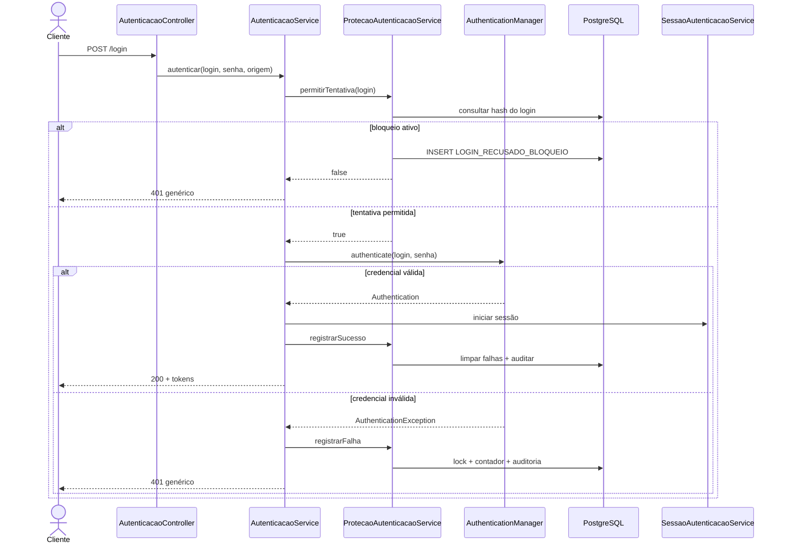
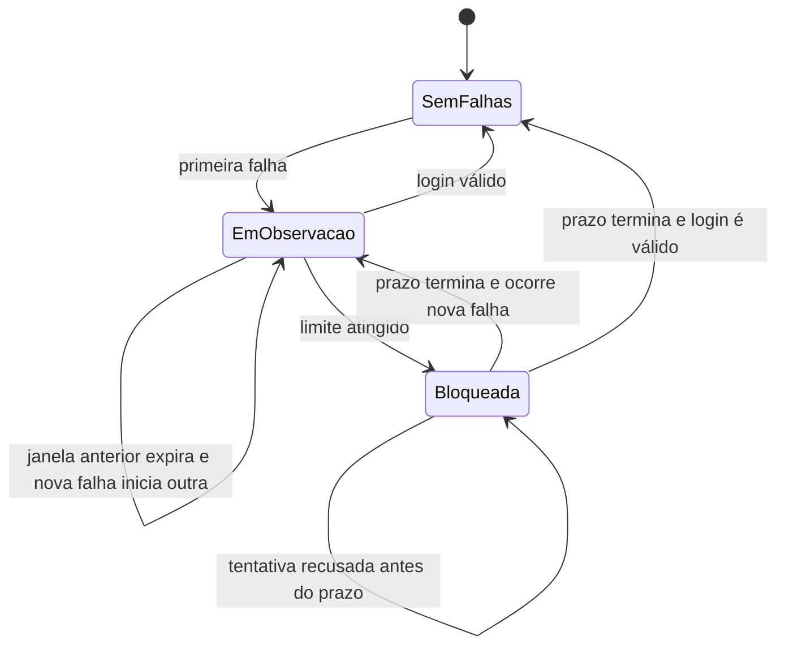

# Aula 17 — Auditoria e proteção da autenticação

[⬅ Voltar para o índice do curso](../../README.md)

---

## 1. Apresentação

Nas Aulas 12 a 16 construímos autenticação, JWT, autorização e sessões renováveis. O sistema já sabe validar uma credencial e decidir o que a conta pode fazer. Ainda falta responder a duas perguntas operacionais:

> Como reduzir tentativas automatizadas de adivinhar senhas?

> Como reconstruir o que aconteceu durante um incidente sem gravar segredos no histórico?

Uma senha protegida com BCrypt reduz o impacto do vazamento do banco, mas não impede um atacante de testar senhas diretamente no endpoint de login. Para esse ataque on-line precisamos controlar a frequência das tentativas. Ao mesmo tempo, falhas, bloqueios, logouts e alterações administrativas devem deixar evidências investigáveis.

Nesta aula implementaremos:

- contador persistente por hash do login;
- janela de observação de falhas;
- bloqueio temporário;
- resposta externa genérica;
- eventos de segurança estruturados;
- auditoria de login, refresh, logout e administração de contas;
- consulta paginada exclusiva para administradores;
- testes de fronteira, integração, autorização e não exposição de dados.

### Pergunta orientadora

> Como detectar abuso, limitar tentativas automatizadas e preservar evidências sem transformar a auditoria em uma nova fonte de vazamento?

### Limite de escopo

Esta aula não implementa WAF, CAPTCHA, MFA, SIEM, detecção comportamental, reputação de IP ou um rate limiter distribuído de borda. O controle criado é um *throttling* persistente por identificador de login. Ele é uma camada de defesa, não uma solução completa contra credential stuffing ou password spraying distribuído.

---

## 2. Resultados de aprendizagem

Ao concluir a aula, o estudante deverá ser capaz de:

1. diferenciar brute force, credential stuffing e password spraying;
2. diferenciar hashing de senha e limitação de tentativas on-line;
3. explicar threshold, janela de observação e duração de bloqueio;
4. reconhecer o risco de negação de serviço causado por lockout;
5. manter a resposta externa igual para conta inexistente, senha incorreta e bloqueio;
6. associar o contador ao login sem persistir o login em texto aberto;
7. atualizar contadores concorrentes com lock pessimista;
8. diferenciar log operacional, evento de segurança e trilha de auditoria;
9. selecionar atributos suficientes para investigação;
10. excluir senhas, tokens e chaves dos eventos;
11. impedir injeção de quebra de linha nos dados auditados;
12. preservar eventos dentro da mesma transação da ação de negócio;
13. restringir a consulta de auditoria ao perfil administrativo;
14. testar limites temporais com `Instant` fixo;
15. justificar riscos residuais e controles complementares.

---

## 3. Pré-requisitos e marco inicial

Confirme o estado do repositório:

```bash
git status
git tag --list
./mvnw clean verify
```

O marco inicial é:

```text
aula-16-refresh-token
```

Recupere especialmente:

- BCrypt e `AuthenticationManager` da Aula 12;
- resposta genérica e JWT da Aula 13;
- autorização por perfis da Aula 14;
- transações e cobertura da Aula 15;
- rotação, revogação e `Clock` da Aula 16.

Branch sugerida, quando a turma trabalhar com branches:

```bash
git switch -c aula-17-auditoria-seguranca
```

---

## 4. Modelo de ameaça

Antes de escolher uma implementação, precisamos nomear os ataques.

| Ataque | Estratégia do atacante | Exemplo |
|---|---|---|
| brute force | muitas senhas contra uma conta | testar dicionário em `ana.souza` |
| credential stuffing | pares vazados de outro serviço | testar e-mail e senha já comprometidos |
| password spraying | uma senha comum contra muitas contas | testar `Empresa@2026` em todos os logins |
| enumeração | descobrir quais contas existem | comparar mensagem, status ou tempo |
| log injection | inserir dados que forjam linhas no log | login contendo CR/LF e texto falso |
| storage exhaustion | gerar eventos/contadores sem limite | milhares de logins aleatórios |

### 4.1 Controle preventivo e controle detectivo

O bloqueio temporário é preventivo: reduz a quantidade de tentativas contra um identificador.

A auditoria é principalmente detectiva: oferece evidências para reconhecer padrões, investigar e responder.

```text
tentativa de login
       │
       ├── controle preventivo ──▶ permitir ou recusar
       │
       └── controle detectivo ───▶ registrar evento seguro
```

Uma trilha não impede o ataque sozinha. Um bloqueio sem trilha reduz tentativas, mas dificulta entender se houve abuso. Os dois controles se complementam.

---

## 5. Por que BCrypt não basta?

BCrypt protege a verificação armazenada da senha e torna cada tentativa custosa. Em um ataque off-line, o invasor possui o hash e tenta descobrir a senha fora do sistema.

No ataque on-line, o próprio servidor realiza a comparação:

```text
atacante ── tentativa 1 ──▶ API ──▶ BCrypt
         ── tentativa 2 ──▶ API ──▶ BCrypt
         ── tentativa N ──▶ API ──▶ BCrypt
```

Sem limitação, o atacante pode usar nossa infraestrutura como verificador. Além do risco para as contas, comparações repetidas consomem CPU.

O throttling reduz o número de verificações permitidas em um intervalo.

---

## 6. Política de bloqueio temporário

A política desta aula possui três parâmetros:

```dotenv
AUTH_MAX_FAILED_ATTEMPTS=5
AUTH_FAILURE_WINDOW=PT15M
AUTH_LOCK_DURATION=PT15M
```

| Parâmetro | Significado |
|---|---|
| `max-failed-attempts` | falhas necessárias para ativar o bloqueio |
| `failure-window` | intervalo no qual as falhas são agrupadas |
| `lock-duration` | tempo durante o qual novas tentativas são recusadas |

Exemplo:

```text
12:00 falha 1
12:02 falha 2
12:04 falha 3
12:06 falha 4
12:08 falha 5 ──▶ bloqueio até 12:23
12:10 senha correta ──▶ recusada sem comparar a senha
12:23 nova tentativa ──▶ permitida
```

Uma falha fora da janela inicia uma nova contagem.

### 6.1 Configuração tipada

```java
@ConfigurationProperties(
        prefix = "app.security.authentication-protection")
public record ProtecaoAutenticacaoProperties(
        int maxFailedAttempts,
        Duration failureWindow,
        Duration lockDuration) {

    public ProtecaoAutenticacaoProperties {
        if (maxFailedAttempts < 1) {
            throw new IllegalArgumentException(
                    "Máximo de falhas deve ser positivo");
        }
        if (failureWindow == null
                || failureWindow.isZero()
                || failureWindow.isNegative()) {
            throw new IllegalArgumentException(
                    "Janela de falhas deve ser positiva");
        }
    }
}
```

Configuração inválida deve impedir a inicialização. É melhor falhar explicitamente do que executar com política indefinida.

---

## 7. Lockout também pode causar negação de serviço

Se qualquer pessoa puder provocar o bloqueio de outra conta, o controle pode ser usado contra usuários legítimos.

```text
atacante conhece o login da vítima
             ↓
envia cinco senhas erradas
             ↓
vítima fica temporariamente impedida de entrar
```

Por isso:

- o bloqueio é temporário, não permanente;
- o limite deve equilibrar risco e usabilidade;
- eventos de bloqueio devem ser monitorados;
- recuperação e MFA são controles complementares;
- um rate limiter de borda pode limitar origem e volume global;
- políticas mais maduras podem usar atraso progressivo e análise de risco.

Não existe um número universal. Cinco tentativas e quinze minutos são valores didáticos configuráveis, não uma recomendação automática para qualquer produção.

---

## 8. Resposta genérica e enumeração

O cliente recebe a mesma resposta quando:

- o login não existe;
- a senha está incorreta;
- a conta foi bloqueada administrativamente;
- o bloqueio temporário está ativo.

```http
HTTP/1.1 401 Unauthorized
```

```json
{
  "status": 401,
  "message": "Login ou senha inválidos"
}
```

Não responder:

```text
Usuário não encontrado
Senha incorreta
Conta temporariamente bloqueada
```

Essas mensagens permitem descobrir contas e estados internos.

### 8.1 Mesmo texto não elimina todos os canais

Enumeração também pode observar:

- status HTTP diferente;
- formato diferente;
- cabeçalhos diferentes;
- tempo de resposta;
- comportamento de recuperação de senha.

Esta aula iguala contrato e status. Igualar rigorosamente o tempo de processamento é mais difícil e precisa ser avaliado com testes próprios. O material não afirma que uma mensagem genérica, sozinha, elimina todos os canais laterais.

---

## 9. Hash do login como chave de correlação

Precisamos agrupar tentativas de um login, inclusive quando a conta não existe. Persistir o texto original aumentaria a exposição de identificadores pessoais.

O serviço normaliza e calcula SHA-256:

```java
String normalizado = login.trim().toLowerCase(Locale.ROOT);
byte[] hash = MessageDigest.getInstance("SHA-256")
        .digest(normalizado.getBytes(StandardCharsets.UTF_8));
String chaveLogin = HexFormat.of().formatHex(hash);
```

Consequências:

- `ANA.SOUZA` e `ana.souza` compartilham a mesma chave;
- o contador não guarda o login original;
- o valor possui 64 caracteres hexadecimais;
- o hash permite correlação, mas não é anonimização perfeita.

### 9.1 Hash determinístico ainda pode ser testado

Se o espaço de logins for previsível, alguém com acesso ao banco pode calcular hashes de candidatos. O controle é minimização de exposição, não criptografia reversível nem anonimato absoluto.

Em um sistema de maior risco, seria possível usar HMAC com uma chave separada. Isso dificulta tabelas pré-calculadas, mas introduz gestão e rotação de chave. Mantemos SHA-256 para preservar o recorte didático.

---

## 10. Entidade de proteção

```java
@Entity
@Table(name = "protecao_autenticacao")
public class ProtecaoAutenticacao {

    @Id
    @GeneratedValue(strategy = GenerationType.IDENTITY)
    private Long id;

    @Column(nullable = false, unique = true, length = 64)
    private String chaveLogin;

    private int falhasConsecutivas;
    private Instant janelaIniciadaEm;
    private Instant bloqueadaAte;
}
```

O comportamento central é:

```java
public boolean registrarFalha(
        Instant agora,
        int maximoTentativas,
        Duration janela,
        Duration duracaoBloqueio) {

    if (janelaIniciadaEm == null
            || !agora.isBefore(janelaIniciadaEm.plus(janela))) {
        falhasConsecutivas = 0;
        janelaIniciadaEm = agora;
    }

    falhasConsecutivas++;
    if (falhasConsecutivas >= maximoTentativas) {
        bloqueadaAte = agora.plus(duracaoBloqueio);
        return true;
    }
    return false;
}
```

`true` significa que esta falha ativou o bloqueio e deve gerar um evento adicional.

### 10.1 Fronteira do bloqueio

```java
public boolean estaBloqueada(Instant agora) {
    return bloqueadaAte != null && agora.isBefore(bloqueadaAte);
}
```

Se `bloqueadaAte` for `12:23`, a conta está bloqueada em `12:22:59.999`, mas é liberada exatamente em `12:23:00`.

### 10.2 Sucesso limpa falhas

```java
public void registrarSucesso() {
    falhasConsecutivas = 0;
    janelaIniciadaEm = null;
    bloqueadaAte = null;
}
```

Falhas anteriores não devem se acumular indefinidamente depois de uma autenticação válida.

---

## 11. Concorrência no contador

Duas falhas podem chegar simultaneamente. Um ciclo ingênuo de leitura e gravação perderia atualização:

```text
transação A lê 3          transação B lê 3
transação A grava 4       transação B grava 4
resultado incorreto: 4; resultado esperado: 5
```

O repository consulta com lock pessimista:

```java
@Lock(LockModeType.PESSIMISTIC_WRITE)
@Query("""
        select protecao
        from ProtecaoAutenticacao protecao
        where protecao.chaveLogin = :chaveLogin
        """)
Optional<ProtecaoAutenticacao> buscarParaAtualizacao(
        String chaveLogin);
```

Para a primeira falha, a linha ainda não existe. O projeto usa um upsert do PostgreSQL:

```sql
INSERT INTO protecao_autenticacao
    (chave_login, falhas_consecutivas)
VALUES (:chaveLogin, 0)
ON CONFLICT (chave_login) DO NOTHING;
```

Depois do upsert, a linha é buscada com `PESSIMISTIC_WRITE` e atualizada dentro da transação.

### 11.1 Por que o upsert é específico do PostgreSQL?

`ON CONFLICT` é uma capacidade do banco adotado no curso. Não usamos H2, e não fingimos portabilidade inexistente. Se o projeto migrar de SGBD, esse trecho deverá ser revisto.

---

## 12. Auditoria, log e não repúdio

Os termos não são sinônimos.

| Conceito | Finalidade |
|---|---|
| log operacional | diagnosticar execução, erros e desempenho |
| evento de segurança | registrar fato relevante para detecção/investigação |
| trilha de auditoria | reconstruir ações e mudanças em ordem temporal |
| não repúdio | fornecer evidência forte de autoria, geralmente com controles criptográficos e organizacionais |

Uma linha no banco criada pela própria aplicação não prova, sozinha, não repúdio. Administradores do banco podem possuir capacidade de alteração; relógios podem estar errados; credenciais podem ter sido roubadas.

Nesta aula criamos uma trilha útil para investigação, sem prometer uma propriedade criptográfica que não implementamos.

---

## 13. Modelo do evento de segurança

O enum fecha o vocabulário:

```java
public enum TipoEventoSeguranca {
    LOGIN_SUCESSO,
    LOGIN_FALHA,
    LOGIN_RECUSADO_BLOQUEIO,
    BLOQUEIO_TEMPORARIO_ATIVADO,
    CONTA_CRIADA,
    SENHA_ALTERADA,
    PERFIS_ALTERADOS,
    STATUS_ALTERADO,
    REFRESH_SUCESSO,
    REFRESH_FALHA,
    LOGOUT,
    LOGOUT_GLOBAL
}
```

Cada evento registra:

| Campo | Pergunta respondida |
|---|---|
| `tipo` | o que ocorreu? |
| `ocorridoEm` | quando ocorreu? |
| `atorContaId` | qual conta iniciou a ação, se conhecida? |
| `alvoContaId` | qual conta foi afetada, se conhecida? |
| `identificadorHash` | quais tentativas anônimas pertencem ao mesmo login? |
| `enderecoOrigem` | de qual endereço observado veio o login? |

Os IDs são valores históricos, não associações JPA. Assim, a trilha não depende do ciclo de vida posterior da entidade `ContaAcesso`.

### 13.1 O que não é registrado

- senha aberta;
- hash BCrypt da senha;
- access token;
- refresh token;
- hash do refresh token;
- cabeçalho `Authorization`;
- corpo completo da requisição;
- login em texto aberto no evento de falha.

Segredo em log continua sendo segredo vazado.

---

## 14. Origem da requisição e proxies

O controller lê:

```java
httpRequest.getRemoteAddr()
```

Isso representa o endereço da conexão que chegou à aplicação. Atrás de proxy reverso, pode ser o endereço do proxy.

Não lemos automaticamente `X-Forwarded-For`, porque qualquer cliente pode forjar esse cabeçalho se a infraestrutura não remover e reconstruir valores confiáveis. Em produção, cabeçalhos encaminhados só devem ser aceitos quando a cadeia de proxies confiáveis estiver configurada.

O endereço IP pode ser dado pessoal. Sua coleta, acesso e retenção precisam de finalidade e política institucional.

---

## 15. Prevenindo injeção na auditoria

Dados externos podem conter `\r` e `\n`. Se forem concatenados em logs textuais, uma entrada pode simular outra linha.

O domínio recusa quebras de linha e limita o endereço a 45 caracteres:

```java
if (valor.length() > 45
        || valor.contains("\r")
        || valor.contains("\n")) {
    throw new IllegalArgumentException(
            "Endereço de origem inválido");
}
```

Além disso:

- o tipo é enum, não texto livre;
- IDs são numéricos;
- o identificador precisa obedecer `[0-9a-f]{64}`;
- não existe campo de “mensagem livre” vindo do usuário.

Estrutura fechada reduz a superfície de log injection e facilita consultas.

---

## 16. Versionando o banco com Liquibase

Crie:

```text
src/main/resources/db/changelog/changes/
└── 008-auditoria-protecao-autenticacao.yaml
```

O arquivo contém três changeSets:

1. `008-01`: tabela de proteção e check do contador;
2. `008-02`: tabela de eventos e check dos tipos;
3. `008-03`: índices de consulta cronológica.

Trecho da proteção:

```yaml
- createTable:
    tableName: protecao_autenticacao
    columns:
      - column:
          name: chave_login
          type: VARCHAR(64)
          constraints:
            nullable: false
            unique: true
      - column:
          name: falhas_consecutivas
          type: INTEGER
          defaultValueNumeric: 0
          constraints:
            nullable: false
      - column:
          name: janela_iniciada_em
          type: TIMESTAMP WITH TIME ZONE
      - column:
          name: bloqueada_ate
          type: TIMESTAMP WITH TIME ZONE
```

A edição comunitária usada no projeto não reconhece `addCheckConstraint` nesse changelog. Por isso, usamos SQL explícito e rollback explícito:

```yaml
- sql:
    sql: >
      ALTER TABLE protecao_autenticacao
      ADD CONSTRAINT ck_protecao_autenticacao_falhas
      CHECK (falhas_consecutivas >= 0)
```

Inclua no master:

```yaml
- include:
    file: db/changelog/changes/008-auditoria-protecao-autenticacao.yaml
```

### Checkpoint 1 — esquema

```bash
./mvnw test -Dtest=PersistenciaJpaTest
```

O Liquibase deve reconhecer 39 changeSets.

---

## 17. Fluxo protegido de login

O caso de uso possui quatro passos:

```java
public TokensAutenticacao autenticar(
        String login,
        String senha,
        String enderecoOrigem) {

    if (!protecaoService.permitirTentativa(
            login, enderecoOrigem)) {
        throw new CredenciaisInvalidasException(
                "Login ou senha inválidos");
    }

    try {
        Authentication authentication = authenticationManager.authenticate(
                UsernamePasswordAuthenticationToken.unauthenticated(
                        login, senha));

        TokensAutenticacao tokens = sessaoService.iniciar(authentication);
        protecaoService.registrarSucesso(login, enderecoOrigem);
        return tokens;
    } catch (AuthenticationException exception) {
        protecaoService.registrarFalha(login, enderecoOrigem);
        throw new CredenciaisInvalidasException(
                "Login ou senha inválidos");
    }
}
```

Observe a ordem:

1. recusa antes do BCrypt quando o bloqueio está ativo;
2. autentica normalmente quando permitido;
3. limpa falhas após sucesso e registra evento;
4. registra falha antes de lançar a resposta genérica.

### 17.1 Fronteira transacional da falha

`registrarFalha` é um método transacional de outro bean. Em uma requisição comum, ele conclui e confirma antes que `AutenticacaoService` lance `CredenciaisInvalidasException`.

```text
registrarFalha()
    BEGIN
    UPDATE contador
    INSERT evento
    COMMIT
retorna ao caso de uso
    ↓
lança exceção
    ↓
HTTP 401
```

Se toda a sequência fosse colocada em uma única transação que sofre rollback ao lançar `401`, o contador desapareceria e o controle nunca bloquearia. Segurança depende da fronteira transacional correta.

---

## 18. Diagrama de sequência do login



---

## 19. Estados da proteção



O bloqueio temporário não altera `StatusContaAcesso`. São conceitos diferentes:

- `StatusContaAcesso.BLOQUEADA`: decisão administrativa persistente;
- `bloqueadaAte`: contenção automática e temporária.

Misturar os dois dificultaria explicar motivo, duração e responsabilidade.

---

## 20. Auditorando outras ações sensíveis

O projeto registra também:

- criação de conta;
- alteração de senha;
- alteração de perfis;
- alteração de status;
- refresh aceito ou recusado;
- logout local;
- logout global.

Exemplo no service de contas:

```java
auditoriaService.registrar(
        TipoEventoSeguranca.PERFIS_ALTERADOS,
        administrador.getId(),
        contaAlterada.getId(),
        null,
        null);
```

### 20.1 Evento na mesma transação da mudança

Uma alteração de perfil e seu evento devem confirmar ou reverter juntos:

```text
BEGIN
UPDATE perfis
INSERT evento PERFIS_ALTERADOS
COMMIT
```

Se o update falhar, não devemos manter um evento afirmando que a mudança ocorreu. Se a gravação obrigatória da auditoria falhar, a ação sensível também não deve ser confirmada silenciosamente.

Para falhas de login, a fronteira é diferente porque precisamos preservar o evento mesmo quando a resposta é de erro. A finalidade define a transação.

---

## 21. Consulta administrativa

Endpoint:

```http
GET /api/auditoria-seguranca?page=0&size=20
Authorization: Bearer <jwt-administrador>
```

Filtro opcional:

```http
GET /api/auditoria-seguranca?tipo=LOGIN_FALHA&page=0&size=20
```

Resposta:

```json
{
  "content": [
    {
      "id": 42,
      "tipo": "LOGIN_FALHA",
      "ocorridoEm": "2026-10-29T18:00:00Z",
      "atorContaId": null,
      "alvoContaId": null,
      "enderecoOrigem": "127.0.0.1"
    }
  ]
}
```

O DTO não expõe `identificadorHash`. O valor existe para correlação interna, mas não precisa circular pela API administrativa inicial.

### 21.1 Autorização em duas camadas

O endpoint é protegido:

```java
.requestMatchers("/api/auditoria-seguranca/**")
.hasRole("ADMINISTRADOR")
```

E o caso de uso também:

```java
@PreAuthorize("hasRole('ADMINISTRADOR')")
public Page<EventoSeguranca> consultar(...) {
    // ...
}
```

Essa defesa em profundidade reduz o risco de uma futura rota chamar o service sem reproduzir a regra HTTP.

---

## 22. Testes temporais sem `sleep`

O teste de domínio usa instante fixo:

```java
private static final Instant INICIO =
        Instant.parse("2026-10-29T12:00:00Z");

@Test
void deveLiberarAoAtingirOFimDoBloqueio() {
    ProtecaoAutenticacao protecao = novaProtecao();
    for (int tentativa = 1; tentativa <= 5; tentativa++) {
        protecao.registrarFalha(
                INICIO, 5,
                Duration.ofMinutes(15),
                Duration.ofMinutes(15));
    }

    assertTrue(protecao.estaBloqueada(
            INICIO.plus(Duration.ofMinutes(15)).minusMillis(1)));
    assertFalse(protecao.estaBloqueada(
            INICIO.plus(Duration.ofMinutes(15))));
}
```

Esperar quinze minutos tornaria o teste inútil. Modelar tempo como dado torna a fronteira rápida e determinística.

O teste também verifica:

- ativação exatamente na quinta falha;
- limpeza após sucesso;
- reinício da janela;
- rejeição de CR/LF na origem;
- rejeição de identificador fora do formato SHA-256.

### Checkpoint 2 — domínio

```bash
./mvnw test -Dtest=ProtecaoAutenticacaoTest
```

---

## 23. Teste de integração da API

`ProtecaoAutenticacaoApiTest` usa PostgreSQL e `MockMvc`.

O cenário principal:

```java
for (int tentativa = 1; tentativa <= 5; tentativa++) {
    loginEsperandoNaoAutorizado(
            "login.protegido",
            "senha-incorreta");
}

loginEsperandoNaoAutorizado(
        "login.protegido",
        SENHA_CORRETA);
```

A senha correta é recusada porque o bloqueio já está ativo. Depois, o teste verifica:

```java
assertEquals(5, protecao.getFalhasConsecutivas());
assertNotNull(protecao.getBloqueadaAte());
assertEquals(5, eventosLOGIN_FALHA);
assertEquals(1, eventosBLOQUEIO_ATIVADO);
assertEquals(1, eventosLOGIN_RECUSADO_BLOQUEIO);
```

Outros cenários comprovam:

- login válido limpa falhas;
- conta inexistente recebe a mesma mensagem;
- auditoria não contém o login original;
- operador recebe `403` na consulta;
- administrador recebe `200`;
- o DTO não expõe o hash de correlação.

### Checkpoint 3 — fluxo integrado

```bash
./mvnw test \
  -Dtest=ProtecaoAutenticacaoTest,ProtecaoAutenticacaoApiTest
```

---

## 24. Laboratório com Postman

Importe:

```text
postman/Suporte-OS.postman_collection.json
```

A pasta **11 — Proteção e auditoria da autenticação** contém:

1. login com identificador desconhecido;
2. verificação de `401` e mensagem genérica;
3. consulta administrativa filtrada por `LOGIN_FALHA`;
4. testes que procuram vazamento de login, senha ou refresh token.

### 24.1 Experimento de bloqueio

No Postman, envie cinco vezes:

```http
POST /api/autenticacao/login
Content-Type: application/json
```

```json
{
  "login": "operador.postman",
  "senha": "senha-incorreta"
}
```

Na sexta tentativa, use a senha correta. A resposta continuará `401` até o final do bloqueio.

Consulte:

```http
GET /api/auditoria-seguranca?tipo=BLOQUEIO_TEMPORARIO_ATIVADO
Authorization: Bearer <adminAccessToken>
```

### Atenção

Não execute o experimento antes das demais pastas se você pretende continuar usando a mesma conta OPERADOR. O bloqueio é real e persistido no banco de desenvolvimento.

---

## 25. Consultas SQL de estudo

Estado dos contadores:

```sql
SELECT id,
       chave_login,
       falhas_consecutivas,
       janela_iniciada_em,
       bloqueada_ate
FROM protecao_autenticacao
ORDER BY id;
```

Eventos recentes:

```sql
SELECT id,
       tipo,
       ocorrido_em,
       ator_conta_id,
       alvo_conta_id,
       endereco_origem
FROM evento_seguranca
ORDER BY ocorrido_em DESC, id DESC
LIMIT 50;
```

Quantidade de falhas por origem:

```sql
SELECT endereco_origem, COUNT(*) AS quantidade
FROM evento_seguranca
WHERE tipo = 'LOGIN_FALHA'
GROUP BY endereco_origem
ORDER BY quantidade DESC;
```

Não projete `identificador_hash` em telas ou relatórios sem necessidade definida.

---

## 26. Limitações e riscos residuais

### 26.1 Password spraying

O atacante pode tentar uma senha contra muitos logins, mantendo cada contador abaixo do limite. São necessários controles adicionais por origem, rede, dispositivo ou risco.

### 26.2 Ataque distribuído

Muitos endereços podem atacar a mesma conta. O contador por login ainda ajuda. Muitos endereços e muitos logins exigem correlação e controles de borda.

### 26.3 Preenchimento da tabela

Cada login desconhecido que falha pode criar uma linha. Um atacante pode gerar identificadores diferentes para consumir armazenamento. Produção precisa combinar:

- limite global/de borda;
- política de retenção;
- limpeza de contadores antigos;
- quotas e monitoramento do banco.

### 26.4 Múltiplas instâncias

Como o estado está no PostgreSQL, todas as instâncias compartilham o contador. Isso é melhor que um `Map` em memória. O banco, porém, passa a participar de cada falha e pode se tornar alvo de carga.

### 26.5 IP atrás de proxy

Sem configuração confiável, a aplicação verá o proxy. Confiar em cabeçalho enviado diretamente pelo cliente criaria dados forjáveis.

### 26.6 Retenção e privacidade

Eventos não devem ser guardados para sempre apenas porque podem ser úteis. A organização deve definir finalidade, acesso, prazo, descarte, backup e resposta a incidentes.

---

## 27. Diagnóstico

| Sintoma | Causa provável | Verificação | Correção |
|---|---|---|---|
| falhas nunca bloqueiam | transação do contador sofre rollback | consultar tabela após `401` | confirmar transação antes de lançar resposta |
| quinta falha vira quatro | atualização perdida | executar tentativas concorrentes | lock pessimista e upsert |
| senha correta continua falhando | bloqueio temporário ativo | consultar `bloqueada_ate` | aguardar prazo ou limpar apenas em ambiente didático |
| login aparece no evento | identificador gravado diretamente | inspecionar tabela/DTO | persistir somente hash normalizado |
| operador consulta auditoria | regra HTTP/service ausente | teste com perfil OPERADOR | exigir ADMINISTRADOR em duas camadas |
| origem contém linhas falsas | dado concatenado sem validação | teste com CR/LF | usar campos estruturados e validar |
| banco cresce rapidamente | muitos logins distintos | contar proteção/eventos | retenção, limpeza e rate limit de borda |
| todos os IPs são iguais | aplicação atrás de proxy | comparar infraestrutura | configurar proxy confiável conscientemente |
| Liquibase rejeita check | change não suportado pela edição | observar parser | usar SQL com rollback explícito |
| auditoria diz que ação ocorreu, mas update falhou | transações separadas indevidas | provocar falha | manter ação e evento na mesma transação |

---

## 28. Segurança da própria auditoria

Uma trilha de segurança precisa de controles próprios:

- leitura limitada;
- escrita apenas pela aplicação;
- transporte protegido;
- relógios sincronizados;
- retenção definida;
- backup protegido;
- capacidade de detectar alteração;
- volume monitorado;
- testes de falha do mecanismo.

Nesta aula, o administrador lê eventos pela API, mas não existe endpoint para criá-los, alterá-los ou excluí-los.

### Falhar aberto ou falhar fechado?

Para ações sensíveis auditadas na mesma transação, a implementação falha fechada: se o evento obrigatório não puder ser persistido, a alteração também reverte.

Em sistemas de altíssima disponibilidade, algumas organizações encaminham eventos para infraestrutura assíncrona. Isso exige fila durável, tratamento de indisponibilidade e decisão explícita sobre perda. Não adicionaremos essa complexidade sem estudá-la.

---

## 29. Desenvolvimento incremental e pontos de quebra

### Ponto A — modelo da política

- propriedades tipadas;
- `ProtecaoAutenticacao`;
- testes temporais.

Commit sugerido:

```text
feat: modelar proteção temporária do login
```

### Ponto B — migração e concorrência

- changelog 008;
- repository com upsert;
- busca com lock;
- 39 changeSets verificados.

Commit sugerido:

```text
feat: persistir controle de tentativas de login
```

### Ponto C — resposta genérica e bloqueio

- integração no login;
- contador de falhas;
- limpeza após sucesso;
- teste HTTP.

Commit sugerido:

```text
feat: limitar falhas consecutivas de autenticação
```

### Ponto D — auditoria

- tipos de evento;
- entidade e repository;
- eventos de login, sessão e administração;
- consulta administrativa.

Commit sugerido:

```text
feat: registrar eventos estruturados de segurança
```

### Ponto E — material e evidências

- OpenAPI;
- Postman;
- testes completos;
- documentação e revisão pedagógica.

Commit consolidado sugerido:

```text
feat: concluir aula 17 sobre auditoria e proteção
```

---

## 30. Verificação final

```bash
./mvnw clean verify
jq empty postman/Suporte-OS.postman_collection.json
git diff --check
git status --short
```

Checklist:

- [ ] configuração rejeita valores inválidos;
- [ ] login é normalizado antes do hash;
- [ ] texto do login não aparece no evento de falha;
- [ ] quinta falha ativa bloqueio;
- [ ] bloqueio é liberado exatamente no prazo;
- [ ] sucesso limpa falhas;
- [ ] conta inexistente usa o mesmo `401`;
- [ ] atualizações concorrentes usam lock;
- [ ] eventos não contêm senhas ou tokens;
- [ ] alterações administrativas são auditadas;
- [ ] refresh e logout são auditados;
- [ ] operador recebe `403` na consulta;
- [ ] administrador consulta com paginação e filtro;
- [ ] Liquibase reconhece 39 changeSets;
- [ ] Postman é JSON válido;
- [ ] cobertura permanece acima do portão da Aula 15.

---

## 31. Transferência para o projeto temático

Implemente no tema escolhido:

- política configurável de falhas;
- hash do identificador;
- controle persistente;
- bloqueio temporário;
- resposta genérica;
- eventos de autenticação e administração;
- consulta administrativa protegida;
- migração e índices;
- testes temporais e HTTP.

Entregue uma matriz de ameaças:

| Ameaça do seu projeto | Controle implementado | Evidência de teste | Risco residual |
|---|---|---|---|
| exemplo | exemplo | exemplo | exemplo |

O estudante deve justificar valores de threshold, janela e duração em relação ao contexto do projeto, não apenas copiar `5/15/15`.

---

## 32. Atividade orientada

Em grupos:

1. classifique três cenários como brute force, stuffing ou spraying;
2. desenhe a linha do tempo de cinco falhas;
3. preveja os eventos gerados;
4. execute o cenário no Postman;
5. consulte as tabelas;
6. tente login correto durante o bloqueio;
7. compare resposta de conta existente e inexistente;
8. confirme que senha e tokens não aparecem;
9. proponha um controle complementar contra spraying;
10. discuta como evitar que lockout seja usado para DoS.

Evidências:

- linha do tempo;
- respostas HTTP;
- consulta SQL sem segredos;
- matriz ameaça–controle;
- saída dos testes.

---

## 33. Atividade autônoma

Implemente um teste concorrente com duas falhas simultâneas para o mesmo hash.

O teste deve:

1. preparar uma proteção com três falhas;
2. iniciar duas transações coordenadas;
3. registrar uma falha em cada transação;
4. confirmar que o resultado final é cinco, não quatro;
5. confirmar apenas um evento de ativação do bloqueio;
6. explicar o papel do lock.

Extensão: proponha uma rotina de retenção que remova proteções antigas sem apagar eventos que ainda precisam ser preservados.

---

## 34. Avaliação sugerida

| Critério | Peso | Evidência |
|---|---:|---|
| modelo de ameaça | 15% | diferencia ataques e riscos residuais |
| política temporal | 15% | threshold, janela e bloqueio corretos |
| concorrência e transação | 15% | upsert, lock e persistência após `401` |
| minimização de dados | 15% | hash, DTO restrito e ausência de segredos |
| auditoria | 15% | eventos coerentes com ator, alvo e tempo |
| autorização | 10% | consulta administrativa protegida |
| testes | 10% | fronteiras, fluxo HTTP e segurança |
| documentação e Git | 5% | decisões e marco reproduzível |

Erros críticos:

- registrar senha ou token;
- revelar conta inexistente ou bloqueio na resposta;
- usar somente um `Map` local sem documentar a limitação;
- perder atualizações concorrentes;
- permitir consulta por OPERADOR;
- afirmar não repúdio sem controles correspondentes;
- ignorar o risco de DoS por lockout;
- apagar eventos para fazer testes passarem.

---

## 35. Orientações ao professor

Antes da aula:

- confirme banco e 39 changeSets;
- execute a suíte;
- prepare uma conta descartável;
- deixe consultas SQL prontas;
- evite projetar tokens completos;
- explique que IP pode ser dado pessoal.

Durante a aula:

- comece pelo modelo de ameaça;
- peça que os estudantes proponham uma política antes de mostrar valores;
- demonstre por que mensagem genérica é necessária;
- retome locking da Aula 11;
- compare transação de ação bem-sucedida com transação de falha;
- mostre que auditoria não é sinônimo de não repúdio;
- termine listando explicitamente riscos residuais.

Perguntas para discussão:

1. Cinco tentativas é pouco ou muito para seu domínio?
2. O bloqueio deve ser por conta, IP, dispositivo ou combinação?
3. Como tratar redes compartilhadas?
4. O que muda com várias instâncias?
5. Quem pode ler a origem das requisições?
6. Por quanto tempo os eventos devem existir?
7. O que fazer se o banco de auditoria estiver indisponível?
8. Como detectar password spraying sem guardar dados excessivos?

---

## 36. Referências

- OWASP. [Authentication Cheat Sheet](https://cheatsheetseries.owasp.org/cheatsheets/Authentication_Cheat_Sheet.html).
- OWASP. [Logging Cheat Sheet](https://cheatsheetseries.owasp.org/cheatsheets/Logging_Cheat_Sheet.html).
- NIST. [SP 800-63B — Passwords](https://pages.nist.gov/800-63-4/sp800-63b/passwords/).
- Java Platform. APIs `MessageDigest`, `Clock`, `Instant` e `Duration`.
- Spring Security. Autenticação, autorização de métodos e Resource Server.

---

## 37. Marco da aula

Depois da revisão:

```bash
git add .
git commit -m "feat: concluir aula 17 sobre auditoria e proteção"
git tag -a aula-17-auditoria-seguranca \
  -m "Aula 17 - auditoria e proteção da autenticação"
git push origin main
git push origin aula-17-auditoria-seguranca
```

A tag só deve ser criada depois que código, migração, OpenAPI, Postman, testes e documentação representarem o mesmo estado executável.
